# Документ о концепции и границах проекта

**Система:** Система записи к врачу через МАХ
**Организация:** Комитет здравоохранения Волгоградской области
**Источник:** Требования и описание проекта системы записи к врачу через МАХ
**Назначение файла:** Документ о концепции и границах проекта для лабораторной работы 1. Описывает назначение системы, ее границы, основные функции, предположения, зависимости и ограничения.

| **Поле** | **Значение**                           |
| ------------ | ---------------------------------------------- |
| Версия | `1.0`                                          |
| Статус | рабочий документ команды |

## 1. Введение

Проект направлен на реализацию сервисов здравоохранения и передачу статистических событий из региональных сервисов здравоохранения в национальный мессенджер MAX. Разрабатываемое решение позволяет пациентам взаимодействовать с лечебно-профилактическими учреждениями (ЛПУ) прямо через мессенджер MAX: записываться на очные приемы, получать телемедицинские консультации (ТМК), просматривать свои медицинские документы и историю посещений.

## 2. Бизнес-контекст и цели

### 2.1. Сбор и описание исходных данных

Проект инициирован в рамках работы по разрешению отраслевого инцидента № 16 «Внедрение МАХ в здравоохранении» по поручению Министерства здравоохранения РФ. Система должна агрегировать статистику по событиям (запись, запись на ТМК, завершение ТМК, закрытие больничного) без ручной обработки и передачи персональных данных пользователей.

### 2.2. Определение возможностей для бизнеса

Внедрение сервиса позволяет перевести процесс записи к врачу и проведения онлайн-консультаций в цифровую среду мессенджера. Это снижает нагрузку на регистратуры поликлиник и упрощает пользовательский путь пациента за счет интеграции таких функций, как авторизация через СНИЛС и номер телефона, самозапись и отмена приемов.

### 2.3. Формирование бизнес-целей

#### БЦ-01. Обеспечение записи к врачу через МАХ

| Параметр                              | Значение                                                                                                                                                                                                                                                                                                                                                                                                                                                                                                                                                                                                                                         |
| --------------------------------------------- | -------------------------------------------------------------------------------------------------------------------------------------------------------------------------------------------------------------------------------------------------------------------------------------------------------------------------------------------------------------------------------------------------------------------------------------------------------------------------------------------------------------------------------------------------------------------------------------------------------------------------------------------------------- |
| Масштабы                              | Количество успешно оформленных записей на очный приём и ТМК через МАХ                                                                                                                                                                                                                                                                                                                                                                                                                                                                                                                         |
| Способ измерения               | Анализ таблиц D_DIRECTION_SERVICES и D_RESERVATION                                                                                                                                                                                                                                                                                                                                                                                                                                                                                                                                                                                          |
| Показатели в прошлом        | На текущий момент (по состоянию на май 2026 г.) отсутствуют примеры комплексных региональных сервисов, реализовавших полный пользовательский путь взаимодействия с пациентом внутри мессенджера МАХ (запись, управление ТМК, видеозвонок, получение результатов), в связи с чем техническое обеспечение мониторинга показателей в прошлом отсутствовало |
| Планируемые показатели   | Количество успешно созданных в МИС записей с признаком устройства type_advice = 4 "MAXBOT" должно быть строго равно числу отправленных в Сервис СП событий со статусом 1 "Отправлено" по топикам Appointment и TMC                                                                                                                                                                                                                                                                                          |
| Обязательные показатели | Число строк со статусом 2 "Ошибка отправки" в таблице INT_MAX_EXP по истечении суток должно быть равно 0. Количество записей, попавших в категорию "утерянные" (IS_LOST = 1), должно стремиться к 0                                                                                                                                                                                                                                                                                                                |

#### БЦ-02. Обеспечение передачи статистики

| Параметр                              | Значение                                                                                                                                                                                                                                                                                                                                                                                                                                                                                                                                                                                                                                         |
| --------------------------------------------- | -------------------------------------------------------------------------------------------------------------------------------------------------------------------------------------------------------------------------------------------------------------------------------------------------------------------------------------------------------------------------------------------------------------------------------------------------------------------------------------------------------------------------------------------------------------------------------------------------------------------------------------------------------- |
| Масштабы                              | Доля успешно доставленных статистических событий                                                                                                                                                                                                                                                                                                                                                                                                                                                                                                                                                             |
| Способ измерения               | Автоматическая сверка общего количества записей в таблице очереди INT_MAX_EXP со статусом 1 ("Отправлено") и данных на дашборде Сервиса СП Минцифры                                                                                                                                                                                                                                                                                                                                                                                      |
| Показатели в прошлом        | На текущий момент (по состоянию на май 2026 г.) отсутствуют примеры комплексных региональных сервисов, реализовавших полный пользовательский путь взаимодействия с пациентом внутри мессенджера МАХ (запись, управление ТМК, видеозвонок, получение результатов), в связи с чем техническое обеспечение мониторинга показателей в прошлом отсутствовало |
| Планируемые показатели   | Допускаются временные задержки отправки в течение дня из-за сбоев связи (статус 2), но за счет механизма повторных попыток все накопившиеся события должны быть успешно доставлены по истечении суток                                                                                                                                                                                                                                                                               |
| Обязательные показатели | 100% предусмотренных типов событий реализованы и проверены:`appointment_open_znp`, `appointment_open_tmk`, `tm_completed`, `sick_leave_close`                                                                                                                                                                                                                                                                                                                                                                                                                                                            |

#### БЦ-03. Снижение нагрузки на регистратуры

| Параметр                              | Значение                                                                                                                                                                                                                                                                                                                                                                                                                                                                                                                                                                                                                                         |
| --------------------------------------------- | -------------------------------------------------------------------------------------------------------------------------------------------------------------------------------------------------------------------------------------------------------------------------------------------------------------------------------------------------------------------------------------------------------------------------------------------------------------------------------------------------------------------------------------------------------------------------------------------------------------------------------------------------------- |
| Масштабы                              | Доля записей оформленных черех MAX от общего числа записей за период                                                                                                                                                                                                                                                                                                                                                                                                                                                                                                                              |
| Способ измерения               | Количество записей с type_advice = 4 к общему количеству записей в D_DIRECTION_SERVICES                                                                                                                                                                                                                                                                                                                                                                                                                                                                                                                       |
| Показатели в прошлом        | На текущий момент (по состоянию на май 2026 г.) отсутствуют примеры комплексных региональных сервисов, реализовавших полный пользовательский путь взаимодействия с пациентом внутри мессенджера МАХ (запись, управление ТМК, видеозвонок, получение результатов), в связи с чем техническое обеспечение мониторинга показателей в прошлом отсутствовало |
| Планируемые показатели   | Доля не менее 15% в течение 6 месяцев после запуска                                                                                                                                                                                                                                                                                                                                                                                                                                                                                                                                                                |
| Обязательные показатели | Доступность самостоятельной записи и отмены записи через МАХ в предусмотренных случаях                                                                                                                                                                                                                                                                                                                                                                                                                                                                                       |

#### БЦ-04. Минимизация технических сбоев при бронировании слотов

| Параметр                              | Значение                                                                                                                                                                                                                                                                                                                                                                                                                                                                                                                                                                                                                                         |
| --------------------------------------------- | -------------------------------------------------------------------------------------------------------------------------------------------------------------------------------------------------------------------------------------------------------------------------------------------------------------------------------------------------------------------------------------------------------------------------------------------------------------------------------------------------------------------------------------------------------------------------------------------------------------------------------------------------------- |
| Масштабы                              | Доля записей, оформленных через MAX, получивших статус "Утеряна" (IS_LOST = 1)                                                                                                                                                                                                                                                                                                                                                                                                                                                                                                                         |
| Способ измерения               | Количество записей с type_advice = 4 И IS_LOST = 1 к общему количеству записей с type_advice = 4                                                                                                                                                                                                                                                                                                                                                                                                                                                                                                             |
| Показатели в прошлом        | На текущий момент (по состоянию на май 2026 г.) отсутствуют примеры комплексных региональных сервисов, реализовавших полный пользовательский путь взаимодействия с пациентом внутри мессенджера МАХ (запись, управление ТМК, видеозвонок, получение результатов), в связи с чем техническое обеспечение мониторинга показателей в прошлом отсутствовало |
| Планируемые показатели   | Доля записей, сорвавшихся из-за рассинхронизации слотов на момент подтверждения, должна стремиться к нулю                                                                                                                                                                                                                                                                                                                                                                                                                                                      |
| Обязательные показатели | В 100% случаев обнаружения утерянной записи (IS_LOST = 1), мгновенно выводится пользователю сообщение: "Запись была утеряна. Необходимо перезаписаться на прием"                                                                                                                                                                                                                                                                                                                                                                |

#### БЦ-05. Защита персональных данных в статистике

| Параметр                              | Значение                                                                                                                                                                                                                                                                                                                                                                                                                                                                                                                                                                                                                                         |
| --------------------------------------------- | -------------------------------------------------------------------------------------------------------------------------------------------------------------------------------------------------------------------------------------------------------------------------------------------------------------------------------------------------------------------------------------------------------------------------------------------------------------------------------------------------------------------------------------------------------------------------------------------------------------------------------------------------------- |
| Масштабы                              | Количество случаев передачи персональных данных в статистических сообщениях                                                                                                                                                                                                                                                                                                                                                                                                                                                                                                          |
| Способ измерения               | Проверка JSON-сообщений и анализ передаваемых полей                                                                                                                                                                                                                                                                                                                                                                                                                                                                                                                                                             |
| Показатели в прошлом        | На текущий момент (по состоянию на май 2026 г.) отсутствуют примеры комплексных региональных сервисов, реализовавших полный пользовательский путь взаимодействия с пациентом внутри мессенджера МАХ (запись, управление ТМК, видеозвонок, получение результатов), в связи с чем техническое обеспечение мониторинга показателей в прошлом отсутствовало |
| Планируемые показатели   | 0 случаев передачи персональных данных в статистических сообщениях                                                                                                                                                                                                                                                                                                                                                                                                                                                                                                                             |
| Обязательные показатели | 0 случаев передачи персональных данных в статистических сообщениях                                                                                                                                                                                                                                                                                                                                                                                                                                                                                                                             |

### 2.4. Формулировка видения решения

Для пациента, который хочет записаться к врачу, закрыть больничный или пройти телемедицинскую консультацию через мессенджер МАХ, система записи к врачу через МАХ - это интеграционный сервис, который обеспечивает авторизацию, просмотр расписания, оформление и отмену записей, а также взаимодействие с сервисами телемедицины. В отличие от самостоятельного обращения к медицинским информационным системам отдельных учреждений, решение предоставляет единый пользовательский интерфейс в МАХ и взаимодействует с региональными МИС, сохраняя данные в информационных системах медицинских организаций.

## 3. Стейкхолдеры

### 3.1. Профили заинтересованных лиц

| Заинтересованное лицо                                                        | Основная ценность                                                                              | Отношение                                                                                    | Основные интересы                                                                                                                                                                           | Ограничения                                                                                                                                                                                                                                                                                                                                                                                                                           |
| ------------------------------------------------------------------------------------------------ | -------------------------------------------------------------------------------------------------------------- | ----------------------------------------------------------------------------------------------------- | ----------------------------------------------------------------------------------------------------------------------------------------------------------------------------------------------------------- | ------------------------------------------------------------------------------------------------------------------------------------------------------------------------------------------------------------------------------------------------------------------------------------------------------------------------------------------------------------------------------------------------------------------------------------------------ |
| Заказчики (Минздрав РФ и Комитет здравоохранения ВО) | Успешное закрытие Отраслевого инцидента № 16 в регионе            | Заказчики                                                                                    | Выполнение целей отраслевого инцидента № 16, получение статистики по целевым событиям                                               | Требуется официальный приказ на ответственного не ниже уровня замминистра; ответственный сотрудник обязан с первого раза скопировать данные по одноразовой ссылке и передать разработчикам РМИС для безопасного хранения и интеграции |
| Руководство МО                                                                      | Снижение нагрузки на регистратуры, цифровизация учреждения | Поставщик медицинских услуг                                                  | Корректность расписаний и записей, соблюдение правил прикрепления и записи                                                                 | Возможности собственной МИС, графики врачей                                                                                                                                                                                                                                                                                                                                                                |
| Пациенты                                                                                 | Удобный доступ к медицинским услугам                                           | Основные пользователи                                                             | Авторизация, поиск свободных слотов, запись и отмена приёма, напоминания, ТМК, закрытие ЛН, запись родственника | Необходимость подтверждения личности; запись по прикреплению к врачам определенной специальности; нельзя 2 и более записей к врачам одной специальности                                                                                                                                                  |
| Врачи                                                                                       | Организованное расписание и проведение консультаций             | Участники процесса оказания медицинских услуг                | Актуальность расписания, отсутствие конфликтов записей, проведение телемедицинских консультаций                       | Рабочий график, специальность, правила МО                                                                                                                                                                                                                                                                                                                                                                     |
| Команда разработки и сопровождения                                | Работоспособность и развитие решения                                          | Исполнитель и технический оператор                                     | Стабильность интеграций, обработка ошибок, мониторинг, безопасность                                                                              | Технические требования, сроки, доступ к тестовым средам и API                                                                                                                                                                                                                                                                                                                                    |
| Оператор мессенджера МАХ                                                   | Корректная работа сервиса на платформе                                       | Внешняя технологическая сторона                                          | Совместимость с платформой, работоспособность интеграции, соблюдение требований API                                                  | Возможности платформы и ограничения MAX Bridge API; при использовании внешних ссылок ВК-звонков автоматический трекинг события tm_completed невозможен                                                                                                                                                                            |
| Ответственные за статистическую отчётность                | Получение достоверных сведений о целевых событиях                  | Получатели статистики или ответственные за мониторинг | Полнота и корректность событий appointment_open_znp, appointment_open_tmk, tm_completed, sick_leave_close                                                                        | Утверждённый формат запросов;                                                                                                                                                                                                                                                                                                                                                                                       |

### 3.2. Матрица влияния / интереса

| Стейкхолдер                                                                           | Влияние (низкое / среднее / высокое) | Интерес (низкий / средний / высокий) | Стратегия работы                                                                                                                                                                         |
| ------------------------------------------------------------------------------------------------ | --------------------------------------------------------------- | --------------------------------------------------------------- | ------------------------------------------------------------------------------------------------------------------------------------------------------------------------------------------------------- |
| Заказчики (Минздрав РФ и Комитет здравоохранения ВО) | Высокое                                                  | Высокий                                                  | регулярные отчеты по KPI инцидента № 16, личный контроль передачи токенов                                                                      |
| Руководство МО                                                                      | Среднее                                                  | Высокий                                                  | Обучение администрированию расписаний, правилам запсии и отмены записи, требования к отчету при закрытии ЛН |
| Пациенты                                                                                 | Низкое                                                    | Высокий                                                  | Проверять удобство интерфейса, авторизации и основных сценариев использования                                                      |
| Врачи                                                                                       | Среднее                                                  | Средний                                                  | Учитывать особенности графиков работы и возможность оказания ТМК                                                                               |
| Команда разработки и сопровождения                                | Высокое                                                  | Высокий                                                  | Выявление и исполнение требований, разработка сервиса, тестирование                                                                          |
| Оператор мессенджера МАХ                                                   | Высокое                                                  | Средний                                                  | Согласовывать технические ограничения и ручная выгрузка логов по ВК-звонкам                                                           |
| Ответственные за статистическую отчётность                | Низкое                                                    | Высокий                                                  | Согласовывать формат запросов                                                                                                                                                |

## 4. Функциональные требования

### 4.1. Основные функции

| ID    | Функция                                                                                                |
| ----- | ------------------------------------------------------------------------------------------------------------- |
| FE-1  | Авторизация по СНИЛС и телефону                                                    |
| FE-2  | Управление профилями родственников                                            |
| FE-3  | Выбор МО                                                                                               |
| FE-4  | Выбор слота и запись на очный прием                                              |
| FE-5  | Просмотр активных записей                                                              |
| FE-6  | Отмена записи на очный прием                                                          |
| FE-7  | Выбор слота и запись на ТМК                                                             |
| FE-8  | Отмена записи на ТМК                                                                         |
| FE-9  | Скачивание медицинских документов                                              |
| FE-10 | Переход к ТМК (создание чата, добавление врача в чат, ссылка) |
| FE-11 | Получение напоминаний о предстоящих приемах                            |
| FE-12 | Предварительное анкетирование перед диспансеризацией         |
| FE-13 | Просмотр направлений на анализы                                                   |
| FE-14 | Отображение утерянных записей                                                      |
| FE-15 | Выбор специальности врача                                                              |
| FE-16 | Выбор конкретного врача данной специальности                          |

### 4.2. Дерево функций

```mermaid
flowchart TB
    SYS[Чат-бот записи к врачу через мессенджер МАХ]

    SYS --> Auth[Авторизация]
    Auth --> FE1[FE-1. Авторизация по СНИЛС и телефону]
    Auth --> FE2[FE-2. Управление профилями родственников]

    SYS --> Booking[Запись на очный прием]
    Booking --> FE12[FE-12. Предварительное анкетирование перед диспансеризацией]
    Booking --> FE3[FE-3. Выбор МО]
    Booking --> FE15[FE-15. Выбор специальности врача]
    Booking --> FE16[FE-16. Выбор конкретного врача данной специальности]
    Booking --> FE4[FE-4. Выбор слота и запись на очный прием]
    Booking --> FE11[FE-11. Получение напоминаний о предстоящих приемах]
    Booking --> FE6[FE-6. Отмена записи на очный прием]

    SYS --> Profile[Профиль пользователя]
    Profile --> FE5[FE-5. Просмотр активных записей]
    Profile --> FE13[FE-13. Просмотр направлений на анализы]
    Profile --> FE14[FE-14. Отображение утерянных записей]
    Profile --> FE9[FE-9. Скачивание медицинских документов]

    SYS --> TMK[Запись на ТМК]
    TMK --> FE3[FE-3. Выбор МО]
    TMK --> FE15[FE-15. Выбор специальности врача]
    TMK --> FE16[FE-16. Выбор конкретного врача данной специальности]
    TMK --> FE7[FE-7. Выбор слота и запись на ТМК]
    TMK --> FE11[FE-11. Получение напоминаний о предстоящих приемах]
    TMK --> FE10[FE-10. Переход к ТМК: создание чата, добавление врача, ссылка]
    TMK --> FE8[FE-8. Отмена записи на ТМК]
```

### 4.3. Варианты использования по ролям

| Основное действующее лицо                                                                     | Варианты использования                                                                                                                                                                                                                                                                                                                                                                                                                                                                                           |
| :------------------------------------------------------------------------------------------------------------------- | :------------------------------------------------------------------------------------------------------------------------------------------------------------------------------------------------------------------------------------------------------------------------------------------------------------------------------------------------------------------------------------------------------------------------------------------------------------------------------------------------------------------------------------ |
| Пациент                                                                                                       | Авторизация по СНИЛС и дате рождения Просмотр расписания и свободных слотов Запись на очный прием к врачу Запись на онлайн-консультацию (ТМК) Запись родственника или подопечного Просмотр активных записей Отмена записи к врачу Получение уведомлений и результатов в чате |
| Врач                                                                                                             | Проведение онлайн-консультации (ТМК) Удаленное закрытие больничного листа Просмотр классического расписания приемов                                                                                                                                                                                                                                                                                                       |
| Ответственный сотрудник регионального органа здравоохранения | Назначение ответственного за Сервис СП Запрос интеграционных параметров и токенов Управление ключами доступа и авторизации Мониторинг показателей инцидента № 16 Направление обращений в техподдержку                                                                                                                                         |

### 4.4. Детальная спецификация ключевых вариантов использования

#### UC-1. Авторизация по СНИЛС и дате рождения

| Поле                                         | Значение                                                                                                                                                                                                                                                                                                                                                                                                                                                                                                                                                                                                         |
| ------------------------------------------------ | ------------------------------------------------------------------------------------------------------------------------------------------------------------------------------------------------------------------------------------------------------------------------------------------------------------------------------------------------------------------------------------------------------------------------------------------------------------------------------------------------------------------------------------------------------------------------------------------------------------------------ |
| Идентификатор и название   | UC-1. Авторизация по СНИЛС и дате рождения                                                                                                                                                                                                                                                                                                                                                                                                                                                                                                                                                |
| Автор                                       |                                                                                                                                                                                                                                                                                                                                                                                                                                                                                                                                                                                                                          |
| Дата создания                        | 09.10.2026                                                                                                                                                                                                                                                                                                                                                                                                                                                                                                                                                                                                               |
| Основное действующее лицо | Пациент                                                                                                                                                                                                                                                                                                                                                                                                                                                                                                                                                                                                           |
| Описание                                 | Процесс первичного распознавания и верификации личности гражданина при его первом входе в чат-бот мессенджера MAX для предоставления санкционированного доступа к государственным медицинским услугам и персональным данным расписания.                                                                                                                                                                          |
| Условие-триггер                    | Пациент впервые отправляет любое текстовое сообщение в чат-бот MAX.                                                                                                                                                                                                                                                                                                                                                                                                                                                                                                |
| Предварительные условия    | PRE-1. Гражданин открыл диалоговое окно официального чат-бота здравоохранения в MAX.                                                                                                                                                                                                                                                                                                                                                                                                                                                                    |
| Выходные условия                  | POST-1. Локальный идентификатор пользователя успешно связан со СНИЛС пациента в системе логирования. POST-2. Гражданину открыт доступ к функционалу записи, просмотра и отмены талонов.                                                                                                                                                                                                                                                                               |
| Приоритет                               | Высокий                                                                                                                                                                                                                                                                                                                                                                                                                                                                                                                                                                                                           |
| Бизнес-правила                      | BR-1. Доступ к персональным медицинским сервисам предоставляется после успешной проверки идентификационных данных пациента. BR-2. При несовпадении СНИЛС и даты рождения доступ к персональным функциям не предоставляется. BR-3. Повторная авторизация не требуется, если сессия пользователя признана действующей и авторизованной. |

#### Нормальное направление 1.0. Верификация сессии пользователя

1. Пациент активирует чат-бот в мессенджере MAX.
2. Бот считывает входящий user_id мессенджера и проверяет его наличие в локальном кэше авторизованных пользователей (см. 4.1).
3. Бот отправляет приветственное сообщение и просит ввести СНИЛС.
4. Пациент отправляет свой СНИЛС в ответном сообщении.
5. Бот просит ввести дату рождения в формате ДД.ММ.ГГГГ.
6. Пациент вводит дату рождения.
7. Система обращается к центральному реестру пациентов МИС БАРС, передавая СНИЛС и дату рождения.
8. МИС БАРС подтверждает наличие карты и прикрепления, возвращая ФИО гражданина.
9. Система сохраняет постоянную связку user_id мессенджера - СНИЛС в локальную базу данных и выводит главное меню бота с обращением по имени-отчеству.

#### Альтернативные направления

**1.1. Сессия уже существует в системе**

1. На шаге 2 система находит user_id в кэше ранее авторизованных пользователей.
2. Бот пропускает шаги ввода (3-8) и сразу отображает для пациента главное интерактивное меню.

#### Исключения

**1.0.E1. Несовпадение данных или отсутствие прикрепления**

1. На шаге 8 МИС БАРС сообщает, что СНИЛС не зарегистрирован в системе или дата рождения введена неверно.
2. Бот извещает: «Ошибка авторизации. Проверьте правильность ввода данных. Если ошибка повторяется, обратитесь в регистратуру поликлиники».
3. Доступ к меню блокируется, управление возвращается к п. 3 нормального направления.

#### UC-3. Запись на очный прием к врачу

| Поле                                         | Значение                                                                                                                                                                                                                                                                                                                                                                                                                                                                                                                                                                                                                                                                                                                                                                                                                                                          |
| ------------------------------------------------ | ------------------------------------------------------------------------------------------------------------------------------------------------------------------------------------------------------------------------------------------------------------------------------------------------------------------------------------------------------------------------------------------------------------------------------------------------------------------------------------------------------------------------------------------------------------------------------------------------------------------------------------------------------------------------------------------------------------------------------------------------------------------------------------------------------------------------------------------------------------------------- |
| Идентификатор и название   | UC-3. Запись на очный прием к врачу                                                                                                                                                                                                                                                                                                                                                                                                                                                                                                                                                                                                                                                                                                                                                                                                               |
| Автор                                       |                                                                                                                                                                                                                                                                                                                                                                                                                                                                                                                                                                                                                                                                                                                                                                                                                                                                           |
| Дата создания                        | 09.10.2026                                                                                                                                                                                                                                                                                                                                                                                                                                                                                                                                                                                                                                                                                                                                                                                                                                                                |
| Основное действующее лицо | Пациент                                                                                                                                                                                                                                                                                                                                                                                                                                                                                                                                                                                                                                                                                                                                                                                                                                                            |
| Описание                                 | Пациент запускает чат-бот в мессенджере MAX, выбирает нужную медицинскую организацию, специальность, конкретного врача, дату и свободное время приема, после чего получает мгновенный талон-подтверждение записи в чате.                                                                                                                                                                                                                                                                                                                                                                                                                                                              |
| Условие-триггер                    | Пациент выбирает команду «Записаться к врачу» в главном меню чат-бота.                                                                                                                                                                                                                                                                                                                                                                                                                                                                                                                                                                                                                                                                                                                                         |
| Предварительные условия    | PRE-1. Пациент имеет подтвержденную учетную запись в мессенджере MAX. PRE-2. Пациент успешно прошел автоматическую авторизацию по СНИЛС (выполнен UC-1).                                                                                                                                                                                                                                                                                                                                                                                                                                                                                                                                                                                                |
| Выходные условия                  | POST-1. Выбранный временной слот успешно заблокирован и сохранен в расписании МИС БАРС. POST-2. В федеральную систему агрегации Минцифры автоматически отправлено S2S-событие "appointment_open_znp". POST-3. Гражданин получил интерактивную карточку записи прямо в диалоге мессенджера.                                                                                                                                                                                                                                                                                                                                                                 |
| Приоритет                               | Высокий                                                                                                                                                                                                                                                                                                                                                                                                                                                                                                                                                                                                                                                                                                                                                                                                                                                            |
| Частота использования        | Постоянно, высокая интенсивность в утренние часы.                                                                                                                                                                                                                                                                                                                                                                                                                                                                                                                                                                                                                                                                                                                                                                               |
| Бизнес-правила                      | BR-1. Запись оформляется только на доступный временной слот в расписании медицинской организации. BR-2. Перед созданием записи проверяется актуальность выбранного слота. BR-3. При недоступности выбранного слота пациенту предлагается выбрать другое время. BR-4. Ограничения на повторные записи применяются в соответствии с согласованными правилами медицинской организации. BR-5. Подтверждение записи отправляется после получения успешного результата от МИС |

#### Нормальное направление 3.0. Оформление талона на очный прием

1. Пациент запрашивает создание новой записи к врачу (см. 3.1).
2. Система извлекает из МИС БАРС и отображает список доступных медицинских организаций, к которым прикреплен гражданин.
3. Пациент выбирает конкретную медицинскую организацию.
4. Система запрашивает и выводит список доступных в этой поликлинике специализаций врачей.
5. Пациент выбирает нужную специальность, после чего система рендерит список ФИО доступных специалистов.
6. Пациент выбирает конкретного врача.
7. Система выводит интерактивный календарь с доступными датами и свободными временными слотами.
8. Пациент выбирает желаемую дату и время (см. 3.0.E1).
9. Система предлагает определить формат визита. Пациент выбирает «Очный визит» (см. 3.2).
10. Система фиксирует бронирование слота в МИС БАРС.
11. Система отправляет серверный REST API запрос с типом события "appointment_open_znp" на шлюз трекера Минцифры России.
12. Система выводит в чат мессенджера MAX карточку-подтверждение записи с указанием даты, времени, кабинета и ФИО врача.

#### Альтернативные направления

**3.1. Запись родственника или подопечного**

1. На шаге 1 пациент указывает, что хочет оформить запись на другого человека.
2. Система запускает процесс переключения контекста на члена семьи (переход к UC-5).
3. Возврат к п. 2 нормального направления с использованием медицинской карты родственника.

**3.2. Выбор дистанционного формата приема**

1. На шаге 9 пациент указывает, что ему необходима онлайн-консультация.
2. Система перенаправляет поток управления на сценарий телемедицины (переход к UC-4).

#### Исключения

**3.0.E1. Конфликт одновременного бронирования слота**

1. В момент подтверждения (шаг 10) выясняется, что выбранное время было занято другим пользователем в МИС секундой ранее.
2. Система извещает пациента, что слот более недоступен для записи.
3. Управление возвращается к п. 7 нормального направления для выбора альтернативного времени.

**3.0.E2. Обнаружение дублирующей активной записи**

1. Перед фиксацией брони (шаг 10) system обнаруживает в МИС БАРС уже существующий действующий талон этого пациента к специалисту того же профиля.
2. Система сообщает, что по правилам отрасли нельзя держать две активные записи к одной специальности одновременно.
3. Система предлагает пациенту отменить старую запись (переход к UC-7), а текущий вариант использования завершается.

#### Другая информация

1. Пользователь должен иметь техническую возможность прервать сценарий и вернуться в главное меню чат-бота на любом шаге до окончательного бронирования талона.
2. По умолчанию при выводе списка врачей система должна ранжировать специалистов по территориальной близости подразделения поликлиники, к которому прикреплен гражданин.

#### UC-7. Отмена записи к врачу

| Поле                                         | Значение                                                                                                                                                                                                                                                                                                                                                                                                                                                                                                                                                                                 |
| ------------------------------------------------ | ------------------------------------------------------------------------------------------------------------------------------------------------------------------------------------------------------------------------------------------------------------------------------------------------------------------------------------------------------------------------------------------------------------------------------------------------------------------------------------------------------------------------------------------------------------------------------------------------ |
| Идентификатор и название   | UC-7. Отмена записи к врачу                                                                                                                                                                                                                                                                                                                                                                                                                                                                                                                                                    |
| Автор                                       |                                                                                                                                                                                                                                                                                                                                                                                                                                                                                                                                                                                                  |
| Дата создания                        | 09.10.2026                                                                                                                                                                                                                                                                                                                                                                                                                                                                                                                                                                                       |
| Основное действующее лицо | Пациент                                                                                                                                                                                                                                                                                                                                                                                                                                                                                                                                                                                   |
| Описание                                 | Гражданин обращается к чат-боту MAX для аннулирования ранее созданного талона на очный прием или онлайн-ТМК. Это необходимо, чтобы оперативно убрать бронь из расписания поликлиники в МИС БАРС и вернуть освободившийся слот в общий оборот для других пациентов.                                                                                                         |
| Условие-триггер                    | Пациент нажимает кнопку «Отменить запись» на интерактивной карточке приема.                                                                                                                                                                                                                                                                                                                                                                                                                                                    |
| Предварительные условия    | PRE-1. Пациент авторизован в боте. PRE-2. В МИС БАРС присутствует хотя бы одна активная запись, привязанная к СНИЛС пациента.                                                                                                                                                                                                                                                                                                                                                                     |
| Выходные условия                  | POST-1. Бронь слота удалена из расписания поликлиники в МИС БАРС, время доступно для повторной записи. POST-2. Статус талона изменен на «Отменен». POST-3. Пользователь получил текстовое уведомление об успешной отмене в чате MAX.                                                                                                                                                                              |
| Приоритет                               | Высокий                                                                                                                                                                                                                                                                                                                                                                                                                                                                                                                                                                                   |
| Бизнес-правила                      | BR-1. Отменить можно только существующую запись, доступную для отмены. BR-2. Отмена выполняется после подтверждения операции пациентом. BR-3. Ограничения по времени отмены определяются правилами медицинской организации. BR-4. Уведомление об успешной отмене отправляется после подтверждения операции со стороны МИС. |

#### Нормальное направление 7.0. Удаление бронирования из расписания

1. Пациент открывает перечень своих текущих броней (выполняется UC-6).
2. Пациент нажимает кнопку «Отменить запись» под карточкой конкретного талона.
3. Система запрашивает подтверждение операции: «Вы действительно хотите отменить запись к врачу?».
4. Пациент выбирает вариант «Да, отменить» (см. 7.1).
5. Система направляет команду удаления брони в МИС БАРС.
6. МИС БАРС аннулирует талон и мгновенно переводит временной слот в статус свободного для поиска.
7. Чат-бот выводит в диалог мессенджера MAX подтверждение: «Запись успешно отменена. Слот возвращен в расписание».

#### Альтернативные направления

**7.1. Отказ от проведения операции отмены**

1. На шаге 4 пациент нажимает кнопку «Нет, сохранить запись».
2. Система прерывает процесс удаления брони и возвращает пользователя к списку активных талонов (шаг 1 нормального направления).

#### Исключения

**7.0.E1. Нарушение временного лимита отмены**

1. Пациент инициирует отмену на шаге 2, когда до начала приема по талону осталось менее 30 минут (например, 15 минут).
2. Система блокирует выполнение серверного запроса, оставляет слот занятым в МИС БАРС и выводит сообщение: «Автоматическая отмена через чат-бот невозможна (осталось менее 30 минут). Пожалуйста, свяжитесь с регистратурой поликлиники». Вариант использования завершается.

### 4.5. Спецификация основных вариантов использования

#### UC-4. Запись на онлайн-консультацию (ТМК)

| Поле                                         | Значение                                                                                                                                                                                                                                                                                                                                                                                                                                                                                                    |
| ------------------------------------------------ | ------------------------------------------------------------------------------------------------------------------------------------------------------------------------------------------------------------------------------------------------------------------------------------------------------------------------------------------------------------------------------------------------------------------------------------------------------------------------------------------------------------------- |
| Идентификатор и название   | UC-4. Запись на онлайн-консультацию (ТМК)                                                                                                                                                                                                                                                                                                                                                                                                                                              |
| Автор                                       |                                                                                                                                                                                                                                                                                                                                                                                                                                                                                                                     |
| Дата создания                        | 09.10.2026                                                                                                                                                                                                                                                                                                                                                                                                                                                                                                          |
| Основное действующее лицо | Пациент                                                                                                                                                                                                                                                                                                                                                                                                                                                                                                      |
| Описание                                 | Пациент выбирает дистанционный формат телемедицинской консультации (ТМК) с врачом, бронирует время приема в чат-боте и получает инструкции по совершению звонка внутри национального мессенджера MAX.                                                                                                                                         |
| Условие-триггер                    | Пациент выбирает пункт «Онлайн-консультация (ТМК)» на этапе определения формата приема.                                                                                                                                                                                                                                                                                                                                                   |
| Предварительные условия    | PRE-1. Пациент успешно выполнил шаги 1–8 нормального направления базового сценария UC-3.                                                                                                                                                                                                                                                                                                                                                           |
| Выходные условия                  | POST-1. Слот для ТМК зарезервирован в расписании врача в МИС БАРС. POST-2. В трекер Минцифры автоматически отправлен JSON REST-запрос с типом события "appointment_open_tmk". POST-3. Пациент получил в чате памятку и ссылку на будущую видеосессию.                                                                                            |
| Приоритет                               | Высокий                                                                                                                                                                                                                                                                                                                                                                                                                                                                                                      |
| Бизнес-правила                      | BR-1. Дистанционная консультация доступна только для специалистов и временных слотов, поддерживающих такой формат. BR-2. Перед созданием записи проверяется доступность временного слота в МИС. BR-3. Подтверждение записи на ТМК отправляется после успешной обработки запроса. |

##### Нормальное направление 4.0

1. Пациент на шаге 9 сценария UC-3 выбирает пункт «Онлайн-консультация (ТМК)».
2. Система проверяет в МИС БАРС доступность выбранного слота времени именно для дистанционного приема данным специалистом.
3. Система блокирует время в МИС, генерирует внутренний callback-идентификатор для интеграции видеозвонка и переводит статус талона в «ТМК».
4. Система формирует и посылает REST API запрос с типом события "appointment_open_tmk" в агрегирующую систему Минцифры.
5. Система выводит в диалог мессенджера MAX подтверждение записи с инструкцией по выходу на связь в назначенное время.

##### Исключения

* **4.0.E1.** Выбранный врач не осуществляет дистанционный прием или у него острадала лицензия на ТМК в МИС БАРС. Система сообщает об ограничении и возвращает пользователя к шагу 8 сценария UC-3 для выбора очного приема или другого специалиста.

#### UC-5. Запись родственника или подопечного

| Поле                                         | Значение                                                                                                                                                                                                                                                                                                                                                                                                                                                                                                                                                                                                                                                                               |
| ------------------------------------------------ | ---------------------------------------------------------------------------------------------------------------------------------------------------------------------------------------------------------------------------------------------------------------------------------------------------------------------------------------------------------------------------------------------------------------------------------------------------------------------------------------------------------------------------------------------------------------------------------------------------------------------------------------------------------------------------------------------- |
| Идентификатор и название   | UC-5. Запись родственника или подопечного                                                                                                                                                                                                                                                                                                                                                                                                                                                                                                                                                                                                                      |
| Автор                                       |                                                                                                                                                                                                                                                                                                                                                                                                                                                                                                                                                                                                                                                                                                |
| Дата создания                        | 09.10.2026                                                                                                                                                                                                                                                                                                                                                                                                                                                                                                                                                                                                                                                                                     |
| Основное действующее лицо | Пациент                                                                                                                                                                                                                                                                                                                                                                                                                                                                                                                                                                                                                                                                                 |
| Описание                                 | Гражданин использует интерфейс чат-бота MAX, чтобы записать на прием члена своей семьи (ребенка, пожилого родственника или недееспособного подопечного). Сценарий обеспечивает переключение контекста поиска и проверок на медицинскую карту другого человека без необходимости создания отдельных аккаунтов.                                                                                                                 |
| Условие-триггер                    | Пациент выбирает опцию «Записать родственника» на этапе выбора формы записи в чат-боте.                                                                                                                                                                                                                                                                                                                                                                                                                                                                                                                              |
| Предварительные условия    | PRE-1. Сам пользователь успешно прошел первичную идентификацию по своему СНИЛС (UC-1).                                                                                                                                                                                                                                                                                                                                                                                                                                                                                                                                          |
| Выходные условия                  | POST-1. Внутренний контекст сессии чат-бота успешно переключен на СНИЛС родственника. POST-2. Данные родственника верифицированы в региональном реестре МИС БАРС.                                                                                                                                                                                                                                                                                                                                                                                             |
| Приоритет                               | Высокий                                                                                                                                                                                                                                                                                                                                                                                                                                                                                                                                                                                                                                                                                 |
| Бизнес-правила                      | BR-1. Данные человека, для которого оформляется запись, должны быть проверены по доступному источнику медицинских данных. BR-2. Возможность записи за другого человека определяется установленным порядком подтверждения полномочий представителя. BR-3. При переключении профиля операции выполняются для выбранного пациента, а не автоматически для самого пользователя. |

#### Нормальное направление 5.0

1. Пациент на шаге 4 сценария UC-3 выбирает вариант «Записать родственника».
2. Чат-бот выводит текстовый запрос: «Введите СНИЛС человека, которого вы хотите записать».
3. Пациент вводит номер СНИЛС родственника.
4. Чат-бот запрашивает дату рождения этого родственника.
5. Пациент вводит дату рождения.
6. Система отправляет агрегированный запрос в МИС БАРС для проверки существования пациента и его территориального прикрепления к поликлиникам региона.
7. МИС БАРС подтверждает валидность данных и возвращает ФИО родственника.
8. Чат-бот фиксирует СНИЛС родственника как целевой для текущей сессии, выводит сообщение «Данные верифицированы. Оформление записи для: ФИО родственника» и перенаправляет поток управления на шаг 6 сценария UC-3.

#### Исключения

* **5.0.E1.** На шаге 7 МИС сообщает, что гражданин с такими параметрами не зарегистрирован. Чат-бот выводит ошибку: «Пациент со СНИЛС не найден в базе данных поликлиник области. Проверьте ввод или обратитесь в регистратуру». Сессия сбрасывается в главное меню.

#### UC-6. Просмотр активных записей

| Поле                                         | Значение                                                                                                                                                                                                                                                                                                                                                                                                                                                       |
| ------------------------------------------------ | ---------------------------------------------------------------------------------------------------------------------------------------------------------------------------------------------------------------------------------------------------------------------------------------------------------------------------------------------------------------------------------------------------------------------------------------------------------------------- |
| Идентификатор и название   | UC-6. Просмотр активных записей                                                                                                                                                                                                                                                                                                                                                                                                                 |
| Автор                                       |                                                                                                                                                                                                                                                                                                                                                                                                                                                                        |
| Дата создания                        | 09.10.2026                                                                                                                                                                                                                                                                                                                                                                                                                                                             |
| Основное действующее лицо | Пациент                                                                                                                                                                                                                                                                                                                                                                                                                                                         |
| Описание                                 | Гражданин отправляет запрос в чат-бот для вывода на экран мобильного устройства актуального перечня всех забронированных на его имя талонов к врачам, чтобы уточнить параметры приемов или инициировать отмену.                                                                       |
| Условие-триггер                    | Пациент выбирает пункт меню «Мои активные записи» в интерфейсе чат-бота.                                                                                                                                                                                                                                                                                                                                  |
| Предварительные условия    | PRE-1. Пациент успешно авторизован в боте (выполнен UC-1).                                                                                                                                                                                                                                                                                                                                                                       |
| Выходные условия                  | POST-1. На экран мессенджера MAX выведен структурированный список действующих броней, извлеченных из МИС БАРС в реальном времени.                                                                                                                                                                                                                                 |
| Приоритет                               | Высокий                                                                                                                                                                                                                                                                                                                                                                                                                                                         |
| Бизнес-правила                      | BR-1. Список записей формируется на основании актуальных данных МИС. BR-2. Пользователь может просматривать только записи, доступные ему в соответствии с правилами идентификации и доступа. BR-3. Отмененные записи не должны отображаться как активные. |

#### Нормальное направление 6.0

1. Пациент нажимает кнопку «Мои активные записи» в главном меню чат-бота.
2. Система считывает user_id мессенджера, определяет связанный СНИЛС пользователя и СНИЛСы родственников, которых он записывал ранее.
3. Система формирует запрос в МИС БАРС на поиск всех активных талонов со статусом «Занят» для пула извлеченных СНИЛС.
4. МИС БАРС возвращает структурированный массив данных (дата, время, ФИО врача, специальность, название клиники, адрес подразделения, тип приема) для каждой найденной записи.
5. Чат-бот последовательно генерирует и выводит в диалоговое окно мессенджера интерактивные карточки приемов.
6. Под каждой карточкой система размещает функциональную кнопку «Отменить запись» (переход к UC-).

#### Исключения

* **6.0.E1.** На шаге 4 МИС БАРС возвращает пустой массив (записи отсутствуют). Чат-бот выводит текстовый ответ: «У вас нет активных записей к врачам на ближайшее время» и отображает кнопку возврата в главное меню. Вариант использования завершается.

#### UC-9. Проведение онлайн-консультации (ТМК)

| Поле                                         | Значение                                                                                                                                                                                                                                                                                                                                                                                                                                                                                                                                                                                            |
| ------------------------------------------------ | ----------------------------------------------------------------------------------------------------------------------------------------------------------------------------------------------------------------------------------------------------------------------------------------------------------------------------------------------------------------------------------------------------------------------------------------------------------------------------------------------------------------------------------------------------------------------------------------------------------- |
| Идентификатор и название   | UC-9. Проведение онлайн-консультации (ТМК)                                                                                                                                                                                                                                                                                                                                                                                                                                                                                                                                   |
| Автор                                       |                                                                                                                                                                                                                                                                                                                                                                                                                                                                                                                                                                                                             |
| Дата создания                        | 09.10.2026                                                                                                                                                                                                                                                                                                                                                                                                                                                                                                                                                                                                  |
| Основное действующее лицо | Врач                                                                                                                                                                                                                                                                                                                                                                                                                                                                                                                                                                                                    |
| Описание                                 | Медицинский специалист осуществляет дистанционный прием пациента посредством видеозвонка через платформу мессенджера MAX, используя при этом свое стандартное автоматизированное рабочее место (АРМ) в МИС БАРС, после чего фиксирует итоги осмотра.                                                                                                                                        |
| Условие-триггер                    | Наступление планового времени приема по талону со статусом «Онлайн-ТМК» в электронном журнале врача.                                                                                                                                                                                                                                                                                                                                                                                                                  |
| Предварительные условия    | PRE-1. Пациент предварительно записан на ТМК на данный временной слот (выполнен UC-3). PRE-2. Врач авторизован в АРМ МИС БАРС и имеет доступ к модулю телемедицины.                                                                                                                                                                                                                                                                                                               |
| Выходные условия                  | POST-1. В электронной медицинской карте сохранен протокол консультации. POST-2. В трекер Минцифры автоматически передан REST-запрос с кодом события "tm_completed" для фиксации выполнения KPI региона.                                                                                                                                                                                                                                                        |
| Приоритет                               | Высокий                                                                                                                                                                                                                                                                                                                                                                                                                                                                                                                                                                                              |
| Бизнес-правила                      | BR-1. Проведение консультации возможно при наличии соответствующей записи и технической возможности подключения. BR-2. Результаты консультации фиксируются в установленном медицинской организацией порядке. BR-3. Статистическое событие tm_completed передается при выполнении предусмотренных условий завершения консультации. |

#### Нормальное направление 9.0

1. Врач в своем расписании в МИС БАРС кликает по active талону ТМК-пациента.
2. МИС БАРС через интеграционный шлюз инициирует защищенный видеозвонок внутри инфраструктуры национального мессенджера MAX, связывая АРМ врача и приложение пациента.
3. Врач проводит дистанционный опрос, собирает жалобы и консультирует гражданина.
4. Врач завершает видеовызов и заполняет обязательный электронный протокол ТМК в МИС БАРС.
5. При сохранении и подписании протокола МИС БАРС автоматически генерирует и отправляет исходящий S2S REST-запрос со значением tm_completed в Минцифры.

#### Исключения

* **9.0.E1.** Врач инициирует звонок (шаг 2), но пациент не принимает вызов в течение 10 минут слота. Врач завершает прецедент в МИС БАРС с фиксацией статуса «Неявка». Локальное логирование происходит, но статистическое событие tm_completed на сервера Минцифры не отправляется.

#### UC-13. Запрос интеграционных параметров и токенов

| Поле                                         | Значение                                                                                                                                                                                                                                                                                                                                                                                                                                                                                                                                    |
| ------------------------------------------------ | --------------------------------------------------------------------------------------------------------------------------------------------------------------------------------------------------------------------------------------------------------------------------------------------------------------------------------------------------------------------------------------------------------------------------------------------------------------------------------------------------------------------------------------------------- |
| Идентификатор и название   | UC-13. Запрос интеграционных параметров и токенов                                                                                                                                                                                                                                                                                                                                                                                                                                                             |
| Автор                                       |                                                                                                                                                                                                                                                                                                                                                                                                                                                                                                                                                     |
| Дата создания                        | 09.10.2026                                                                                                                                                                                                                                                                                                                                                                                                                                                                                                                                          |
| Основное действующее лицо | Ответственный сотрудник регионального органа здравоохранения                                                                                                                                                                                                                                                                                                                                                                                                                                |
| Описание                                 | Руководитель/заместитель руководителя Комитета здравоохранения осуществляет официальное административное взаимодействие с Минцифры России для безопасного получения уникальных технологических ключей доступа к Сервису сбора статистики.                                                                                         |
| Условие-триггер                    | Необходимость первичной конфигурации интеграционного шлюза чат-бота или плановая компрометация/обновление текущего ключа авторизации.                                                                                                                                                                                                                                                                                        |
| Предварительные условия    | PRE-1. Внутри ведомства официально издан и подписан Приказ о назначении данного должностного лица (уровня не ниже замминистра) персонально ответственным за Сервис СП.                                                                                                                                                                                                                                      |
| Выходные условия                  | POST-1. Уникальные параметры (ID приложения, токен, регион) успешно получены и переданы ИТ-дирекции для встраивания в конфигурацию системы логирования.                                                                                                                                                                                                                                                                      |
| Приоритет                               | Высокий                                                                                                                                                                                                                                                                                                                                                                                                                                                                                                                                      |
| Бизнес-правила                      | BR-1. Запрос интеграционных параметров направляется в установленном порядке. BR-2. Доступ к токенам и другим параметрам авторизации предоставляется только уполномоченным лицам. BR-3. Секретные параметры должны храниться и передаваться с соблюдением установленных требований безопасности. |

#### Нормальное направление 13.0

1. Ответственный сотрудник формирует со своего официального служебного email-адреса электронное письмо на адрес digital.med@max.ru.
2. К письму прикрепляется электронная копия (скан) официального ведомственного Приказа о назначении ответственным.
3. Техническая служба Минцифры проверяет документ и генерирует в ответном письме уникальную защищенную одноразовую веб-ссылку.
4. Ответственный сотрудник открывает полученную ссылку в браузере.
5. Система отображает параметры: ID ПРИЛОЖЕНИЯ, ТОКЕН АВТОРИЗАЦИИ и РЕГИОН БОТА.
6. Сотрудник копирует текстовые строки, обеспечивает их безопасное изолированное хранение и передает техническим специалистам ИТ-отдела региона для внесения в конфигурационные файлы REST API клиентов.

#### Исключения

* **12.0.E1.** При попытке повторного перехода по ссылке (шаг 4) веб-сервер возвращает ошибку, так как ссылка уже открывалась ранее. Доступ заблокирован. Сотрудник ОИВ обязан составить повторное официальное обращение на digital.med@max.ru для перевыпуска параметров.

### 4.6. Сжатое описание информационных и служебных вариантов использования

#### UC-8. Получение уведомлений и результатов в чате

| Поле                                       | Значение                                                                                                                                                                                                                                                                                                                                                                                                                                                                                                                                                                                                                                                            |
| :--------------------------------------------- | :-------------------------------------------------------------------------------------------------------------------------------------------------------------------------------------------------------------------------------------------------------------------------------------------------------------------------------------------------------------------------------------------------------------------------------------------------------------------------------------------------------------------------------------------------------------------------------------------------------------------------------------------------------------------------- |
| Идентификатор и название | UC-8. Получение уведомлений и результатов в чате                                                                                                                                                                                                                                                                                                                                                                                                                                                                                                                                                                                       |
| Автор                                     |                                                                                                                                                                                                                                                                                                                                                                                                                                                                                                                                                                                                                                                                             |
| Дата создания                      | 09.10.2026                                                                                                                                                                                                                                                                                                                                                                                                                                                                                                                                                                                                                                                                  |
| Описание                               | Автоматический фоновый процесс отправки push-сообщений и файлов из МИС БАРС в MAX (цифровые талоны, напоминания за 24 и 2 часа до начала приема). Сразу после подписания медицинского протокола врачом система отправляет заключение в формате зашифрованного PDF-вложения, полностью исключая передачу открытых диалогов в тексте сообщения согласно требованиям 152-ФЗ. |
| Исключения                           | Блокировка чат-бота пользователем в мессенджере: отправка пакета завершается ошибкой, МИС фиксирует статус недоставки уведомления.                                                                                                                                                                                                                                                                                                                                                                                                                         |
| Приоритет                             | Высокий                                                                                                                                                                                                                                                                                                                                                                                                                                                                                                                                                                                                                                                              |

#### UC-10. Удаленное закрытие больничного листа

| Поле                                       | Значение                                                                                                                                                                                                                                                                                                                                                                                                                                                                                                                                                                                                                                  |
| :--------------------------------------------- | :------------------------------------------------------------------------------------------------------------------------------------------------------------------------------------------------------------------------------------------------------------------------------------------------------------------------------------------------------------------------------------------------------------------------------------------------------------------------------------------------------------------------------------------------------------------------------------------------------------------------------------------------ |
| Идентификатор и название | UC-10. Удаленное закрытие больничного листа                                                                                                                                                                                                                                                                                                                                                                                                                                                                                                                                                                      |
| Автор                                     |                                                                                                                                                                                                                                                                                                                                                                                                                                                                                                                                                                                                                                                   |
| Дата создания                      | 09.10.2026                                                                                                                                                                                                                                                                                                                                                                                                                                                                                                                                                                                                                                        |
| Описание                               | Процесс фиксации выздоровления пациента по итогам ТМК-сессии. Врач выполняет стандартную операцию закрытия электронного листка нетрудоспособности в интерфейсе МИС БАРС, после чего локальная система автоматически генерирует исходящий S2S REST-запрос с кодом события sick_leave_close на шлюз Минцифры для обновления федеральных метрик инцидента № 16. |
| Исключения                           | Ошибка валидации данных ЭЛН на стороне Социального фонда РФ: система блокирует отправку статистического события до ручного исправления медицинских сведений врачом.                                                                                                                                                                                                                                                                                                                                 |
| Приоритет                             | Высокий                                                                                                                                                                                                                                                                                                                                                                                                                                                                                                                                                                                                                                    |

#### UC-11. Просмотр классического расписания приемов

| Поле                                       | Значение                                                                                                                                                                                                                                                                                                                                                                                                                                                                                                                                                                                                                                                                                            |
| :--------------------------------------------- | :---------------------------------------------------------------------------------------------------------------------------------------------------------------------------------------------------------------------------------------------------------------------------------------------------------------------------------------------------------------------------------------------------------------------------------------------------------------------------------------------------------------------------------------------------------------------------------------------------------------------------------------------------------------------------------------------------------- |
| Идентификатор и название | UC-11. Просмотр классического расписания приемов                                                                                                                                                                                                                                                                                                                                                                                                                                                                                                                                                                                                                      |
| Автор                                     |                                                                                                                                                                                                                                                                                                                                                                                                                                                                                                                                                                                                                                                                                                             |
| Дата создания                      | 09.10.2026                                                                                                                                                                                                                                                                                                                                                                                                                                                                                                                                                                                                                                                                                                  |
| Описание                               | Полностью пассивный интеграционный сценарий для медицинского персонала. Врач работает исключительно в своем привычном календаре МИС БАРС. Все слоты времени, забронированные гражданами дистанционно через чат-бот MAX, мгновенно отображаются в общем расписании наряду с записями из физической регистратуры или инфоматов, что исключает необходимость двойного ввода данных. |
| Исключения                           | Нет.                                                                                                                                                                                                                                                                                                                                                                                                                                                                                                                                                                                                                                                                                                     |
| Приоритет                             | Средний                                                                                                                                                                                                                                                                                                                                                                                                                                                                                                                                                                                                                                                                                              |

#### UC-12. Назначение ответственного за Сервис СП

| Поле                                       | Значение                                                                                                                                                                                                                                                                                                                                                                                                                                                                                                                                                                                                                                                                                                                                                                                                                                    |
| :--------------------------------------------- | :-------------------------------------------------------------------------------------------------------------------------------------------------------------------------------------------------------------------------------------------------------------------------------------------------------------------------------------------------------------------------------------------------------------------------------------------------------------------------------------------------------------------------------------------------------------------------------------------------------------------------------------------------------------------------------------------------------------------------------------------------------------------------------------------------------------------------------------------------- |
| Идентификатор и название | UC-12. Назначение ответственного за Сервис СП                                                                                                                                                                                                                                                                                                                                                                                                                                                                                                                                                                                                                                                                                                                                                                     |
| Автор                                     |                                                                                                                                                                                                                                                                                                                                                                                                                                                                                                                                                                                                                                                                                                                                                                                                                                                     |
| Дата создания                      | 09.10.2026                                                                                                                                                                                                                                                                                                                                                                                                                                                                                                                                                                                                                                                                                                                                                                                                                                          |
| Описание                               | Подготовительный нормативно-правовой сценарий проекта. Руководитель регионального комитета здравоохранения издает официальный внутренний Приказ, утверждающий конкретного сотрудника (в должности не ниже заместителя министра области) персонально ответственным за сбор, логирование и корректную передачу статистических событий в мессенджере MAX. Данный Приказ выступает юридическим основанием для последующего получения токенов авторизации. |
| Исключения                           | Отсутствие подписанного Приказа или несоответствие уровня должности назначенного лица: Минцифры официально отказывает в выдаче интеграционных токенов.                                                                                                                                                                                                                                                                                                                                                                                                                                                                                                                                                         |
| Приоритет                             | Высокий                                                                                                                                                                                                                                                                                                                                                                                                                                                                                                                                                                                                                                                                                                                                                                                                                                      |

#### UC-15. Мониторинг показателей инцидента № 16

| Поле                                       | Значение                                                                                                                                                                                                                                                                                                                                                                                                                                                                                                                                                                                                      |
| :--------------------------------------------- | :-------------------------------------------------------------------------------------------------------------------------------------------------------------------------------------------------------------------------------------------------------------------------------------------------------------------------------------------------------------------------------------------------------------------------------------------------------------------------------------------------------------------------------------------------------------------------------------------------------------------- |
| Идентификатор и название | UC-15. Мониторинг показателей инцидента № 16                                                                                                                                                                                                                                                                                                                                                                                                                                                                                                                                           |
| Автор                                     |                                                                                                                                                                                                                                                                                                                                                                                                                                                                                                                                                                                                                       |
| Дата создания                      | 09.10.2026                                                                                                                                                                                                                                                                                                                                                                                                                                                                                                                                                                                                            |
| Описание                               | Административный прецедент контроля целевых метрик. Ответственный сотрудник регионального органа здравоохранения заходит на закрытый аналитический веб-портал Минцифры России для проверки объемов успешно доставленных статистических событий от регионального бота и оперативного отслеживания текущего рейтинга субъекта. |
| Исключения                           | Ошибка авторизации учетной записи ведомства: направить официальное техническое обращение по установленной форме на электронный адрес техподдержки Сервиса СП.                                                                                                                                                                                                                                                                                                               |
| Приоритет                             | Средний                                                                                                                                                                                                                                                                                                                                                                                                                                                                                                                                                                                                        |

#### UC-16. Направление обращений в техподдержку

| Поле                                       | Значение                                                                                                                                                                                                                                                                                                                                                                                                                                                                                                                                                                                        |
| :--------------------------------------------- | :------------------------------------------------------------------------------------------------------------------------------------------------------------------------------------------------------------------------------------------------------------------------------------------------------------------------------------------------------------------------------------------------------------------------------------------------------------------------------------------------------------------------------------------------------------------------------------------------------ |
| Идентификатор и название | UC-16. Направление обращений в техподдержку                                                                                                                                                                                                                                                                                                                                                                                                                                                                                                                            |
| Автор                                     |                                                                                                                                                                                                                                                                                                                                                                                                                                                                                                                                                                                                         |
| Дата создания                      | 09.10.2026                                                                                                                                                                                                                                                                                                                                                                                                                                                                                                                                                                                              |
| Описание                               | Регламент действий при возникновении систематических ошибок обмена данными. Ответственный сотрудник ОИВ направляет со своего служебного email-адреса официальный запрос на digital.med@max.ru. Тема письма должна строго соответствовать шаблону инструкции, а дальнейший трекинг проблемы ведутся внутри исходной ветки переписки. |
| Исключения                           | Неверный формат темы электронного письма: автоматический робот Минцифры отклоняет обращение, сотруднику ОИВ отправляется уведомление о необходимости перевыпуска запроса.                                                                                                                                                                                                                                                                          |
| Приоритет                             | Средний                                                                                                                                                                                                                                                                                                                                                                                                                                                                                                                                                                                          |

## 5. Нефункциональные требования

### 5. Нефункциональные требования

| ID | Категория | Требование | Метрика / порог |
| :--- | :--- | :--- | :--- | :--- |
| **NFR-1** | Совместимость | Периодичность обновления и синхронизации доступного расписания врачей из МИС. | Не реже одного раза в 30 минут. |
| **NFR-2** | Надежность | Срок обязательного хранения логов и журналов истории интеграционных REST API запросов в МИС. | Строго 30 дней. |
| **NFR-3** | Безопасность | Режим использования ссылки для первичной выгрузки интеграционных ключей Сервиса СП. | Доступна строго для однократного открытия. |
| **NFR-4** | Безопасность | Полное исключение ПД из статистических пакетов. | Нет отправки персональных данных. |
| **NFR-5** | Конфиденциальность | Наличие обязательного юридического предупреждения о файлах cookies на региональном уровне. | Дословное совпадение формулировки в согласии ПДН. |
| **NFR-6** | Надежность | Допустимый период переотправки пакетов для утерянных записей. | Повторная отправка по крону в течение 24 часов (по истечении суток). | 
| **NFR-7** | Совместимость | Способ отображения даты для записей на лабораторные исследования, не имеющих фиксированного часа. | Подстановка константы "по живой очереди" к строке даты. | 
| **NFR-8** | Совместимость | Максимальный лимит на длину текстовой строки, передаваемой во внешние системы. | Не более 64 символов. |
| **NFR-9** | Экономичность | Временной лимит на удаление записи через интерфейс бота до начала приема. | Не менее 30 минут до начала приема. | 
| **NFR-10** | Экономичность | Блокировка бронирования слотов при нахождении пациента на амбулаторном лечении. | Запрет записи при наличии открытой истории болезни. | 

## 6. Границы кейса

### 6.1. In Scope

- Авторизация пользователя и выбор профиля пациента для получения медицинских услуг через МАХ - FE-1, FE-10.
- Просмотр медицинских организаций, специальностей и врачей - FE-2, FE-3, FE-4.
- Просмотр расписания и выбор свободного времени для приёма - FE-4, FE-5.
- Создание записи на приём и просмотр существующих записей - FE-6, FE-7, FE-8.
- Отмена ранее созданной записи - FE-9.
- Запись ребёнка или подопечного через профиль родителя или законного представителя - FE-10.
- Получение напоминаний о приёме - FE-11.
- Создание и проведение телемедицинских консультаций через МАХ в рамках поддерживаемых сценариев - FE-12.
- Интеграция с региональными медицинскими информационными системами для получения расписания и выполнения операций с записями - FE-13, FE-14.
- Передача статистических событий о записи на приём, завершении телемедицинской консультации и закрытии листка нетрудоспособности - FE-15.
- Обработка ошибок при взаимодействии с МИС и информирование пользователя о результате операции - FE-17.
- Использование интерфейса МАХ для доступа к предусмотренным функциям системы - FE-18.

### 6.2. Out of Scope

- Создание единой централизованной базы медицинских данных пациентов. Данные остаются в медицинских информационных системах соответствующих организаций.
- Разработка собственной медицинской информационной системы вместо интеграции с существующими региональными МИС.
- Самостоятельное назначение лечения, постановка диагнозов и выдача медицинских рекомендаций системой записи.
- Разработка отдельного нативного мобильного приложения вне МАХ.
- Реализация функций, не поддерживаемых используемыми региональными МИС или согласованными интерфейсами интеграции.
- Реализация дополнительных медицинских услуг и сценариев телемедицины, не предусмотренных текущими требованиями.
- Самостоятельное оформление и закрытие листков нетрудоспособности системой записи без участия уполномоченных медицинских работников и соответствующих медицинских систем.
- Реализация новых интеграций с медицинскими организациями, не включёнными в согласованный перечень подключения.

### 6.3. Состав первого и последующих выпусков

| Функция                                                                                | Выпуск 1                                                                                                                                                                                      | Выпуск 2                                                                                                                                         | Выпуск 3                                                                                               |
| --------------------------------------------------------------------------------------------- | --------------------------------------------------------------------------------------------------------------------------------------------------------------------------------------------------- | ------------------------------------------------------------------------------------------------------------------------------------------------------ | ------------------------------------------------------------------------------------------------------------ |
| FE-1. Авторизация                                                                  | Авторизация через ЕСИА                                                                                                                                                          | Улучшение обработки ошибок авторизации                                                                              | -                                                                                                            |
| FE-2. Просмотр специальностей                                           | Просмотр списка доступных специальностей                                                                                                                       | -                                                                                                                                                      | -                                                                                                            |
| FE-3. Просмотр врачей                                                           | Просмотр врачей по выбранной специальности                                                                                                                    | Расширение фильтров поиска                                                                                                     | -                                                                                                            |
| FE-4. Медицинские организации и расписание                   | Просмотр расписания с обновлением данных не реже одного раза в 30 минут                                                                   | -                                                                                                                                                      | -                                                                                                            |
| FE-5. Выбор даты и времени                                                   | Выбор свободного временного интервала                                                                                                                             | -                                                                                                                                                      | -                                                                                                            |
| FE-6. Создание записи                                                           | Запись на приём через региональную МИС                                                                                                                             | Обработка повторных запросов и конфликтов записи                                                            | -                                                                                                            |
| FE-7. Просмотр записей                                                         | Просмотр активных и предстоящих записей                                                                                                                          | -                                                                                                                                                      | -                                                                                                            |
| FE-8. Информация о записи                                                    | Просмотр даты, времени, врача и медицинской организации                                                                                              | Дополнительные сведения о приёме, если поддерживаются МИС                                            | -                                                                                                            |
| FE-9. Отмена записи                                                               | Отмена записи через МИС и обновление расписания через 30 минут после подтверждения отмены                                | -                                                                                                                                                      | -                                                                                                            |
| FE-10. Запись ребёнка или подопечного                              | Запись через профиль родителя или законного представителя                                                                                        | Добавление возможности переключаться между профилем родителя и профилем ребёнка | Просмотр списка детей или подопечных, доступных для записи |
| FE-11. Напоминания                                                                 | Базовые напоминания о предстоящем приёме                                                                                                                        | Уведомления об отмене приёма                                                                                                  | -                                                                                                            |
| FE-12. Телемедицинские консультации                                | Телемедицинская консультация через МАХ                                                                                                                           | Обработка повторного подключения и технических сбоев                                                    | Консультации через другие платформы                                          |
| FE-13. Интеграция с МИС                                                         | Получение расписания, создание, просмотр и отмена записи                                                                                            | -                                                                                                                                                      | -                                                                                                            |
| FE-14. Проверка доступности времени                                 | Проверка свободного интервала перед созданием записи                                                                                                 | Дополнительные проверки по правилам медицинских организаций                                      | -                                                                                                            |
| FE-15. Статистические события                                            | Передача событий о записи, завершении телемедицинской консультации и закрытии листка нетрудоспособности | Повторная отправка событий при временной недоступности сервиса                                 | Расширение аналитической отчётности                                         |
| FE-16. Процессы работы с листками нетрудоспособности | Поддержка согласованных сценариев взаимодействия с соответствующими медицинскими системами                       | -                                                                                                                                                      | -                                                                                                            |
| FE-17. Обработка ошибок                                                        | Обработка основных ошибок МИС и информирование пользователя                                                                                    | Улучшение диагностики и журналирования ошибок                                                                 | Дополнительные средства мониторинга                                         |
| FE-18. Интерфейс МАХ                                                              | Доступ к основным функциям через МАХ                                                                                                                                 | Расширение пользовательских сценариев                                                                               | Улучшение интерфейса                                                                      |

## 7. Ограничения и допущения

### 7.1. Ограничения и исключения

Ограничения:

1. Лимиты MAX Bot API и шлюзов.
2. Ограничения Max Bridge API
3. Учитываются медицинские организации, подведомственные комитетам здравоохранения Волгоградской области, за исключением федеральных и частных учреждений.
4. Запись по месту прикрепления. К терапевту и стоматологу прикрепление не требуется.
5. Перенос записи недоступен.
6. Обновление расписания раз в 30 минут.
7. Отсутствие автоматических уведомлений об отмене приема врачом.
8. Раздельные БД и серверы поликлиник.
9. Самостоятельная запись ребенка недоступна, осуществляется только через профиль родителя или законного представителя.
10. Ипользовать данные МИС БАРС и не делать свою отдельную БД для бота.

Исключения:

см. 6.2 Out of Scope

### 7.2. Предположения и зависимости

| Тип                 | Формулировка                                                                                                                                                                                                                                                                                                                                          |
| ---------------------- | ----------------------------------------------------------------------------------------------------------------------------------------------------------------------------------------------------------------------------------------------------------------------------------------------------------------------------------------------------------------- |
| допущение     | Врачи, раписание и список больниц уже заведены в МИС БАРС, и поддерживаются в актуальном состоянии. Бот только читает эти данные через API и ничего не создает.                                                                    |
| допущение     | У жителей, для которых создается бот, установлен мессенджер MAX, и они знают свой снилс, дату рождения и данные тех, кого они записывают.                                                                                                             |
| зависимость | Чат-бот работает стабильно только тогда, когда медицинская система МИС БАРС и ее сервисы доступны и отвечают без сбоев.                                                                                                                                        |
| зависимость | МИС должна определять пациента по СНИЛС и дате рождения. В описании МИС пациента ищут по ФИО, полису, документу, телефону и дате рождения, а СНИЛС лишь сверяется после поиска.                                     |
| зависимость | Уведомления и напоминания в MAX идут через существующую очередь отправки МИС, которая обрабатывается по расписанию, поэтому возможна задержка.                                                                                             |
| зависимость | Для отчетности по инциденту №16 региональный орган здравоохранения должен назначить отвественного приказом, должность должна быть не ниже заместителя министра, и получить идентификаторы у MAX. |
| зависимость | В форму согласия на обработку данных нужно включить обязательную формулировку про cookies и веб-аналитику из инструкции Минцифры                                                                                                                          |

### 7.3. Приоритеты проекта

| Область   | Ограничения                                                                                                                                                                                             | Движущая сила | Степень свободы                                                                                            |
| ---------------- | ------------------------------------------------------------------------------------------------------------------------------------------------------------------------------------------------------------------ | ------------------------- | ------------------------------------------------------------------------------------------------------------------------ |
| Функции   | Все функции, запланированные на выпуск 1.0, должны быть полностью реализованы                                                                       |                           |                                                                                                                          |
| Качество | Система должна корректно обрабатывать данные пользователя и выполнять предусмотренные процедуры записи на приём |                           |                                                                                                                          |
| Сроки       |                                                                                                                                                                                                                    |                           | Сроки согласовываются с заказчиком                                                        |
| Расходы   |                                                                                                                                                                                                                    |                           | Допустимые расходы определяются в рамках согласованного бюджета |
| Персонал |                                                                                                                                                                                                                    |                           | Состав команды определяется при планировании проекта                      |

### 7.4. Особенности развертывания

Каждая медицинская организация использует собственный сервер и базу данных. Для взаимодействия с базами данных медицинских организаций используется общий сервер с бизнес-логикой.

## 8. Риски

| ID   | Риск                                                                                                                                                                                                   | Вероятность | Ущерб | Митигация                                                                                                                                                     |
| ---- | ---------------------------------------------------------------------------------------------------------------------------------------------------------------------------------------------------------- | ---------------------- | ---------- | ---------------------------------------------------------------------------------------------------------------------------------------------------------------------- |
| RI-1 | Пользователь не сможет завершить запись из-за ошибок авторизации или проверки данных                                              | 0.4                    | 9          | Предусмотреть сообщения об ошибках и отображение контактов технической поддержки               |
| RI-2 | Пользователь не найдёт подходящий слот на желаемую дату                                                                                                    | 0.5                    | 3          | Показывать доступные даты и слоты, информировать об ограничениях расписания                          |
| RI-3 | Выбранный слот окажется недоступен к моменту подтверждения записи                                                                                | 0.4                    | 9          | Повторно проверять доступность слота перед подтверждением записи                                             |
| RI-4 | Пользователь не сможет записаться к выбранному врачу из-за ограничений по месту регистрации или прикреплению | 0.5                    | 6          | Проверять ограничения до подтверждения записи и уведомлять пользователя о причине отказа |
| RI-5 | Пациент несвоевременно узнает об отмене приёма со стороны врача                                                                                     | 0.4                    | 6          | Согласовать порядок уведомления пациентов об отмене приема с медицинскими организациями  |

## 9. Критерии приемки

| ID     | Критерий                                                                             | Как проверяется                                                                                                                                                                                                       | Порог                                                                                                                                                                                                                                                                            | Срок                        |
| ------ | -------------------------------------------------------------------------------------------- | ----------------------------------------------------------------------------------------------------------------------------------------------------------------------------------------------------------------------------------- | ------------------------------------------------------------------------------------------------------------------------------------------------------------------------------------------------------------------------------------------------------------------------------------- | ------------------------------- |
| AC-1   | Валидация пациента по СНИЛС                                          | Запрос на проверку данных через интеграцию с ГИС ВО                                                                                                                                      | Проверка занимает не более 3 минут; при отсутствии СНИЛС отображается номер техподдержки                                                                                                                   | приемка выпуска 1 |
| AC-2   | Соблюдение правил прикрепления                                  | Проверить возможность записи к специалистам, для которых прикрепление обязательно и для которых прикрепление не требуется | Запись доступна по правилам прикрепления                                                                                                                                                                                                          | приемка выпуска 1 |
| AC-3   | Отмена записи                                                                    | Выбрать существующую запись, подтвердить отмену и проверить, что запись отменена                                                                               | Запись отменяется после двух подтверждений                                                                                                                                                                                                      | приемка выпуска 1 |
| AC-4   | Напоминания о приеме                                                       | Проверяется отправка напоминаний перед приемом                                                                                                                                            | Напоминания отправляются за 24 часа и за 15 минут до начала приема                                                                                                                                                                 | приемка выпуска 1 |
| AC-5   | Запись на онлайн-консультацию                                      | Записаться на доступный слот, проверить наличие ссылки на консультацию и добавление врача в группу MAX                                          | Ссылка доступна и врач добавляется за 5–15 минут до начала приема                                                                                                                                                                 | приемка выпуска 1 |
| АС-6 | Запись на прием и просмотр записей                              | Оформить запись к врачу, открыть раздел "Мои Записи" и проверить наличие созданной записи                                                                 | Созданная запись отображается корректно                                                                                                                                                                                                           | приемка выпуска 1 |
| АС-7 | Корректность записи на слот                                          | Проверить попытки создать две активные записи к одной специальности и записи с пересекающимся временем                                     | Система не допускает нарушения установленных ограничений                                                                                                                                                                           | приемка выпуска 1 |
| AC-8   | Отображение медицинских специальностей                   | Открыть раздел выбора специальности                                                                                                                                                                 | Отображается список медицинских специальностей, полученный из МИС                                                                                                                                                           | приемка выпуска 1 |
| AC-9   | Отображение врачей выбранной специальности            | Выбрать медицинскую специальность и открыть список врачей                                                                                                                        | Отображается список врачей, соответствующих выбранной специальности                                                                                                                                                      | приемка выпуска 1 |
| AC-10  | Отображение медицинских организаций и расписания | Выбрать медицинскую организацию и проверить доступность расписания врачей                                                                                         | Отображаются доступные медицинские организации и расписание врачей                                                                                                                                                        | приемка выпуска 1 |
| AC-11  | Просмотр подробной информации о записи                     | Открыть существующую запись в разделе "Мои записи"                                                                                                                                        | Отображается подробная информация о выбранной записи                                                                                                                                                                                   | приемка выпуска 1 |
| AC-12  | Запись ребёнка или подопечного                                    | Через профиль родителя или законного представителя выбрать ребёнка или подопечного и оформить запись                                        | Запись создаётся для выбранного пациента и доступна для просмотра                                                                                                                                                            | приемка выпуска 1 |
| AC-13  | Подтверждение успешной записи                                     | Оформить запись и проверить ответ МИС                                                                                                                                                               | При положительном ответе МИС бот сообщает об успешной записи и показывает детали приема. При ошибке бот не подтверждает запись без проверки ее статуса | приемка выпуска 1 |
| AC-14  | Обработка занятого слота                                               | Выбрать свободный слот, который становится недоступен до подтверждения записи                                                                                   | Бот не подтверждает неуспешную запись, обновляет доступность расписания и предлагает выбрать другой слот                                                                                   | приемка выпуска 1 |
