# Документ о концепции и границах проекта

**Система:** Система записи к врачу через МАХ
**Организация:** Комитет здравоохранения Волгоградской области
**Источник:** Требования и описание проекта системы записи к врачу через МАХ
**Назначение файла:** Документ о концепции и границах проекта для лабораторной работы 1. Описывает назначение системы, ее границы, основные функции, предположения, зависимости и ограничения.

| **Поле** | **Значение**                           |
| ------------ | ---------------------------------------------- |
| Версия | `1.0`                                          |
| Статус | рабочий документ команды |

## 1. Введение

Проект направлен на реализацию сервисов здравоохранения и передачу статистических событий из региональных сервисов здравоохранения в национальный мессенджер MAX. Разрабатываемое решение позволяет пациентам взаимодействовать с лечебно-профилактическими учреждениями (ЛПУ) прямо через мессенджер MAX: записываться на очные приемы, получать телемедицинские консультации (ТМК), просматривать свои медицинские документы и историю посещений.

## 2. Бизнес-контекст и цели

### 2.1. Сбор и описание исходных данных

Проект инициирован в рамках работы по разрешению отраслевого инцидента № 16 «Внедрение МАХ в здравоохранении» по поручению Министерства здравоохранения РФ. Система должна агрегировать статистику по событиям (запись, запись на ТМК, завершение ТМК, закрытие больничного) без ручной обработки и передачи персональных данных пользователей.

### 2.2. Определение возможностей для бизнеса

Внедрение сервиса позволяет перевести процесс записи к врачу и проведения онлайн-консультаций в цифровую среду мессенджера. Это снижает нагрузку на регистратуры поликлиник и упрощает пользовательский путь пациента за счет интеграции таких функций, как авторизация через СНИЛС и номер телефона, самозапись и отмена приемов.

### 2.3. Формирование бизнес-целей

#### БЦ-01. Обеспечение записи к врачу через МАХ

| Параметр                              | Значение                                                                                                                                                                                                                                                                                                                                                                                                                                                                                                                                                                                                                                         |
| --------------------------------------------- | -------------------------------------------------------------------------------------------------------------------------------------------------------------------------------------------------------------------------------------------------------------------------------------------------------------------------------------------------------------------------------------------------------------------------------------------------------------------------------------------------------------------------------------------------------------------------------------------------------------------------------------------------------- |
| Масштабы                              | Количество успешно оформленных записей на очный приём и ТМК через МАХ                                                                                                                                                                                                                                                                                                                                                                                                                                                                                                                         |
| Способ измерения               | Анализ таблиц D_DIRECTION_SERVICES и D_RESERVATION                                                                                                                                                                                                                                                                                                                                                                                                                                                                                                                                                                                          |
| Показатели в прошлом        | На текущий момент (по состоянию на май 2026 г.) отсутствуют примеры комплексных региональных сервисов, реализовавших полный пользовательский путь взаимодействия с пациентом внутри мессенджера МАХ (запись, управление ТМК, видеозвонок, получение результатов), в связи с чем техническое обеспечение мониторинга показателей в прошлом отсутствовало |
| Планируемые показатели   | Количество успешно созданных в МИС записей с признаком устройства type_advice = 4 "MAXBOT" должно быть строго равно числу отправленных в Сервис СП событий со статусом 1 "Отправлено" по топикам Appointment и TMC                                                                                                                                                                                                                                                                                          |
| Обязательные показатели | Число строк со статусом 2 "Ошибка отправки" в таблице INT_MAX_EXP по истечении суток должно быть равно 0. Количество записей, попавших в категорию "утерянные" (IS_LOST = 1), должно стремиться к 0                                                                                                                                                                                                                                                                                                                |

#### БЦ-02. Обеспечение передачи статистики

| Параметр                              | Значение                                                                                                                                                                                                                                                                                                                                                                                                                                                                                                                                                                                                                                         |
| --------------------------------------------- | -------------------------------------------------------------------------------------------------------------------------------------------------------------------------------------------------------------------------------------------------------------------------------------------------------------------------------------------------------------------------------------------------------------------------------------------------------------------------------------------------------------------------------------------------------------------------------------------------------------------------------------------------------- |
| Масштабы                              | Доля успешно доставленных статистических событий                                                                                                                                                                                                                                                                                                                                                                                                                                                                                                                                                             |
| Способ измерения               | Автоматическая сверка общего количества записей в таблице очереди INT_MAX_EXP со статусом 1 ("Отправлено") и данных на дашборде Сервиса СП Минцифры                                                                                                                                                                                                                                                                                                                                                                                      |
| Показатели в прошлом        | На текущий момент (по состоянию на май 2026 г.) отсутствуют примеры комплексных региональных сервисов, реализовавших полный пользовательский путь взаимодействия с пациентом внутри мессенджера МАХ (запись, управление ТМК, видеозвонок, получение результатов), в связи с чем техническое обеспечение мониторинга показателей в прошлом отсутствовало |
| Планируемые показатели   | Допускаются временные задержки отправки в течение дня из-за сбоев связи (статус 2), но за счет механизма повторных попыток все накопившиеся события должны быть успешно доставлены по истечении суток                                                                                                                                                                                                                                                                               |
| Обязательные показатели | 100% предусмотренных типов событий реализованы и проверены:`appointment_open_znp`, `appointment_open_tmk`, `tm_completed`, `sick_leave_close`                                                                                                                                                                                                                                                                                                                                                                                                                                                            |

#### БЦ-03. Снижение нагрузки на регистратуры

| Параметр                              | Значение                                                                                                                                                                                                                                                                                                                                                                                                                                                                                                                                                                                                                                         |
| --------------------------------------------- | -------------------------------------------------------------------------------------------------------------------------------------------------------------------------------------------------------------------------------------------------------------------------------------------------------------------------------------------------------------------------------------------------------------------------------------------------------------------------------------------------------------------------------------------------------------------------------------------------------------------------------------------------------- |
| Масштабы                              | Доля записей оформленных черех MAX от общего числа записей за период                                                                                                                                                                                                                                                                                                                                                                                                                                                                                                                              |
| Способ измерения               | Количество записей с type_advice = 4 к общему количеству записей в D_DIRECTION_SERVICES                                                                                                                                                                                                                                                                                                                                                                                                                                                                                                                       |
| Показатели в прошлом        | На текущий момент (по состоянию на май 2026 г.) отсутствуют примеры комплексных региональных сервисов, реализовавших полный пользовательский путь взаимодействия с пациентом внутри мессенджера МАХ (запись, управление ТМК, видеозвонок, получение результатов), в связи с чем техническое обеспечение мониторинга показателей в прошлом отсутствовало |
| Планируемые показатели   | Доля не менее 15% в течение 6 месяцев после запуска                                                                                                                                                                                                                                                                                                                                                                                                                                                                                                                                                                |
| Обязательные показатели | Доступность самостоятельной записи и отмены записи через МАХ в предусмотренных случаях                                                                                                                                                                                                                                                                                                                                                                                                                                                                                       |

#### БЦ-04. Минимизация технических сбоев при бронировании слотов

| Параметр                              | Значение                                                                                                                                                                                                                                                                                                                                                                                                                                                                                                                                                                                                                                         |
| --------------------------------------------- | -------------------------------------------------------------------------------------------------------------------------------------------------------------------------------------------------------------------------------------------------------------------------------------------------------------------------------------------------------------------------------------------------------------------------------------------------------------------------------------------------------------------------------------------------------------------------------------------------------------------------------------------------------- |
| Масштабы                              | Доля записей, оформленных через MAX, получивших статус "Утеряна" (IS_LOST = 1)                                                                                                                                                                                                                                                                                                                                                                                                                                                                                                                         |
| Способ измерения               | Количество записей с type_advice = 4 И IS_LOST = 1 к общему количеству записей с type_advice = 4                                                                                                                                                                                                                                                                                                                                                                                                                                                                                                             |
| Показатели в прошлом        | На текущий момент (по состоянию на май 2026 г.) отсутствуют примеры комплексных региональных сервисов, реализовавших полный пользовательский путь взаимодействия с пациентом внутри мессенджера МАХ (запись, управление ТМК, видеозвонок, получение результатов), в связи с чем техническое обеспечение мониторинга показателей в прошлом отсутствовало |
| Планируемые показатели   | Доля записей, сорвавшихся из-за рассинхронизации слотов на момент подтверждения, должна стремиться к нулю                                                                                                                                                                                                                                                                                                                                                                                                                                                      |
| Обязательные показатели | В 100% случаев обнаружения утерянной записи (IS_LOST = 1), мгновенно выводится пользователю сообщение: "Запись была утеряна. Необходимо перезаписаться на прием"                                                                                                                                                                                                                                                                                                                                                                |

#### БЦ-05. Защита персональных данных в статистике

| Параметр                              | Значение                                                                                                                                                                                                                                                                                                                                                                                                                                                                                                                                                                                                                                         |
| --------------------------------------------- | -------------------------------------------------------------------------------------------------------------------------------------------------------------------------------------------------------------------------------------------------------------------------------------------------------------------------------------------------------------------------------------------------------------------------------------------------------------------------------------------------------------------------------------------------------------------------------------------------------------------------------------------------------- |
| Масштабы                              | Количество случаев передачи персональных данных в статистических сообщениях                                                                                                                                                                                                                                                                                                                                                                                                                                                                                                          |
| Способ измерения               | Проверка JSON-сообщений и анализ передаваемых полей                                                                                                                                                                                                                                                                                                                                                                                                                                                                                                                                                             |
| Показатели в прошлом        | На текущий момент (по состоянию на май 2026 г.) отсутствуют примеры комплексных региональных сервисов, реализовавших полный пользовательский путь взаимодействия с пациентом внутри мессенджера МАХ (запись, управление ТМК, видеозвонок, получение результатов), в связи с чем техническое обеспечение мониторинга показателей в прошлом отсутствовало |
| Планируемые показатели   | 0 случаев передачи персональных данных в статистических сообщениях                                                                                                                                                                                                                                                                                                                                                                                                                                                                                                                             |
| Обязательные показатели | 0 случаев передачи персональных данных в статистических сообщениях                                                                                                                                                                                                                                                                                                                                                                                                                                                                                                                             |

### 2.4. Формулировка видения решения

Для пациента, который хочет записаться к врачу, закрыть больничный или пройти телемедицинскую консультацию через мессенджер МАХ, система записи к врачу через МАХ - это интеграционный сервис, который обеспечивает авторизацию, просмотр расписания, оформление и отмену записей, а также взаимодействие с сервисами телемедицины. В отличие от самостоятельного обращения к медицинским информационным системам отдельных учреждений, решение предоставляет единый пользовательский интерфейс в МАХ и взаимодействует с региональными МИС, сохраняя данные в информационных системах медицинских организаций.

## 3. Стейкхолдеры

### 3.1. Профили заинтересованных лиц

| Заинтересованное лицо                                                        | Основная ценность                                                                              | Отношение                                                                                    | Основные интересы                                                                                                                                                                           | Ограничения                                                                                                                                                                                                                                                                                                                                                                                                                           |
| ------------------------------------------------------------------------------------------------ | -------------------------------------------------------------------------------------------------------------- | ----------------------------------------------------------------------------------------------------- | ----------------------------------------------------------------------------------------------------------------------------------------------------------------------------------------------------------- | ------------------------------------------------------------------------------------------------------------------------------------------------------------------------------------------------------------------------------------------------------------------------------------------------------------------------------------------------------------------------------------------------------------------------------------------------ |
| Заказчики (Минздрав РФ и Комитет здравоохранения ВО) | Успешное закрытие Отраслевого инцидента № 16 в регионе            | Заказчики                                                                                    | Выполнение целей отраслевого инцидента № 16, получение статистики по целевым событиям                                               | Требуется официальный приказ на ответственного не ниже уровня замминистра; ответственный сотрудник обязан с первого раза скопировать данные по одноразовой ссылке и передать разработчикам РМИС для безопасного хранения и интеграции |
| Руководство МО                                                                      | Снижение нагрузки на регистратуры, цифровизация учреждения | Поставщик медицинских услуг                                                  | Корректность расписаний и записей, соблюдение правил прикрепления и записи                                                                 | Возможности собственной МИС, графики врачей                                                                                                                                                                                                                                                                                                                                                                |
| Пациенты                                                                                 | Удобный доступ к медицинским услугам                                           | Основные пользователи                                                             | Авторизация, поиск свободных слотов, запись и отмена приёма, напоминания, ТМК, закрытие ЛН, запись родственника | Необходимость подтверждения личности; запись по прикреплению к врачам определенной специальности; нельзя 2 и более записей к врачам одной специальности                                                                                                                                                  |
| Врачи                                                                                       | Организованное расписание и проведение консультаций             | Участники процесса оказания медицинских услуг                | Актуальность расписания, отсутствие конфликтов записей, проведение телемедицинских консультаций                       | Рабочий график, специальность, правила МО                                                                                                                                                                                                                                                                                                                                                                     |
| Команда разработки и сопровождения                                | Работоспособность и развитие решения                                          | Исполнитель и технический оператор                                     | Стабильность интеграций, обработка ошибок, мониторинг, безопасность                                                                              | Технические требования, сроки, доступ к тестовым средам и API                                                                                                                                                                                                                                                                                                                                    |
| Оператор мессенджера МАХ                                                   | Корректная работа сервиса на платформе                                       | Внешняя технологическая сторона                                          | Совместимость с платформой, работоспособность интеграции, соблюдение требований API                                                  | Возможности платформы и ограничения MAX Bridge API; при использовании внешних ссылок ВК-звонков автоматический трекинг события tm_completed невозможен                                                                                                                                                                            |
| Ответственные за статистическую отчётность                | Получение достоверных сведений о целевых событиях                  | Получатели статистики или ответственные за мониторинг | Полнота и корректность событий appointment_open_znp, appointment_open_tmk, tm_completed, sick_leave_close                                                                        | Утверждённый формат запросов;                                                                                                                                                                                                                                                                                                                                                                                       |

### 3.2. Матрица влияния / интереса

| Стейкхолдер                                                                           | Влияние (низкое / среднее / высокое) | Интерес (низкий / средний / высокий) | Стратегия работы                                                                                                                                                                         |
| ------------------------------------------------------------------------------------------------ | --------------------------------------------------------------- | --------------------------------------------------------------- | ------------------------------------------------------------------------------------------------------------------------------------------------------------------------------------------------------- |
| Заказчики (Минздрав РФ и Комитет здравоохранения ВО) | Высокое                                                  | Высокий                                                  | регулярные отчеты по KPI инцидента № 16, личный контроль передачи токенов                                                                      |
| Руководство МО                                                                      | Среднее                                                  | Высокий                                                  | Обучение администрированию расписаний, правилам запсии и отмены записи, требования к отчету при закрытии ЛН |
| Пациенты                                                                                 | Низкое                                                    | Высокий                                                  | Проверять удобство интерфейса, авторизации и основных сценариев использования                                                      |
| Врачи                                                                                       | Среднее                                                  | Средний                                                  | Учитывать особенности графиков работы и возможность оказания ТМК                                                                               |
| Команда разработки и сопровождения                                | Высокое                                                  | Высокий                                                  | Выявление и исполнение требований, разработка сервиса, тестирование                                                                          |
| Оператор мессенджера МАХ                                                   | Высокое                                                  | Средний                                                  | Согласовывать технические ограничения и ручная выгрузка логов по ВК-звонкам                                                           |
| Ответственные за статистическую отчётность                | Низкое                                                    | Высокий                                                  | Согласовывать формат запросов                                                                                                                                                |

## 4. Функциональные требования

### 4.1. Основные функции

| ID    | Функция                                                                                                |
| ----- | ------------------------------------------------------------------------------------------------------------- |
| FE-1  | Авторизация по СНИЛС и телефону                                                    |
| FE-2  | Управление профилями родственников                                            |
| FE-3  | Выбор МО                                                                                               |
| FE-4  | Выбор слота и запись на очный прием                                              |
| FE-5  | Просмотр активных записей                                                              |
| FE-6  | Отмена записи на очный прием                                                          |
| FE-7  | Выбор слота и запись на ТМК                                                             |
| FE-8  | Отмена записи на ТМК                                                                         |
| FE-9  | Скачивание медицинских документов                                              |
| FE-10 | Переход к ТМК (создание чата, добавление врача в чат, ссылка) |
| FE-11 | Получение напоминаний о предстоящих приемах                            |
| FE-12 | Предварительное анкетирование перед диспансеризацией         |
| FE-13 | Просмотр направлений на анализы                                                   |
| FE-14 | Отображение утерянных записей                                                      |
| FE-15 | Выбор специальности врача                                                              |
| FE-16 | Выбор конкретного врача данной специальности                          |
| FE-17 | Закрытие ЛН                                                                                         |

### 4.2. Дерево функций

```mermaid
flowchart TB
    SYS[Чат-бот записи к врачу через мессенджер МАХ]

    SYS --> Auth[Авторизация]
    Auth --> FE1[FE-1. Авторизация по СНИЛС и телефону]
    Auth --> FE2[FE-2. Управление профилями родственников]

    SYS --> Booking[Запись на очный прием]
    Booking --> FE12[FE-12. Предварительное анкетирование перед диспансеризацией]
    Booking --> FE3[FE-3. Выбор МО]
    Booking --> FE15[FE-15. Выбор специальности врача]
    Booking --> FE16[FE-16. Выбор конкретного врача данной специальности]
    Booking --> FE4[FE-4. Выбор слота и запись на очный прием]
    Booking --> FE11[FE-11. Получение напоминаний о предстоящих приемах]
    Booking --> FE6[FE-6. Отмена записи на очный прием]

    SYS --> Profile[Профиль пользователя]
    Profile --> FE5[FE-5. Просмотр активных записей]
    Profile --> FE13[FE-13. Просмотр направлений на анализы]
    Profile --> FE14[FE-14. Отображение утерянных записей]
    Profile --> FE9[FE-9. Скачивание медицинских документов]

    SYS --> TMK[Запись на ТМК]
    TMK --> FE3[FE-3. Выбор МО]
    TMK --> FE15[FE-15. Выбор специальности врача]
    TMK --> FE16[FE-16. Выбор конкретного врача данной специальности]
    TMK --> FE7[FE-7. Выбор слота и запись на ТМК]
    TMK --> FE11[FE-11. Получение напоминаний о предстоящих приемах]
    TMK --> FE10[FE-10. Переход к ТМК: создание чата, добавление врача, ссылка]
    TMK --> FE8[FE-8. Отмена записи на ТМК]
    TMK --> FE17[FE-17. Закрытие ЛН]
```

### 4.3. Варианты использования по ролям

| Основное действующее лицо | Варианты использования                                                                                                                                                                                                                                                                                                                                                                                                                                                                                                                                                |
| :----------------------------------------------- | :----------------------------------------------------------------------------------------------------------------------------------------------------------------------------------------------------------------------------------------------------------------------------------------------------------------------------------------------------------------------------------------------------------------------------------------------------------------------------------------------------------------------------------------------------------------------------------------- |
| Пациент                                   | **UC-1.** Авторизация по СНИЛС и телефону **UC-2.** Переключение на профиль ребенка или родственника **UC-3.** Запись на очный прием **UC-4.** Запись на ТМК **UC-5.** Просмотр записей **UC-6.** Отмена очного приема или ТМК **UC-7.** Скачивание медицинских документов (ЛН) **UC-8.** Получение напоминаний о приеме **UC-9.** Получение ТМК |
| Врач                                         | **UC-10.** Закрытие ЛН **UC11.** Проведение ТМК                                                                                                                                                                                                                                                                                                                                                                                                                                                                                                                  |

### 4.4. Детальная спецификация ключевых вариантов использования

#### UC-1. Авторизация по СНИЛС и телефону

| Поле                                         | Значение                                                                                                                                                                       |
| :----------------------------------------------- | :------------------------------------------------------------------------------------------------------------------------------------------------------------------------------------- |
| Идентификатор и название   | UC-1. Авторизация по СНИЛС и телефону                                                                                                                       |
| Автор                                       | мы                                                                                                                                                                                   |
| Дата создания                        | 06.11.2026                                                                                                                                                                             |
| Основное действующее лицо | Пациент                                                                                                                                                                         |
| Описание                                 | Вход пациента в бот для проверки его карты в МИС БАРС.                                                                                      |
| Условие-триггер                    | Отправка первого сообщения                                                                                                                                     |
| Предварительные условия    | PRE-1. Пациент открыл бот в мессенджере MAX.                                                                                                               |
| Выходные условия                  | POST-1. В системе создана связь**`MAX_ID`** и СНИЛС пациента. POST-2. Пациенту открыт доступ к записи на прием. |
| Приоритет                               | Высокий                                                                                                                                                                         |
| Бизнес-правила                      | BR-1. Поиск карты пациента в МИС выполняется по точному совпадению номера телефона и СНИЛС.                 |

##### Нормальное направление 1.0. Авторизация сессии пользователя

1. Пациент активирует бот в мессенджере MAX.
2. Бот считывает **`MAX_ID`**, не находит его у себя и запрашивает ввод СНИЛС.
3. Пациент вводит СНИЛС.
4. Бот просит ввести номер мобильного телефона.
5. Пациент вводит номер телефона.
6. Бот вызывает метод МИС для проверки данных в МИС БАРС.
7. МИС БАРС находит карту пациента, подтверждает прикрепление и возвращает ФИО гражданина.
8. Бот сохраняет связку **`MAX_ID`** со СНИЛС в базу данных и выводит главное меню с приветствием.

##### Альтернативные направления

**1.1. Сессия уже существует в системе**

1. На шаге 2 система находит **`MAX_ID`** среди ранее авторизованных пользователей.
2. Бот пропускает шаги ввода (3-6) и сразу отображает для пациента главное интерактивное меню.

##### Исключения

**1.0.E1. Данные не найдены в картотеке**

1. На шаге 7 система сообщает, что пациент с такими данными не зарегистрирован.
2. Бот извещает: "Ваши данные не найдены в картотеке. Пожалуйста, проверьте введенные данные, обратитесь в медицинскую организацию, в которую планируете запись, или попробуйте другие способы авторизации". Доступ к меню блокируется.

---

#### UC-3. Запись на очный прием

| Поле                                         | Значение                                                                                                                                                                                                                                                                                                                                                                                        |
| :----------------------------------------------- | :------------------------------------------------------------------------------------------------------------------------------------------------------------------------------------------------------------------------------------------------------------------------------------------------------------------------------------------------------------------------------------------------------ |
| Идентификатор и название   | UC-3. Запись на очный прием                                                                                                                                                                                                                                                                                                                                                           |
| Автор                                       | мы                                                                                                                                                                                                                                                                                                                                                                                                    |
| Дата создания                        | 06.11.2026                                                                                                                                                                                                                                                                                                                                                                                              |
| Основное действующее лицо | Пациент                                                                                                                                                                                                                                                                                                                                                                                          |
| Описание                                 | Последовательный выбор пациентом клиники, специальности, врача и слота с фиксацией в МИС.                                                                                                                                                                                                                                    |
| Условие-триггер                    | Пациент выбирает команду "Записаться к врачу" в главном меню бота.                                                                                                                                                                                                                                                                                |
| Предварительные условия    | PRE-1. Пациент успешно прошел авторизацию (выполнен UC-1).                                                                                                                                                                                                                                                                                                       |
| Выходные условия                  | POST-1. Выбранный слот успешно занят и сохранен в МИС. POST-2. Отправлено S2S-событие `appointment_open_znp`.                                                                                                                                                                                                                                 |
| Приоритет                               | Высокий                                                                                                                                                                                                                                                                                                                                                                                          |
| Бизнес-правила                      | BR-1. Запись оформляется только на доступный слот в расписании. BR-2. Бот запрещает создание записи к врачу той специальности, по которой у пациента уже есть активный не оказанный прием в период видимости расписания. |

##### Нормальное направление 3.0. Оформление очного приема

1. Пациент запрашивает создание новой записи к врачу.
2. Пациент выбирает МО.
3. Пациент выбирает специальность.
4. Пациент выбирает конкретного врача.
5. Пациент выбирает слот.
6. Пациент выбирает формат визита: "Очный визит".
7. МИС фиксирует запись в БД.
8. Бот отображает запись с указанием даты, времени, кабинета и этажа в расписании.

##### Альтернативные направления

**3.1. Запись родственника или подопечного**

1. На шаге 1 пациент указывает, что хочет оформить запись на другого человека.
2. Бот запускает процесс переключения на профиль члена семьи (переход к UC-2).

**3.2. Выбор дистанционного формата приема**

1. На шаге 6 пациент указывает, что ему необходима ТМК.
2. Система перенаправляет поток управления на сценарий ТМК (переход к UC-4).

##### Исключения

**3.0.E1. Обнаружение дублирующей активной записи**

1. Срабатывает ограничение на запись к врачам одной специальности.
2. Бот сообщает: "Запрещена запись к врачу при наличии не оказанного и не отмененного приема к врачу той же специальности. Если требуется произвести запись на другое время, отмените действующую запись: <Наименование услуги> <Дата и время бронирования>". Запись блокируется.

---

#### UC-6. Отмена очного приема или ТМК

| Поле                                         | Значение                                                                                                             |
| :----------------------------------------------- | :--------------------------------------------------------------------------------------------------------------------------- |
| Идентификатор и название   | UC-6. Отмена очного приема или ТМК                                                                   |
| Автор                                       | мы                                                                                                                         |
| Дата создания                        | 06.11.2026                                                                                                                   |
| Основное действующее лицо | Пациент                                                                                                               |
| Описание                                 | Пациент отменяет запись, освобождается слот.                                           |
| Условие-триггер                    | Пациент нажимает кнопку "Отменить запись" у активного приема в боте. |
| Предварительные условия    | PRE-1. Пациент авторизован в боте. PRE-2. В МИС эта запись активна.            |
| Выходные условия                  | POST-1. Запись отменена. POST-2. Через 30 минут освободился слот.                  |
| Приоритет                               | Высокий                                                                                                               |
| Бизнес-правила                      | BR-1. Отмена заблокирована, если прием уже оказан или в процессе.           |

##### Нормальное направление 6.0. Удаление бронирования из расписания

1. Пациент открывает перечень своих текущих приемов (выполняется UC-5).
2. Пациент нажимает кнопку "Отменить запись" на приеме.
3. Бот запрашивает подтверждение операции.
4. Пациент выбирает вариант соглашается (см. 7.1).
5. МИС аннулирует запись.
6. Через 30 минут слот возвращается в расписание как свободный.

##### Альтернативные направления

**7.1. Отказ от проведения операции отмены**

1. На шаге 4 пациент отказывается.
2. Бот прерывает процесс удаления записи и возвращает пользователя к расписанию.

##### Исключения

**6.0.E1. Прием уже оказан или в процессе**

1. МИС определяет, что прием уже оказан или в процессе.
2. Бот блокирует выполнение удаления и выводит сообщение: "Запись на услугу обработана, отмена невозможна". Запись не отменяется.

---

### 4.5. Спецификация основных вариантов использования

#### UC-4. Запись на ТМК

| Поле                                       | Значение                                                                                                                                                                           |
| :--------------------------------------------- | :----------------------------------------------------------------------------------------------------------------------------------------------------------------------------------------- |
| Идентификатор и название | UC-4. Запись на ТМК                                                                                                                                                             |
| Описание                               | Пациент выбирает дистанционный формат ТМК, выбирает слот и получает инструкции по совершению звонка. |
| Исключения                           | 4.0.E1. У врача в МИС отсутствует привязанная ТМК-услуга. Бот возвращает к выбору расписания.                       |
| Приоритет                             | Высокий                                                                                                                                                                             |

#### UC-2. Переключение на профиль ребенка или родственника

| Поле                                       | Значение                                                                                                                                                                                                                                                                            |
| :--------------------------------------------- | :------------------------------------------------------------------------------------------------------------------------------------------------------------------------------------------------------------------------------------------------------------------------------------------ |
| Идентификатор и название | UC-2. Переключение на профиль ребенка или родственника                                                                                                                                                                                           |
| Описание                               | Пациент запрашивает список связанных членов семьи. Бот переключает на профиль, зарегестрированный на СНИЛС члена семьи и направляет поток на шаги записи. |
| Исключения                           | 2.0.E1. Связи родственников не подтверждены. Бот выводит ошибку.                                                                                                                                                                            |
| Приоритет                             | Высокий                                                                                                                                                                                                                                                                              |

#### UC-5. Просмотр записей

| Поле                                       | Значение                                                                                                                                                                                                                                                                                                   |
| :--------------------------------------------- | :----------------------------------------------------------------------------------------------------------------------------------------------------------------------------------------------------------------------------------------------------------------------------------------------------------------- |
| Идентификатор и название | UC-5. Просмотр записей                                                                                                                                                                                                                                                                              |
| Описание                               | Пациент просматривает активные и утерянные записи, анправления на анализы.                                                                                                                                                                         |
| Исключения                           | 5.0.E1. Обнаружен сбой синхронизации слота и запись получила статус утерянной. Бот выводит под записью пометку: "Запись была утеряна. Необходимо перезаписаться на прием". |
| Приоритет                             | Высокий                                                                                                                                                                                                                                                                                                     |

### 4.6. Сжатое описание информационных и служебных вариантов использования

#### UC-7. Скачивание медицинских документов (ЛН)

* **Описание:** По запросу пациента бот отправляет файл закрытого ЛН в чат.

#### UC-8. Получение напоминаний о приеме

* **Описание:** Автоматический крон-процесс МИС-таблицы очереди INT_MAX_EXP по топику Appointments. Сервис находит соответствующие значения MAX_ID и отправляет напоминания о скором очном или онлайн-визите за 24 часа и 15 минут до приема.

#### UC-9. Получение ТМК

* **Описание:** Бот создает группу с пацентом в мессенджере MAX. За 5 минут до приема МИС получает и отправляет ссылку на созданную видеоконференцию "Сферум" (VK Звонки). Бот автоматически отправляет эту ссылку текстовым сообщением с кнопкой входа в группу пациенту и добавляет в нее врача.

#### UC-10. Закрытие ЛН

* **Описание:** Фоновый процесс фиксации закрытия ЛН. Врач закрывает ЛН, что генерирует запись в таблице INT_MAX_EXP с топиком Bulletines. Крон-задача обрабатывает её, бот отправляет файлом закрытый ЛН.

#### UC-11. Проведение ТМК

* **Описание:** Процесс для врача. В плановое время врач созванивается с пациентом через конференцию в "Сферум" и заполняет электронный протокол, сохранение которого инициирует автоматическую передачу S2S-события об окончании ТМК.

## 5. Нефункциональные требования

### 5. Нефункциональные требования

| ID         | Категория                   | Требование                                                                                                                                                                  | Метрика / порог                                                                                               |  |
| :--------- | :----------------------------------- | :------------------------------------------------------------------------------------------------------------------------------------------------------------------------------------ | :------------------------------------------------------------------------------------------------------------------------ | :- |
| **NFR-1**  | Совместимость           | Периодичность обновления и синхронизации доступного расписания врачей из МИС.                                     | Не реже одного раза в 30 минут.                                                                     |  |
| **NFR-2**  | Надежность                 | Срок обязательного хранения логов и журналов истории интеграционных REST API запросов в МИС.                  | Строго 30 дней.                                                                                                 |  |
| **NFR-3**  | Безопасность             | Режим использования ссылки для первичной выгрузки интеграционных ключей Сервиса СП.                          | Доступна строго для однократного открытия.                                           |  |
| **NFR-4**  | Безопасность             | Полное исключение ПД из статистических пакетов.                                                                                              | Нет отправки персональных данных.                                                            |  |
| **NFR-5**  | Конфиденциальность | Наличие обязательного юридического предупреждения о файлах cookies на региональном уровне.                   | Дословное совпадение формулировки в согласии ПДН.                              |  |
| **NFR-6**  | Надежность                 | Допустимый период переотправки пакетов для утерянных записей.                                                                   | Повторная отправка по крону в течение 24 часов (по истечении суток). |  |
| **NFR-7**  | Совместимость           | Способ отображения даты для записей на лабораторные исследования, не имеющих фиксированного часа. | Подстановка константы "по живой очереди" к строке даты.                      |  |
| **NFR-8**  | Совместимость           | Максимальный лимит на длину текстовой строки, передаваемой во внешние системы.                                     | Не более 64 символов.                                                                                      |  |
| **NFR-9**  | Экономичность           | Временной лимит на удаление записи через интерфейс бота до начала приема.                                               | Не менее 30 минут до начала приема.                                                             |  |
| **NFR-10** | Экономичность           | Блокировка бронирования слотов при нахождении пациента на амбулаторном лечении.                                 | Запрет записи при наличии открытой истории болезни.                           |  |

## 6. Границы кейса

### 6.1. In Scope

- Авторизация пользователя и выбор профиля пациента для получения медицинских услуг через МАХ - FE-1, FE-10.
- Просмотр медицинских организаций, специальностей и врачей - FE-2, FE-3, FE-4.
- Просмотр расписания и выбор свободного времени для приёма - FE-4, FE-5.
- Создание записи на приём и просмотр существующих записей - FE-6, FE-7, FE-8.
- Отмена ранее созданной записи - FE-9.
- Запись ребёнка или подопечного через профиль родителя или законного представителя - FE-10.
- Получение напоминаний о приёме - FE-11.
- Создание и проведение телемедицинских консультаций через МАХ в рамках поддерживаемых сценариев - FE-12.
- Интеграция с региональными медицинскими информационными системами для получения расписания и выполнения операций с записями - FE-13, FE-14.
- Передача статистических событий о записи на приём, завершении телемедицинской консультации и закрытии листка нетрудоспособности - FE-15.
- Обработка ошибок при взаимодействии с МИС и информирование пользователя о результате операции - FE-17.
- Использование интерфейса МАХ для доступа к предусмотренным функциям системы - FE-18.

### 6.2. Out of Scope

- Создание единой централизованной базы медицинских данных пациентов. Данные остаются в медицинских информационных системах соответствующих организаций.
- Разработка собственной медицинской информационной системы вместо интеграции с существующими региональными МИС.
- Самостоятельное назначение лечения, постановка диагнозов и выдача медицинских рекомендаций системой записи.
- Разработка отдельного нативного мобильного приложения вне МАХ.
- Реализация функций, не поддерживаемых используемыми региональными МИС или согласованными интерфейсами интеграции.
- Реализация дополнительных медицинских услуг и сценариев телемедицины, не предусмотренных текущими требованиями.
- Самостоятельное оформление и закрытие листков нетрудоспособности системой записи без участия уполномоченных медицинских работников и соответствующих медицинских систем.
- Реализация новых интеграций с медицинскими организациями, не включёнными в согласованный перечень подключения.

### 6.3. Состав первого и последующих выпусков

| Функция                                                                                | Выпуск 1                                                                                                                                                                                      | Выпуск 2                                                                                                                                         | Выпуск 3                                                                                               |
| --------------------------------------------------------------------------------------------- | --------------------------------------------------------------------------------------------------------------------------------------------------------------------------------------------------- | ------------------------------------------------------------------------------------------------------------------------------------------------------ | ------------------------------------------------------------------------------------------------------------ |
| FE-1. Авторизация                                                                  | Авторизация через ЕСИА                                                                                                                                                          | Улучшение обработки ошибок авторизации                                                                              | -                                                                                                            |
| FE-2. Просмотр специальностей                                           | Просмотр списка доступных специальностей                                                                                                                       | -                                                                                                                                                      | -                                                                                                            |
| FE-3. Просмотр врачей                                                           | Просмотр врачей по выбранной специальности                                                                                                                    | Расширение фильтров поиска                                                                                                     | -                                                                                                            |
| FE-4. Медицинские организации и расписание                   | Просмотр расписания с обновлением данных не реже одного раза в 30 минут                                                                   | -                                                                                                                                                      | -                                                                                                            |
| FE-5. Выбор даты и времени                                                   | Выбор свободного временного интервала                                                                                                                             | -                                                                                                                                                      | -                                                                                                            |
| FE-6. Создание записи                                                           | Запись на приём через региональную МИС                                                                                                                             | Обработка повторных запросов и конфликтов записи                                                            | -                                                                                                            |
| FE-7. Просмотр записей                                                         | Просмотр активных и предстоящих записей                                                                                                                          | -                                                                                                                                                      | -                                                                                                            |
| FE-8. Информация о записи                                                    | Просмотр даты, времени, врача и медицинской организации                                                                                              | Дополнительные сведения о приёме, если поддерживаются МИС                                            | -                                                                                                            |
| FE-9. Отмена записи                                                               | Отмена записи через МИС и обновление расписания через 30 минут после подтверждения отмены                                | -                                                                                                                                                      | -                                                                                                            |
| FE-10. Запись ребёнка или подопечного                              | Запись через профиль родителя или законного представителя                                                                                        | Добавление возможности переключаться между профилем родителя и профилем ребёнка | Просмотр списка детей или подопечных, доступных для записи |
| FE-11. Напоминания                                                                 | Базовые напоминания о предстоящем приёме                                                                                                                        | Уведомления об отмене приёма                                                                                                  | -                                                                                                            |
| FE-12. Телемедицинские консультации                                | Телемедицинская консультация через МАХ                                                                                                                           | Обработка повторного подключения и технических сбоев                                                    | Консультации через другие платформы                                          |
| FE-13. Интеграция с МИС                                                         | Получение расписания, создание, просмотр и отмена записи                                                                                            | -                                                                                                                                                      | -                                                                                                            |
| FE-14. Проверка доступности времени                                 | Проверка свободного интервала перед созданием записи                                                                                                 | Дополнительные проверки по правилам медицинских организаций                                      | -                                                                                                            |
| FE-15. Статистические события                                            | Передача событий о записи, завершении телемедицинской консультации и закрытии листка нетрудоспособности | Повторная отправка событий при временной недоступности сервиса                                 | Расширение аналитической отчётности                                         |
| FE-16. Процессы работы с листками нетрудоспособности | Поддержка согласованных сценариев взаимодействия с соответствующими медицинскими системами                       | -                                                                                                                                                      | -                                                                                                            |
| FE-17. Обработка ошибок                                                        | Обработка основных ошибок МИС и информирование пользователя                                                                                    | Улучшение диагностики и журналирования ошибок                                                                 | Дополнительные средства мониторинга                                         |
| FE-18. Интерфейс МАХ                                                              | Доступ к основным функциям через МАХ                                                                                                                                 | Расширение пользовательских сценариев                                                                               | Улучшение интерфейса                                                                      |

## 7. Ограничения и допущения

### 7.1. Ограничения и исключения

Ограничения:

1. Лимиты MAX Bot API и шлюзов.
2. Ограничения Max Bridge API
3. Учитываются медицинские организации, подведомственные комитетам здравоохранения Волгоградской области, за исключением федеральных и частных учреждений.
4. Запись по месту прикрепления. К терапевту и стоматологу прикрепление не требуется.
5. Перенос записи недоступен.
6. Обновление расписания раз в 30 минут.
7. Отсутствие автоматических уведомлений об отмене приема врачом.
8. Раздельные БД и серверы поликлиник.
9. Самостоятельная запись ребенка недоступна, осуществляется только через профиль родителя или законного представителя.
10. Ипользовать данные МИС БАРС и не делать свою отдельную БД для бота.
11. Срок обязательного хранения логов и журналов истории интеграционных REST API запросов в МИС строго 30 дней.
12. Длина текстовой строки, передаваемой во внешние системы, не должна превышать 64 символа
13. Отмена записи через бота допускается не позднее чем за 30 минут до начала приёма
14. Запрет записи при наличии открытой истории болезни.

Исключения:

см. 6.2 Out of Scope

### 7.2. Предположения и зависимости

| Тип                 | Формулировка                                                                                                                                                                                                                                                                                                                                                                                             |
| ---------------------- | -------------------------------------------------------------------------------------------------------------------------------------------------------------------------------------------------------------------------------------------------------------------------------------------------------------------------------------------------------------------------------------------------------------------- |
| допущение     | Врачи, раписание, список больниц и слоты для ТМК уже заведены в МИС БАРС, и поддерживаются в актуальном состоянии. Бот взаимодействует с МИС через API.                                                                                                                                     |
| допущение     | У пользователей, для которых создается бот, установлен мессенджер MAX, и они знают свой снилс, номер телефона и данные тех, кого они записывают                                                                                                                                                   |
| допущение     | Для записи родственника у пользователя имеется возможность подтвердить связь с пациентом. Для записи ребёнка у родителя есть возможность переключиться на профиль ребёнка с данными свидетельства о рождении.                      |
| зависимость | Проверка данных пациента идёт через ГИС ВО и может занимать до 3 минут.                                                                                                                                                                                                                                                                                     |
| зависимость | Чат-бот работает стабильно только тогда, когда медицинская система МИС БАРС и ее сервисы доступны и отвечают без сбоев.                                                                                                                                                                                           |
| зависимость | Для получения ключей нужен официальный приказ о назначении ответственного сотрудника (не ниже заместителя министра). Ответственный должен сразу скопировать ключи по одноразовой ссылке и передать их разработчикам РМИС. |
| зависимость | Статистика уходит, только если работает шлюз и токен верный. Если отправка не удалась, бот повторяет её автоматически в течение 24 часов.                                                                                                                                                             |
| зависимость | ТМК работает через MAX Bridge API и Сферум. Событие tm_completed для внешних ссылок автоматически не отслеживается, логи выгружает оператор MAX вручную.                                                                                                                                                     |
| зависимость | Напоминания и закрытый ЛН отправляются через очередь INT\_MAX\_EXP по крону, поэтому возможна задержка.                                                                                                                                                                                                                                  |

### 7.3. Приоритеты проекта

| Область   | Ограничения                                                                                                                                                                                             | Движущая сила | Степень свободы                                                                                            |
| ---------------- | ------------------------------------------------------------------------------------------------------------------------------------------------------------------------------------------------------------------ | ------------------------- | ------------------------------------------------------------------------------------------------------------------------ |
| Функции   | Все функции, запланированные на выпуск 1.0, должны быть полностью реализованы                                                                       |                           |                                                                                                                          |
| Качество | Система должна корректно обрабатывать данные пользователя и выполнять предусмотренные процедуры записи на приём |                           |                                                                                                                          |
| Сроки       |                                                                                                                                                                                                                    |                           | Сроки согласовываются с заказчиком                                                        |
| Расходы   |                                                                                                                                                                                                                    |                           | Допустимые расходы определяются в рамках согласованного бюджета |
| Персонал |                                                                                                                                                                                                                    |                           | Состав команды определяется при планировании проекта                      |

### 7.4. Особенности развертывания

Каждая медицинская организация использует собственный сервер и базу данных. Для взаимодействия с базами данных медицинских организаций используется общий сервер с бизнес-логикой.

## 8. Риски

| ID   | Риск                                                                                                                                                                                                   | Вероятность | Ущерб | Митигация                                                                                                                                                                                                                                                |
| ---- | ---------------------------------------------------------------------------------------------------------------------------------------------------------------------------------------------------------- | ---------------------- | ---------- | ----------------------------------------------------------------------------------------------------------------------------------------------------------------------------------------------------------------------------------------------------------------- |
| RI-1 | Пользователь не сможет завершить запись из-за ошибок авторизации или проверки данных                                              | 0.4                    | 9          | Предусмотреть сообщения об ошибках и отображение контактов технической поддержки.                                                                                                         |
| RI-2 | Пользователь не найдёт подходящий слот на желаемую дату                                                                                                    | 0.5                    | 3          | Показывать доступные даты и слоты, информировать об ограничениях расписания.                                                                                                                    |
| RI-3 | Выбранный слот окажется недоступен к моменту подтверждения записи                                                                                | 0.4                    | 9          | Повторно проверять доступность слота перед подтверждением записи.                                                                                                                                       |
| RI-4 | Пользователь не сможет записаться к выбранному врачу из-за ограничений по месту регистрации или прикреплению | 0.5                    | 6          | Проверять ограничения до подтверждения записи и уведомлять пользователя о причине отказа. К терапевту и стоматологу прикрепление не нужно. |
| RI-5 | Пациент несвоевременно узнает об отмене приёма со стороны врача                                                                                     | 0.4                    | 6          | Согласовать порядок обзвона пациентов об отмене приема с медицинскими организациями.                                                                                                   |
| RI-6 | Запись получит статус утерянной из-за сбоя синхронизации слота                                                                                       | 0.3                    | 8          | Сразу показывать пометку: "Запись была утеряна. Необходимо перезаписаться на прием". Следить за долей утерянных записей.                                      |
| RI-7 | В статистические события попадут персональные данные                                                                                                       | 0.1                    | 10         | Проверка JSON-сообщений и анализ передаваемых полей.                                                                                                                                                                     |
| RI-8 | Статистические сообщения не дойдут до Сервиса СП                                                                                                                 | 0.4                    | 8          | Повторять отправку в течение суток и ежедневно сверять число отправленных событий с данными Сервиса СП.                                                                   |

## 9. Критерии приемки

| ID     | Критерий                                                                             | Как проверяется                                                                                                                                                                                                       | Порог                                                                                                                                                                                                                                                                            | Срок                        |
| ------ | -------------------------------------------------------------------------------------------- | ----------------------------------------------------------------------------------------------------------------------------------------------------------------------------------------------------------------------------------- | ------------------------------------------------------------------------------------------------------------------------------------------------------------------------------------------------------------------------------------------------------------------------------------- | ------------------------------- |
| AC-1   | Валидация пациента по СНИЛС                                          | Запрос на проверку данных через интеграцию с ГИС ВО                                                                                                                                      | Проверка занимает не более 3 минут; при отсутствии СНИЛС отображается номер техподдержки                                                                                                                   | приемка выпуска 1 |
| AC-2   | Соблюдение правил прикрепления                                  | Проверить возможность записи к специалистам, для которых прикрепление обязательно и для которых прикрепление не требуется | Запись доступна по правилам прикрепления                                                                                                                                                                                                          | приемка выпуска 1 |
| AC-3   | Отмена записи                                                                    | Выбрать существующую запись, подтвердить отмену и проверить, что запись отменена                                                                               | Запись отменяется после двух подтверждений                                                                                                                                                                                                      | приемка выпуска 1 |
| AC-4   | Напоминания о приеме                                                       | Проверяется отправка напоминаний перед приемом                                                                                                                                            | Напоминания отправляются за 24 часа и за 15 минут до начала приема                                                                                                                                                                 | приемка выпуска 1 |
| AC-5   | Запись на онлайн-консультацию                                      | Записаться на доступный слот, проверить наличие ссылки на консультацию и добавление врача в группу MAX                                          | Ссылка доступна и врач добавляется за 5–15 минут до начала приема                                                                                                                                                                 | приемка выпуска 1 |
| АС-6 | Запись на прием и просмотр записей                              | Оформить запись к врачу, открыть раздел "Мои Записи" и проверить наличие созданной записи                                                                 | Созданная запись отображается корректно                                                                                                                                                                                                           | приемка выпуска 1 |
| АС-7 | Корректность записи на слот                                          | Проверить попытки создать две активные записи к одной специальности и записи с пересекающимся временем                                     | Система не допускает нарушения установленных ограничений                                                                                                                                                                           | приемка выпуска 1 |
| AC-8   | Отображение медицинских специальностей                   | Открыть раздел выбора специальности                                                                                                                                                                 | Отображается список медицинских специальностей, полученный из МИС                                                                                                                                                           | приемка выпуска 1 |
| AC-9   | Отображение врачей выбранной специальности            | Выбрать медицинскую специальность и открыть список врачей                                                                                                                        | Отображается список врачей, соответствующих выбранной специальности                                                                                                                                                      | приемка выпуска 1 |
| AC-10  | Отображение медицинских организаций и расписания | Выбрать медицинскую организацию и проверить доступность расписания врачей                                                                                         | Отображаются доступные медицинские организации и расписание врачей                                                                                                                                                        | приемка выпуска 1 |
| AC-11  | Просмотр подробной информации о записи                     | Открыть существующую запись в разделе "Мои записи"                                                                                                                                        | Отображается подробная информация о выбранной записи                                                                                                                                                                                   | приемка выпуска 1 |
| AC-12  | Запись ребёнка или подопечного                                    | Через профиль родителя или законного представителя выбрать ребёнка или подопечного и оформить запись                                        | Запись создаётся для выбранного пациента и доступна для просмотра                                                                                                                                                            | приемка выпуска 1 |
| AC-13  | Подтверждение успешной записи                                     | Оформить запись и проверить ответ МИС                                                                                                                                                               | При положительном ответе МИС бот сообщает об успешной записи и показывает детали приема. При ошибке бот не подтверждает запись без проверки ее статуса | приемка выпуска 1 |
| AC-14  | Обработка занятого слота                                               | Выбрать свободный слот, который становится недоступен до подтверждения записи                                                                                   | Бот не подтверждает неуспешную запись, обновляет доступность расписания и предлагает выбрать другой слот                                                                                   | приемка выпуска 1 |
