# Документ о концепции и границах проекта

**Система:** Cafeteria Ordering System
**Организация:** Process Impact
**Источник:** Карл Вигерс, приложение «Документ о концепции и границах проекта» (кафетерий)
**Назначение файла:** эталон содержания и глубины проработки для лабораторной работы 1. Структура приведена к обязательным разделам задания; идентификаторы и формулировки сохранены по оригиналу.

| Поле     | Значение                                                   |
| ------------ | ------------------------------------------------------------------ |
| Версия | `1.0-example`                                                      |
| Статус | эталон (не рабочий документ команды) |

> [!NOTE]
> Не все варианты использования в оригинале расписаны одинаково подробно. UC-1 приведен полностью; UC-5 — средне; UC-9 — сжато. Так и нужно поступать в студенческом документе: детализировать то, чего разработчикам еще неоткуда взять.

## 1. Введение

Проект направлен на реализацию сервисов здравоохранения и передачу статистических событий из региональных информационных систем в национальный мессенджер MAX. Разрабатываемое решение позволяет пациентам взаимодействовать с лечебно-профилактическими учреждениями (ЛПУ) прямо через мессенджер MAX: записываться на очные приемы, получать телемедицинские консультации (ТМК), просматривать свои медицинские документы и историю посещений.

## 2. Бизнес-контекст и цели
### 2.1. Сбор и описание исходных данных
Проект инициирован в рамках работы по разрешению отраслевого инцидента № 16 «Внедрение МАХ в здравоохранении» по поручению Министерства здравоохранения РФ. Система должна агрегировать статистику по событиям (запись, завершение ТМК, закрытие больничного) без ручной обработки и передачи персональных данных пользователей.

### 2.2. Определение возможностей для бизнеса
Внедрение сервиса позволяет перевести процесс записи к врачу и проведения онлайн-консультаций в цифровую среду мессенджера. Это снижает нагрузку на регистратуры поликлиник и упрощает пользовательский путь пациента за счет интеграции таких функций, как авторизация через ЕСИА, самозапись и отмена приемов.
[RTM.md](../../example/RTM.md)
### 2.3. Формирование бизнес-целей
#### БЦ-01. Обеспечение записи к врачу через МАХ

| Параметр | Значение |
|---|---|
| Масштабы | Количество успешно оформленных записей на приём через МАХ |
| Способ измерения | Анализ журналов операций записи и статистики МИС |
| Показатели в прошлом | 0 записей через новый сервис до запуска |
| Планируемые показатели | Не менее 1 000 успешных записей в месяц после выхода на целевую эксплуатацию |
| Обязательные показатели | Не менее 95% успешно завершённых операций записи при корректных исходных данных и доступности МИС |

#### БЦ-02. Предотвращение дублирующих записей

| Параметр | Значение |
|---|---|
| Масштабы | Количество дублирующих записей к врачам одной специальности в один день по вине системы |
| Способ измерения | Анализ записей в МИС и журналов операций |
| Показатели в прошлом | Не установлены; требуется анализ существующих данных |
| Планируемые показатели | 0 подтверждённых случаев дублирования по вине системы |
| Обязательные показатели | 0 подтверждённых случаев дублирования по вине системы |

#### БЦ-03. Предотвращение пересечения записей по времени

| Параметр | Значение |
|---|---|
| Масштабы | Количество записей с пересекающимися временными интервалами, созданных по вине системы |
| Способ измерения | Анализ расписаний и результатов интеграционных испытаний |
| Показатели в прошлом | Не установлены |
| Планируемые показатели | 0 подтверждённых случаев пересечения по вине системы |
| Обязательные показатели | 0 подтверждённых случаев пересечения по вине системы |

#### БЦ-04. Обеспечение передачи статистики

| Параметр | Значение |
|---|---|
| Масштабы | Доля успешно доставленных статистических событий |
| Способ измерения | Анализ журналов HTTP-запросов POST и ответов принимающей стороны |
| Показатели в прошлом | 0 событий до запуска интеграции |
| Планируемые показатели | Не менее 99% событий успешно доставляются с учётом повторных попыток |
| Обязательные показатели | 100% предусмотренных типов событий реализованы и проверены: `appointment_open_znp`, `appointment_open_tmk`, `tm_completed`, `sick_leave_close` |

#### БЦ-05. Снижение нагрузки на регистратуры

| Параметр | Значение |
|---|---|
| Масштабы | Количество обращений в регистратуру по вопросам записи к врачу |
| Способ измерения | Сравнение среднего количества обращений за 3 месяца до и после внедрения |
| Показатели в прошлом | Принимаются за 100% по результатам исходного замера |
| Планируемые показатели | Снижение количества обращений минимум на 15% в течение 6 месяцев после запуска |
| Обязательные показатели | Доступность самостоятельной записи и отмены записи через МАХ в предусмотренных случаях |

#### БЦ-06. Обеспечение актуальности расписания

| Параметр | Значение |
|---|---|
| Масштабы | Доля отображаемых свободных интервалов, соответствующих данным МИС на момент проверки |
| Способ измерения | Сопоставление расписания в МАХ и соответствующей МИС |
| Показатели в прошлом | Требуют исходного замера |
| Планируемые показатели | Не менее 98% совпадений при проверке доступности интервалов |
| Обязательные показатели | Перед оформлением записи выполняется проверка доступности выбранного интервала в соответствии с возможностями интеграции |

#### БЦ-07. Обеспечение успешности интеграционного обмена

| Параметр | Значение |
|---|---|
| Масштабы | Доля успешно выполненных интеграционных операций |
| Способ измерения | Анализ журналов запросов и ответов МИС |
| Показатели в прошлом | Требуют исходного замера |
| Планируемые показатели | Не менее 99% успешных операций при доступности интеграционных систем и корректных исходных данных |
| Обязательные показатели | Корректная обработка ошибок и отсутствие подтверждения операции при отсутствии успешного результата |

#### БЦ-08. Обеспечение проведения телемедицинских консультаций

| Параметр | Значение |
|---|---|
| Масштабы | Количество успешно организованных телемедицинских консультаций через МАХ |
| Способ измерения | Анализ статистики организации и завершения консультаций |
| Показатели в прошлом | 0 консультаций через новый сервис до запуска |
| Планируемые показатели | Не менее 100 успешно организованных консультаций в месяц после запуска соответствующего функционала |
| Обязательные показатели | 100% предусмотренных сценариев организации консультаций проходят приёмочные испытания |

#### БЦ-09. Защита персональных данных в статистике

| Параметр | Значение |
|---|---|
| Масштабы | Количество случаев передачи персональных данных в статистических сообщениях |
| Способ измерения | Проверка JSON-сообщений и анализ передаваемых полей |
| Показатели в прошлом | Требуют проверки существующей реализации |
| Планируемые показатели | 0 случаев передачи персональных данных в статистических сообщениях |
| Обязательные показатели | 0 случаев передачи персональных данных в статистических сообщениях |

### 2.4. Формулировка видения решения
Для пациента, который хочет записаться к врачу или пройти телемедицинскую консультацию через мессенджер МАХ, система записи к врачу через МАХ - это интеграционный сервис, который обеспечивает авторизацию, просмотр расписания, оформление и отмену записей, а также взаимодействие с сервисами телемедицины. В отличие от самостоятельного обращения к медицинским информационным системам отдельных учреждений, решение предоставляет единый пользовательский интерфейс в МАХ и взаимодействует с региональными МИС, сохраняя данные в информационных системах медицинских организаций.

## 3. Стейкхолдеры

### 3.1. Профили заинтересованных лиц

| Заинтересованное лицо | Основная ценность | Отношение | Основные интересы | Ограничения |
|-----------------------|-------------------|-----------|-------------------|-------------|
| Министерство здравоохранения РФ | Реализация инициативы по внедрению МАХ в здравоохранении | Инициатор отраслевой инициативы | Выполнение целей отраслевого инцидента № 16, получение статистики по целевым событиям | Требования отраслевой инициативы и согласованные показатели |
| Орган управления здравоохранением Волгоградской области | Развитие цифровых сервисов здравоохранения региона | Предполагаемый заказчик или куратор внедрения | Подключение медицинских организаций, контроль работы сервиса, получение статистики | Региональная инфраструктура и доступность ресурсов |
| Медицинские организации | Снижение нагрузки на регистратуры и упрощение записи пациентов | Заинтересованная сторона и поставщик медицинских данных | Корректность расписаний и записей, соблюдение правил прикрепления и записи | Возможности собственной МИС, графики врачей, локальные правила |
| Пациенты | Удобный доступ к медицинским услугам | Основные пользователи | Авторизация, поиск свободного времени, запись и отмена приёма, напоминания, телемедицинские консультации | Доступность услуг, корректность данных, необходимость подтверждения личности |
| Родители и законные представители | Возможность организовывать посещения врача для детей и подопечных | Пользователи сервиса | Переключение профилей и запись другого лица в рамках предоставленных полномочий | Необходимость подтверждения права представлять пациента |
| Врачи | Организованное расписание и проведение консультаций | Участники процесса оказания медицинских услуг | Актуальность расписания, отсутствие конфликтов записей, проведение телемедицинских консультаций | Рабочий график, специальность, правила медицинской организации |
| Региональные медицинские информационные системы (МИС) | Корректный обмен данными с внешним сервисом | Интегрируемые системы | Обработка запросов, предоставление расписания и сведений, выполнение операций записи | API, структура данных, доступность и ограничения конкретной МИС |
| Команда разработки и сопровождения сервиса | Работоспособность и развитие решения | Исполнитель и технический оператор | Стабильность интеграций, обработка ошибок, мониторинг, безопасность | Технические требования, сроки, доступ к тестовым средам и API |
| Оператор мессенджера МАХ и интеграционных средств | Корректная работа сервиса на платформе | Внешняя технологическая сторона | Совместимость с платформой, работоспособность интеграции, соблюдение требований API | Возможности платформы и ограничения MAX Bridge API |
| Ответственные за статистическую отчётность | Получение достоверных сведений о целевых событиях | Получатели статистики или ответственные за мониторинг | Полнота и корректность событий appointment_open_znp, appointment_open_tmk, tm_completed, sick_leave_close | Утверждённая схема сообщений и правила передачи данных |

### 3.2. Матрица влияния / интереса

| Стейкхолдер | Влияние (низкое / среднее / высокое) | Интерес (низкий / средний / высокий) | Стратегия работы |
|-------------|--------------------------------------|--------------------------------------|------------------|
| Министерство здравоохранения РФ | Высокое | Высокий | Учитывать отраслевые требования, предоставлять результаты и статистику по согласованным показателям |
| Орган управления здравоохранением Волгоградской области | Высокое | Высокий | Согласовывать объём внедрения, требования и результаты |
| Медицинские организации | Высокое | Высокий | Согласовывать правила записи, требования к интеграции, расписания и сценарии приёмки |
| Пациенты | Среднее | Высокий | Проверять удобство интерфейса, собирать обратную связь, тестировать основные сценарии |
| Родители и законные представители | Среднее | Высокий | Проверять сценарии переключения профилей и записи детей |
| Врачи | Среднее | Высокий | Учитывать рабочие процессы, особенности расписаний и телемедицинских консультаций |
| Региональные МИС | Высокое | Высокий | Согласовывать API, форматы данных, ограничения и обработку ошибок |
| Команда разработки и сопровождения | Высокое | Высокий | Контролировать требования, риски, интеграции и результаты тестирования |
| Оператор МАХ и интеграционных средств | Высокое | Средний | Согласовывать технические ограничения и проверять совместимость |
| Ответственные за статистическую отчётность | Среднее | Высокий | Согласовывать метрики, формат сообщений, контроль доставки и проверку статистики |

## 4. Функциональные требования

### 4.1. Основные функции

| ID | Функция |
|---|---|
| FE-1 | Авторизация пациента через ЕСИА для получения доступа к персональным медицинским сервисам |
| FE-2 | Просмотр доступных медицинских специальностей |
| FE-3 | Просмотр списка врачей выбранной специальности |
| FE-4 | Просмотр доступных медицинских организаций и расписания врачей |
| FE-5 | Выбор врача, даты и свободного времени для записи на прием |
| FE-6 | Создание записи пациента на прием к врачу |
| FE-7 | Просмотр списка активных и предстоящих записей пациента |
| FE-8 | Просмотр подробной информации о записи на прием |
| FE-9 | Отмена ранее созданной записи на прием к врачу |
| FE-10 | Создание и просмотр записи на прием к врачу для ребенка или другого подопечного через профиль родителя или законного представителя |
| FE-11 | Получение напоминаний о предстоящих приемах |
| FE-12 | Организация телемедицинских консультаций через мессенджер МАХ |
| FE-13 | Взаимодействие с региональными медицинскими информационными системами для получения расписания и обработки записей пациентов |
| FE-14 | Проверка возможности записи с учетом ограничений расписания и правил медицинской организации |
| FE-15 | Передача статистических событий о создании записи, проведении телемедицинской консультации и закрытии листка нетрудоспособности |
| FE-16 | Обеспечение взаимодействия с процессами открытия и закрытия листков нетрудоспособности в рамках поддерживаемых сценариев |
| FE-17 | Обработка ошибок при авторизации, получении расписания, создании и отмене записи, а также при взаимодействии с МИС |
| FE-18 | Предоставление доступа к сервисам записи на прием и телемедицинских консультаций через интерфейс мессенджера МАХ |

### 4.2. Дерево функций

```mermaid
flowchart TB
    SYS[Система записи к врачу через МАХ]

    SYS --> Auth[Авторизация]
    Auth --> FE1[Авторизация через ЕСИА]
    Auth --> FE10[Выбор профиля пациента]

    SYS --> Appointment[Запись на прием]
    Appointment --> FE2[Просмотр специальностей]
    Appointment --> FE3[Просмотр врачей]
    Appointment --> FE4[Просмотр организаций и расписания]
    Appointment --> FE5[Выбор врача и времени]
    Appointment --> FE6[Создание записи]
    Appointment --> FE14[Проверка возможности записи]

    SYS --> MyAppointments[Мои записи]
    MyAppointments --> FE7[Просмотр активных записей]
    MyAppointments --> FE8[Просмотр подробностей записи]
    MyAppointments --> FE9[Отмена записи]

    SYS --> Telemedicine[Телемедицина]
    Telemedicine --> FE12[Организация консультации через МАХ]

    SYS --> Notifications[Уведомления]
    Notifications --> FE11[Напоминания о приеме]

    SYS --> MIS[Интеграция с МИС]
    MIS --> FE13[Получение расписания и обработка записей]
    MIS --> Schedule[Получение данных о врачах и организациях]
    MIS --> Booking[Создание и отмена записей]

    SYS --> Statistics[Статистика]
    Statistics --> FE15[Передача статистических событий]
    Statistics --> FE16[События по листкам нетрудоспособности]

    SYS --> Support[Обработка ошибок и доступ]
    Support --> FE17[Обработка ошибок]
    Support --> FE18[Доступ через интерфейс МАХ]
```

### 4.3. Варианты использования по ролям

| Основное действующее лицо | Варианты использования |
| :--- | :--- |
| Пациент | Авторизация по СНИЛС и дате рождения Просмотр расписания и свободных слотов Запись на очный прием к врачу Запись на онлайн-консультацию (ТМК) Запись родственника или подопечного Просмотр активных записей Отмена записи к врачу Получение уведомлений и результатов в чате |
| Врач | Проведение онлайн-консультации (ТМК) Удаленное закрытие больничного листа Просмотр классического расписания приемов |
| Ответственный сотрудник регионального органа здравоохранения | Назначение ответственного за Сервис СП Запрос интеграционных параметров и токенов Управление ключами доступа и авторизации Мониторинг показателей инцидента № 16 Направление обращений в техподдержку |

### 4.4. Детальная спецификация ключевых вариантов использования

#### UC-1. Авторизация по СНИЛС и дате рождения

| Поле | Значение |
|------|----------|
| Идентификатор и название | UC-1. Авторизация по СНИЛС и дате рождения |
| Автор |  |
| Дата создания | 09.10.2026 |
| Основное действующее лицо | Пациент |
| Описание | Процесс первичного распознавания и верификации личности гражданина при его первом входе в чат-бот мессенджера MAX для предоставления санкционированного доступа к государственным медицинским услугам и персональным данным расписания. |
| Условие-триггер | Пациент впервые отправляет любое текстовое сообщение в чат-бот MAX. |
| Предварительные условия | PRE-1. Гражданин открыл диалоговое окно официаческого чат-бота здравоохранения в MAX. |
| Выходные условия | POST-1. Локальный идентификатор пользователя успешно связан со СНИЛС пациента в системе логирования. POST-2. Гражданину открыт доступ к функционалу записи, просмотра и отмены талонов. |
| Приоритет | Высокий |
| Бизнес-правила | BR-1. Доступ к персональным медицинским сервисам предоставляется после успешной проверки идентификационных данных пациента. BR-2. При несовпадении СНИЛС и даты рождения доступ к персональным функциям не предоставляется. BR-3. Повторная авторизация не требуется, если сессия пользователя признана действующей и авторизованной. |

#### Нормальное направление 1.0. Верификация сессии пользователя

1. Пациент активирует чат-бот в мессенджере MAX.
2. Бот считывает входящий user_id мессенджера и проверяет его наличие в локальном кэше авторизованных пользователей (см. 4.1).
3. Бот отправляет приветственное сообщение и просит ввести СНИЛС.
4. Пациент отправляет свой СНИЛС в ответном сообщении.
5. Бот просит ввести дату рождения в формате ДД.ММ.ГГГГ.
6. Пациент вводит дату рождения.
7. Система обращается к центральному реестру пациентов МИС БАРС, передавая СНИЛС и дату рождения.
8. МИС БАРС подтверждает наличие карты и прикрепления, возвращая ФИО гражданина.
9. Система сохраняет постоянную связку user_id мессенджера - СНИЛС в локальную базу данных и выводит главное меню бота с обращением по имени-отчеству.

#### Альтернативные направления

**1.1. Сессия уже существует в системе**
1. На шаге 2 система находит user_id в кэше ранее авторизованных пользователей.
2. Бот пропускает шаги ввода (3-8) и сразу отображает для пациента главное интерактивное меню.

#### Исключения

**1.0.E1. Несовпадение данных или отсутствие прикрепления**
1. На шаге 8 МИС БАРС сообщает, что СНИЛС не зарегистрирован в системе или дата рождения введена неверно.
2. Бот извещает: «Ошибка авторизации. Проверьте правильность ввода данных. Если ошибка повторяется, обратитесь в регистратуру поликлиники».
3. Доступ к меню блокируется, управление возвращается к п. 3 нормального направления.

#### UC-3. Запись на очный прием к врачу

| Поле | Значение |
|------|----------|
| Идентификатор и название | UC-3. Запись на очный прием к врачу |
| Автор | |
| Дата создания | 09.10.2026 |
| Основное действующее лицо | Пациент |
| Описание | Пациент запускает чат-бот в мессенджере MAX, выбирает нужную медицинскую организацию, специальность, конкретного врача, дату и свободное время приема, после чего получает мгновенный талон-подтверждение записи в чате. |
| Условие-триггер | Пациент выбирает команду «Записаться к врачу» в главном меню чат-бота. |
| Предварительные условия | PRE-1. Пациент имеет подтвержденную учетную запись в мессенджере MAX. PRE-2. Пациент успешно прошел автоматическую авторизацию по СНИЛС (выполнен UC-1). |
| Выходные условия | POST-1. Выбранный временной слот успешно заблокирован и сохранен в расписании МИС БАРС. POST-2. В федеральную систему агрегации Минцифры автоматически отправлено S2S-событие "appointment_open_znp". POST-3. Гражданин получил интерактивную карточку записи прямо в диалоге мессенджера. |
| Приоритет | Высокий |
| Частота использования | Постоянно, высокая интенсивность в утренние часы. |
| Бизнес-правила | BR-1. Запись оформляется только на доступный временной слот в расписании медицинской организации. BR-2. Перед созданием записи проверяется актуальность выбранного слота. BR-3. При недоступности выбранного слота пациенту предлагается выбрать другое время. BR-4. Ограничения на повторные записи применяются в соответствии с согласованными правилами медицинской организации. BR-5. Подтверждение записи отправляется после получения успешного результата от МИС |

#### Нормальное направление 3.0. Оформление талона на очный прием

1. Пациент запрашивает создание новой записи к врачу (см. 3.1).
2. Система извлекает из МИС БАРС и отображает список доступных медицинских организаций, к которым прикреплен гражданин.
3. Пациент выбирает конкретную медицинскую организацию.
4. Система запрашивает и выводит список доступных в этой поликлинике специализаций врачей.
5. Пациент выбирает нужную специальность, после чего система рендерит список ФИО доступных специалистов.
6. Пациент выбирает конкретного врача.
7. Система выводит интерактивный календарь с доступными датами и свободными временными слотами.
8. Пациент выбирает желаемую дату и время (см. 3.0.E1).
9. Система предлагает определить формат визита. Пациент выбирает «Очный визит» (см. 3.2).
10. Система фиксирует бронирование слота в МИС БАРС.
11. Система отправляет серверный REST API запрос с типом события "appointment_open_znp" на шлюз трекера Минцифры России.
12. Система выводит в чат мессенджера MAX карточку-подтверждение записи с указанием даты, времени, кабинета и ФИО врача.

#### Альтернативные направления

**3.1. Запись родственника или подопечного**
1. На шаге 1 пациент указывает, что хочет оформить запись на другого человека.
2. Система запускает процесс переключения контекста на члена семьи (переход к UC-5).
3. Возврат к п. 2 нормального направления с использованием медицинской карты родственника.

**3.2. Выбор дистанционного формата приема**
1. На шаге 9 пациент указывает, что ему необходима онлайн-консультация.
2. Система перенаправляет поток управления на сценарий телемедицины (переход к UC-4).

#### Исключения

**3.0.E1. Конфликт одновременного бронирования слота**
1. В момент подтверждения (шаг 10) выясняется, что выбранное время было занято другим пользователем в МИС секундой ранее.
2. Система извещает пациента, что слот более недоступен для записи.
3. Управление возвращается к п. 7 нормального направления для выбора альтернативного времени.

**3.0.E2. Обнаружение дублирующей активной записи**
1. Перед фиксацией брони (шаг 10) system обнаруживает в МИС БАРС уже существующий действующий талон этого пациента к специалисту того же профиля.
2. Система сообщает, что по правилам отрасли нельзя держать две активные записи к одной специальности одновременно.
3. Система предлагает пациенту отменить старую запись (переход к UC-7), а текущий вариант использования завершается.

#### Другая информация
1. Пользователь должен иметь техническую возможность прервать сценарий и вернуться в главное меню чат-бота на любом шаге до окончательного бронирования талона.
2. По умолчанию при выводе списка врачей система должна ранжировать специалистов по территориальной близости подразделения поликлиники, к которому прикреплен гражданин.

#### UC-7. Отмена записи к врачу

| Поле | Значение |
|------|----------|
| Идентификатор и название | UC-7. Отмена записи к врачу |
| Автор |  |
| Дата создания | 09.10.2026 |
| Основное действующее лицо | Пациент |
| Описание | Гражданин обращается к чат-боту MAX для аннулирования ранее созданного талона на очный прием или онлайн-ТМК. Это необходимо, чтобы оперативно убрать бронь из расписания поликлиники в МИС БАРС и вернуть освободившийся слот в общий оборот для других пациентов. |
| Условие-триггер | Пациент нажимает кнопку «Отменить запись» на интерактивной карточке приема. |
| Предварительные условия | PRE-1. Пациент авторизован в боте. PRE-2. В МИС БАРС присутствует хотя бы одна активная запись, привязанная к СНИЛС пациента. |
| Выходные условия | POST-1. Бронь слота удалена из расписания поликлиники в МИС БАРС, время доступно для повторной записи. POST-2. Статус талона изменен на «Отменен». POST-3. Пользователь получил текстовое уведомление об успешной отмене в чате MAX. |
| Приоритет | Высокий |
| Бизнес-правила | BR-1. Отменить можно только существующую запись, доступную для отмены. BR-2. Отмена выполняется после подтверждения операции пациентом. BR-3. Ограничения по времени отмены определяются правилами медицинской организации. BR-4. Уведомление об успешной отмене отправляется после подтверждения операции со стороны МИС. |

#### Нормальное направление 7.0. Удаление бронирования из расписания

1. Пациент открывает перечень своих текущих броней (выполняется UC-6).
2. Пациент нажимает кнопку «Отменить запись» под карточкой конкретного талона.
3. Система запрашивает подтверждение операции: «Вы действительно хотите отменить запись к врачу?».
4. Пациент выбирает вариант «Да, отменить» (см. 7.1).
5. Система направляет команду удаления брони в МИС БАРС.
6. МИС БАРС аннулирует талон и мгновенно переводит временной слот в статус свободного для поиска.
7. Чат-бот выводит в диалог мессенджера MAX подтверждение: «Запись успешно отменена. Слот возвращен в расписание».

#### Альтернативные направления

**7.1. Отказ от проведения операции отмены**
1. На шаге 4 пациент нажимает кнопку «Нет, сохранить запись».
2. Система прерывает процесс удаления брони и возвращает пользователя к списку активных талонов (шаг 1 нормального направления).

#### Исключения

**7.0.E1. Нарушение временного лимита отмены**
1. Пациент инициирует отмену на шаге 2, когда до начала приема по талону осталось менее 30 минут (например, 15 минут).
2. Система блокирует выполнение серверного запроса, оставляет слот занятым в МИС БАРС и выводит сообщение: «Автоматическая отмена через чат-бот невозможна (осталось менее 30 минут). Пожалуйста, свяжитесь с регистратурой поликлиники». Вариант использования завершается.

### 4.5. Спецификация основных вариантов использования

#### UC-4. Запись на онлайн-консультацию (ТМК)

| Поле | Значение |
|------|----------|
| Идентификатор и название | UC-4. Запись на онлайн-консультацию (ТМК) |
| Автор |  |
| Дата создания | 09.10.2026 |
| Основное действующее лицо | Пациент |
| Описание | Пациент выбирает дистанционный формат телемедицинской консультации (ТМК) с врачом, бронирует время приема в чат-боте и получает инструкции по совершению звонка внутри национального мессенджера MAX. |
| Условие-триггер | Пациент выбирает пункт «Онлайн-консультация (ТМК)» на этапе определения формата приема. |
| Предварительные условия | PRE-1. Пациент успешно выполнил шаги 1–8 нормального направления базового сценария UC-3. |
| Выходные условия | POST-1. Слот для ТМК зарезервирован в расписании врача в МИС БАРС. POST-2. В трекер Минцифры автоматически отправлен JSON REST-запрос с типом события "appointment_open_tmk". POST-3. Пациент получил в чате памятку и ссылку на будущую видеосессию. |
| Приоритет | Высокий |
| Бизнес-правила | BR-1. Дистанционная консультация доступна только для специалистов и временных слотов, поддерживающих такой формат. BR-2. Перед созданием записи проверяется доступность временного слота в МИС. BR-3. Подтверждение записи на ТМК отправляется после успешной обработки запроса.|

##### Нормальное направление 4.0
1. Пациент на шаге 9 сценария UC-3 выбирает пункт «Онлайн-консультация (ТМК)».
2. Система проверяет в МИС БАРС доступность выбранного слота времени именно для дистанционного приема данным специалистом.
3. Система блокирует время в МИС, генерирует внутренний callback-идентификатор для интеграции видеозвонка и переводит статус талона в «ТМК».
4. Система формирует и посылает REST API запрос с типом события "appointment_open_tmk" в агрегирующую систему Минцифры.
5. Система выводит в диалог мессенджера MAX подтверждение записи с инструкцией по выходу на связь в назначенное время.

##### Исключения
* **4.0.E1.** Выбранный врач не осуществляет дистанционный прием или у него острадала лицензия на ТМК в МИС БАРС. Система сообщает об ограничении и возвращает пользователя к шагу 8 сценария UC-3 для выбора очного приема или другого специалиста.

#### UC-5. Запись родственника или подопечного

| Поле | Значение |
|------|----------|
| Идентификатор и название | UC-5. Запись родственника или подопечного |
| Автор | |
| Дата создания | 09.10.2026 |
| Основное действующее лицо | Пациент |
| Описание | Гражданин использует интерфейс чат-бота MAX, чтобы записать на прием члена своей семьи (ребенка, пожилого родственника или недееспособного подопечного). Сценарий обеспечивает переключение контекста поиска и проверок на медицинскую карту другого человека без необходимости создания отдельных аккаунтов. |
| Условие-триггер | Пациент выбирает опцию «Записать родственника» на этапе выбора формы записи в чат-боте. |
| Предварительные условия | PRE-1. Сам пользователь успешно прошел первичную идентификацию по своему СНИЛС (UC-1). |
| Выходные условия | POST-1. Внутренний контекст сессии чат-бота успешно переключен на СНИЛС родственника. POST-2. Данные родственника верифицированы в региональном реестре МИС БАРС. |
| Приоритет | Высокий |
| Бизнес-правила | BR-1. Данные человека, для которого оформляется запись, должны быть проверены по доступному источнику медицинских данных. BR-2. Возможность записи за другого человека определяется установленным порядком подтверждения полномочий представителя. BR-3. При переключении профиля операции выполняются для выбранного пациента, а не автоматически для самого пользователя.|

#### Нормальное направление 5.0
1. Пациент на шаге 4 сценария UC-3 выбирает вариант «Записать родственника».
2. Чат-бот выводит текстовый запрос: «Введите СНИЛС человека, которого вы хотите записать».
3. Пациент вводит номер СНИЛС родственника.
4. Чат-бот запрашивает дату рождения этого родственника.
5. Пациент вводит дату рождения.
6. Система отправляет агрегированный запрос в МИС БАРС для проверки существования пациента и его территориального прикрепления к поликлиникам региона.
7. МИС БАРС подтверждает валидность данных и возвращает ФИО родственника.
8. Чат-бот фиксирует СНИЛС родственника как целевой для текущей сессии, выводит сообщение «Данные верифицированы. Оформление записи для: ФИО родственника» и перенаправляет поток управления на шаг 6 сценария UC-3.

#### Исключения
* **5.0.E1.** На шаге 7 МИС сообщает, что гражданин с такими параметрами не зарегистрирован. Чат-бот выводит ошибку: «Пациент со СНИЛС не найден в базе данных поликлиник области. Проверьте ввод или обратитесь в регистратуру». Сессия сбрасывается в главное меню.

#### UC-6. Просмотр активных записей

| Поле | Значение |
|------|----------|
| Идентификатор и название | UC-6. Просмотр активных записей |
| Автор |  |
| Дата создания | 09.10.2026 |
| Основное действующее лицо | Пациент |
| Описание | Гражданин отправляет запрос в чат-бот для вывода на экран мобильного устройства актуального перечня всех забронированных на его имя талонов к врачам, чтобы уточнить параметры приемов или инициировать отмену. |
| Условие-триггер | Пациент выбирает пункт меню «Мои активные записи» в интерфейсе чат-бота. |
| Предварительные условия | PRE-1. Пациент успешно авторизован в боте (выполнен UC-1). |
| Выходные условия | POST-1. На экран мессенджера MAX выведен структурированный список действующих броней, извлеченных из МИС БАРС в реальном времени. |
| Приоритет | Высокий |
| Бизнес-правила | BR-1. Список записей формируется на основании актуальных данных МИС. BR-2. Пользователь может просматривать только записи, доступные ему в соответствии с правилами идентификации и доступа. BR-3. Отмененные записи не должны отображаться как активные. |

#### Нормальное направление 6.0
1. Пациент нажимает кнопку «Мои активные записи» в главном меню чат-бота.
2. Система считывает user_id мессенджера, определяет связанный СНИЛС пользователя и СНИЛСы родственников, которых он записывал ранее.
3. Система формирует запрос в МИС БАРС на поиск всех активных талонов со статусом «Занят» для пула извлеченных СНИЛС.
4. МИС БАРС возвращает структурированный массив данных (дата, время, ФИО врача, специальность, название клиники, адрес подразделения, тип приема) для каждой найденной записи.
5. Чат-бот последовательно генерирует и выводит в диалоговое окно мессенджера интерактивные карточки приемов.
6. Под каждой карточкой система размещает функциональную кнопку «Отменить запись» (переход к UC-).

#### Исключения
* **6.0.E1.** На шаге 4 МИС БАРС возвращает пустой массив (записи отсутствуют). Чат-бот выводит текстовый ответ: «У вас нет активных записей к врачам на ближайшее время» и отображает кнопку возврата в главное меню. Вариант использования завершается.

#### UC-9. Проведение онлайн-консультации (ТМК)

| Поле | Значение |
|------|----------|
| Идентификатор и название | UC-9. Проведение онлайн-консультации (ТМК) |
| Автор |  |
| Дата создания | 09.10.2026 |
| Основное действующее лицо | Врач |
| Описание | Медицинский специалист осуществляет дистанционный прием пациента посредством видеозвонка через платформу мессенджера MAX, используя при этом свое стандартное автоматизированное рабочее место (АРМ) в МИС БАРС, после чего фиксирует итоги осмотра. |
| Условие-триггер | Наступление планового времени приема по талону со статусом «Онлайн-ТМК» в электронном журнале врача. |
| Предварительные условия | PRE-1. Пациент предварительно записан на ТМК на данный временной слот (выполнен UC-3). PRE-2. Врач авторизован в АРМ МИС БАРС и имеет доступ к модулю телемедицины. |
| Выходные условия | POST-1. В электронной медицинской карте сохранен протокол консультации. POST-2. В трекер Минцифры автоматически передан REST-запрос с кодом события "tm_completed" для фиксации выполнения KPI региона. |
| Приоритет | Высокий |
| Бизнес-правила | BR-1. Проведение консультации возможно при наличии соответствующей записи и технической возможности подключения. BR-2. Результаты консультации фиксируются в установленном медицинской организацией порядке. BR-3. Статистическое событие tm_completed передается при выполнении предусмотренных условий завершения консультации.|

#### Нормальное направление 9.0
1. Врач в своем расписании в МИС БАРС кликает по active талону ТМК-пациента.
2. МИС БАРС через интеграционный шлюз инициирует защищенный видеозвонок внутри инфраструктуры национального мессенджера MAX, связывая АРМ врача и приложение пациента.
3. Врач проводит дистанционный опрос, собирает жалобы и консультирует гражданина.
4. Врач завершает видеовызов и заполняет обязательный электронный протокол ТМК в МИС БАРС.
5. При сохранении и подписании протокола МИС БАРС автоматически генерирует и отправляет исходящий S2S REST-запрос со значением tm_completed в Минцифры.

#### Исключения
* **9.0.E1.** Врач инициирует звонок (шаг 2), но пациент не принимает вызов в течение 10 минут слота. Врач завершает прецедент в МИС БАРС с фиксацией статуса «Неявка». Локальное логирование происходит, но статистическое событие tm_completed на сервера Минцифры не отправляется.

#### UC-13. Запрос интеграционных параметров и токенов

| Поле | Значение |
|------|----------|
| Идентификатор и название | UC-13. Запрос интеграционных параметров и токенов |
| Автор |  |
| Дата создания | 09.10.2026 |
| Основное действующее лицо | Ответственный сотрудник регионального органа здравоохранения |
| Описание | Руководитель/заместитель руководителя Комитета здравоохранения осуществляет официальное административное взаимодействие с Минцифры России для безопасного получения уникальных технологических ключей доступа к Сервису сбора статистики. |
| Условие-триггер | Необходимость первичной конфигурации интеграционного шлюза чат-бота или плановая компрометация/обновление текущего ключа авторизации. |
| Предварительные условия | PRE-1. Внутри ведомства официально издан и подписан Приказ о назначении данного должностного лица (уровня не ниже замминистра) персонально ответственным за Сервис СП. |
| Выходные условия | POST-1. Уникальные параметры (ID приложения, токен, регион) успешно получены и переданы ИТ-дирекции для встраивания в конфигурацию системы логирования. |
| Приоритет | Высокий |
| Бизнес-правила | BR-1. Запрос интеграционных параметров направляется в установленном порядке. BR-2. Доступ к токенам и другим параметрам авторизации предоставляется только уполномоченным лицам. BR-3. Секретные параметры должны храниться и передаваться с соблюдением установленных требований безопасности.|

#### Нормальное направление 13.0
1. Ответственный сотрудник формирует со своего официального служебного email-адреса электронное письмо на адрес digital.med@max.ru.
2. К письму прикрепляется электронная копия (скан) официального ведомственного Приказа о назначении ответственным.
3. Техническая служба Минцифры проверяет документ и генерирует в ответном письме уникальную защищенную одноразовую веб-ссылку.
4. Ответственный сотрудник открывает полученную ссылку в браузере.
5. Система отображает параметры: ID ПРИЛОЖЕНИЯ, ТОКЕН АВТОРИЗАЦИИ и РЕГИОН БОТА.
6. Сотрудник копирует текстовые строки, обеспечивает их безопасное изолированное хранение и передает техническим специалистам ИТ-отдела региона для внесения в конфигурационные файлы REST API клиентов.

#### Исключения

* **12.0.E1.** При попытке повторного перехода по ссылке (шаг 4) веб-сервер возвращает ошибку, так как ссылка уже открывалась ранее. Доступ заблокирован. Сотрудник ОИВ обязан составить повторное официальное обращение на digital.med@max.ru для перевыпуска параметров.

### 4.6. Сжатое описание информационных и служебных вариантов использования

#### UC-8. Получение уведомлений и результатов в чате

| Поле | Значение |
| :--- | :--- |
| Идентификатор и название | UC-8. Получение уведомлений и результатов в чате |
| Автор |  |
| Дата создания | 09.10.2026 |
| Описание | Автоматический фоновый процесс отправки push-сообщений и файлов из МИС БАРС в MAX (цифровые талоны, напоминания за 24 и 2 часа до начала приема). Сразу после подписания медицинского протокола врачом система отправляет заключение в формате зашифрованного PDF-вложения, полностью исключая передачу открытых диалогов в тексте сообщения согласно требованиям 152-ФЗ. |
| Исключения | Блокировка чат-бота пользователем в мессенджере: отправка пакета завершается ошибкой, МИС фиксирует статус недоставки уведомления. |
| Приоритет | Высокий |

#### UC-10. Удаленное закрытие больничного листа

| Поле | Значение |
| :--- | :--- |
| Идентификатор и название | UC-10. Удаленное закрытие больничного листа |
| Автор |  |
| Дата создания | 09.10.2026 |
| Описание | Процесс фиксации выздоровления пациента по итогам ТМК-сессии. Врач выполняет стандартную операцию закрытия электронного листка нетрудоспособности в интерфейсе МИС БАРС, после чего локальная система автоматически генерирует исходящий S2S REST-запрос с кодом события sick_leave_close на шлюз Минцифры для обновления федеральных метрик инцидента № 16. |
| Исключения | Ошибка валидации данных ЭЛН на стороне Социального фонда РФ: система блокирует отправку статистического события до ручного исправления медицинских сведений врачом. |
| Приоритет | Высокий |

#### UC-11. Просмотр классического расписания приемов

| Поле | Значение |
| :--- | :--- |
| Идентификатор и название | UC-11. Просмотр классического расписания приемов |
| Автор |  |
| Дата создания | 09.10.2026 |
| Описание | Полностью пассивный интеграционный сценарий для медицинского персонала. Врач работает исключительно в своем привычном календаре МИС БАРС. Все слоты времени, забронированные гражданами дистанционно через чат-бот MAX, мгновенно отображаются в общем расписании наряду с записями из физической регистратуры или инфоматов, что исключает необходимость двойного ввода данных. |
| Исключения | Нет. |
| Приоритет | Средний |

#### UC-12. Назначение ответственного за Сервис СП

| Поле | Значение |
| :--- | :--- |
| Идентификатор и название | UC-12. Назначение ответственного за Сервис СП |
| Автор |  |
| Дата создания | 09.10.2026 |
| Описание | Подготовительный нормативно-правовой сценарий проекта. Руководитель регионального комитета здравоохранения издает официальный внутренний Приказ, утверждающий конкретного сотрудника (в должности не ниже заместителя министра области) персонально ответственным за сбор, логирование и корректную передачу статистических событий в мессенджере MAX. Данный Приказ выступает юридическим основанием для последующего получения токенов авторизации. |
| Исключения | Отсутствие подписанного Приказа или несоответствие уровня должности назначенного лица: Минцифры официально отказывает в выдаче интеграционных токенов. |
| Приоритет | Высокий |

#### UC-15. Мониторинг показателей инцидента № 16

| Поле | Значение |
| :--- | :--- |
| Идентификатор и название | UC-15. Мониторинг показателей инцидента № 16 |
| Автор |  |
| Дата создания | 09.10.2026 |
| Описание | Административный прецедент контроля целевых метрик. Ответственный сотрудник регионального органа здравоохранения заходит на закрытый аналитический веб-портал Минцифры России для проверки объемов успешно доставленных статистических событий от регионального бота и оперативного отслеживания текущего рейтинга субъекта. |
| Исключения | Ошибка авторизации учетной записи ведомства: направить официальное техническое обращение по установленной форме на электронный адрес техподдержки Сервиса СП. |
| Приоритет | Средний |

#### UC-16. Направление обращений в техподдержку

| Поле | Значение |
| :--- | :--- |
| Идентификатор и название | UC-16. Направление обращений в техподдержку |
| Автор |  |
| Дата создания | 09.10.2026 |
| Описание | Регламент действий при возникновении систематических ошибок обмена данными. Ответственный сотрудник ОИВ направляет со своего служебного email-адреса официальный запрос на digital.med@max.ru. Тема письма должна строго соответствовать шаблону инструкции, а дальнейший трекинг проблемы ведутся внутри исходной ветки переписки. |
| Исключения | Неверный формат темы электронного письма: автоматический робот Минцифры отклоняет обращение, сотруднику ОИВ отправляется уведомление о необходимости перевыпуска запроса. |
| Приоритет | Средний |

## 5. Нефункциональные требования

| ID | Категория | Требование | Метрика / порог |
|---|---|---|---|
| NFR-P1 | Производительность | Система должна загружать расписание врачей за приемлемое время. | Не более 10 секунд для 90% запросов. |
| NFR-P2 | Производительность | Система должна обрабатывать запросы на запись и отмену приема. | Не более 15 секунд для 90% операций. |
| NFR-A1 | Доступность | Сервис должен быть доступен для пользователей с учетом технических перерывов. | Не менее 95% времени в месяц. |
| NFR-S1 | Безопасность | Доступ к персональным данным должен предоставляться только после авторизации. | 100% операций с персональными данными проходят проверку доступа. |
| NFR-S2 | Безопасность | Статистические события не должны содержать персональные данные пациентов. | 0 персональных данных в статистических сообщениях. |
| NFR-C1 | Совместимость | Система должна корректно обмениваться данными с региональной МИС. | Успешное выполнение не менее 90% интеграционных тестов. |
| NFR-C2 | Совместимость | Система должна получать обновленное расписание врачей из региональной МИС. | Обновление данных — не реже одного раза в 30 минут. |
| NFR-R1 | Надежность | При недоступности МИС система должна сообщать об ошибке и не подтверждать неуспешную запись. | 0 ложных подтверждений записи. |
| NFR-Q1 | Качество | Основные сценарии записи, отмены и просмотра приема должны проходить тестирование. | Не менее 90% тестов пройдены. |
| NFR-U1 | Удобство использования | Пользователь должен иметь возможность пройти основной сценарий записи через интерфейс МАХ. | Не менее 90% пользователей тестирования завершают сценарий без посторонней помощи. |

## 6. Границы кейса

### 6.1. In Scope

- Заказ и оплата блюд кафетерия (получение на месте или доставка) — FE-1.
- Создание и просмотр меню — FE-4 (часть функций).
- Доступ через интрасеть и Интернет — часть FE-6.
- Оплата выпуска 1 — только удержанием из зарплаты.
- Только стандартные функции меню обедов в выпуске 1.

### 6.2. Out of Scope

- **LI-1.** На некоторые пункты меню кафетерия доставка не распространяется, поэтому блюда, доступные клиентам Cafeteria Ordering System, будут подмножеством полных меню кафетерия.
- **LI-2.** Cafeteria Ordering System применяется только для кафетерия главного офиса Process Impact в г. Клакамас, штат Орегон.
- Заказы из ресторанов (FE-2) — не в выпуске 1.
- Подписки на стандартные блюда (FE-3) — не в выпуске 1.
- Список ингредиентов (FE-5) — не в выпуске 1.
- Нативные приложения для смартфонов и планшетов — не в выпуске 1.
- Оплата кредитной или дебетовой картой — не в выпуске 1.
- Заказы на завтрак и ужин — не в выпуске 1.

> [!WARNING]
> Явный Out of Scope защищает от *scope creep*: запросы «а давайте сразу рестораны и карты» выносятся в выпуски 2–3, а не в текущий кейс.

### 6.3. Состав первого и последующих выпусков

| Функция                                                | Выпуск 1                                                                                                                                                                                                   | Выпуск 2                                                                              | Выпуск 3                                                                        |
| ------------------------------------------------------------- | ---------------------------------------------------------------------------------------------------------------------------------------------------------------------------------------------------------------- | ------------------------------------------------------------------------------------------- | ------------------------------------------------------------------------------------- |
| FE-1. Заказ в кафетерии                        | Только стандартные функции из меню обедов; оплата заказов производится только посредством удержания из зарплаты | Прием платежа кредитной или дебетовой картой         | Прием заказов на завтрак и ужин                             |
| FE-2. Заказы из ресторанов                  | Не реализована                                                                                                                                                                                      | Блюда доставляются только на территории компании | Реализована полностью                                             |
| FE-3. Подписки на стандартные блюда | Не реализована                                                                                                                                                                                      | Реализация, если позволит время                                  | Реализована полностью                                             |
| FE-4. Меню                                                | Создание и просмотр меню                                                                                                                                                                    | Модификация, удаление и архивирование меню             | —                                                                                    |
| FE-5. Список ингредиентов                   | Не реализована                                                                                                                                                                                      | Реализована полностью                                                   | —                                                                                    |
| FE-6. Доступ к системе                          | Интрасеть и доступ через Интернет извне                                                                                                                                        | Приложения для телефонов и планшетов с iOS и Android      | Приложения для телефонов и планшетов с Windows Phone |

## 7. Ограничения и допущения

### 7.1. Ограничения и исключения

См. LI-1 и LI-2 в [Out of Scope](#62-out-of-scope).

### 7.2. Предположения и зависимости

| Тип                 | Формулировка                                                                                                                                                                                                                                                                                                        |
| ---------------------- | ------------------------------------------------------------------------------------------------------------------------------------------------------------------------------------------------------------------------------------------------------------------------------------------------------------------------------- |
| допущение     | Информация о медицинских организациях, врачах и расписании содержится в МИС БАРС.                                                                                                                                                                          |
| допущение     | Пользователи имеют доступ к мессенджеру MAX и могут предоставить данные, необходимые для идентификации себя или выбора профиля человека, которого они хотят записать на приём. |
| зависимость | Чат-бот работает стабильно только тогда, когда медицинская система МИС БАРС и ее сервисы доступны и отвечают без сбоев.                                                                                                      |
| зависимость | Для идентификации пациента используются СНИЛС и дата рождения.                                                                                                                                                                                                            |
| зависимость | Отправка уведомлений и напоминаний в MAX зависит от работы системы отправки сообщений. При сбоях сообщения могут приходить с задержкой.                                                                         |
| зависимость | Запись ребёнка на приём зависит от наличия его профиля в медицинской системе.                                                                                                                                                                                  |
| зависимость | Проведение дистанционных консультаций зависит от работы MAX Bridge, через который создаются группы для консультаций и добавляется врач.                                                                             |
| зависимость | Доступность свободных слотов зависит от расписания медицинской организации. Расписание обновляется каждые 30 минут.                                                                                                          |
| зависимость | Если врач отменяет приём, медицинская организация связывается с пациентом по телефону. Уведомления об отмене через MAX не отправляются.                                                                         |

### 7.3. Приоритеты проекта

| Область   | Ограничения                                                                                                                                                                                             | Движущая сила | Степень свободы                                                                                            |
| ---------------- | ------------------------------------------------------------------------------------------------------------------------------------------------------------------------------------------------------------------ | ------------------------- | ------------------------------------------------------------------------------------------------------------------------ |
| Функции   | Все функции, запланированные на выпуск 1.0, должны быть полностью реализованы                                                                       |                           |                                                                                                                          |
| Качество | Система должна корректно обрабатывать данные пользователя и выполнять предусмотренные процедуры записи на приём |                           |                                                                                                                          |
| Сроки       |                                                                                                                                                                                                                    |                           | Сроки согласовываются с заказчиком                                                        |
| Расходы   |                                                                                                                                                                                                                    |                           | Допустимые расходы определяются в рамках согласованного бюджета |
| Персонал |                                                                                                                                                                                                                    |                           | Состав команды определяется при планировании проекта                      |

### 7.4. Особенности развертывания

Каждая медицинская организация использует собственный сервер и базу данных. Для взаимодействия с базами данных медицинских организаций используется общий сервер с бизнес-логикой.

## 8. Риски

| ID   | Риск                                                                                                                                                                                                                                                                                                                            | Вероятность | Ущерб | Митигация                                                                                                                                                                                                                                 |
| ---- | ----------------------------------------------------------------------------------------------------------------------------------------------------------------------------------------------------------------------------------------------------------------------------------------------------------------------------------- | ---------------------- | ---------- | -------------------------------------------------------------------------------------------------------------------------------------------------------------------------------------------------------------------------------------------------- |
| RI-1 | Профсоюз работников кафетериев может потребовать пересмотра контрактов сотрудников кафетерия, чтобы они отражали новое распределение обязанностей и график работы кафетерия | 0,6                    | 3          | Заранее согласовать изменения обязанностей с руководством кафетерия и профсоюзом; не закладывать сокращение штата в цели выпуска 1 |
| RI-2 | Слишком мало сотрудников могут сразу принять новую систему, что уменьшит прибыль от инвестиций в разработку системы и изменений в схеме работы кафетерия                                          | 0,3                    | 9          | Обучение (NFR-U1), сохранение привычного получения заказа в кафетерии, критерий adoption SM-1                                                                                         |
| RI-3 | Близлежащие рестораны могут не согласиться предоставить скидки, что уменьшит удовлетворенность сотрудников системой и, возможно, ее использование                                                    | 0,3                    | 3          | Рестораны вынесены из выпуска 1; пилот с 1–2 площадками во выпуске 2                                                                                                                           |
| RI-4 | Имеющихся возможностей может оказаться недостаточно, из-за чего сотрудники смогут не всегда получать свои заказы и заказывать доставку на нужное время                                             | 0,5                    | 6          | Лимиты слотов доставки в UC-1 (исключение 1.0.E2); допущение AS-2 проверить до запуска                                                                                                   |

> [!WARNING]
> Наибольший ущерб у RI-2 (adoption). Критерии успеха SM-1 и SM-2 как раз проверяют, что сотрудники начали пользоваться системой, а не только что она «работает».

## 9. Критерии приемки

| ID     | Критерий                                                                             | Как проверяется                                                                                                                                                                                                       | Порог                                                                                                                                                          | Срок                        |
| ------ | -------------------------------------------------------------------------------------------- | ----------------------------------------------------------------------------------------------------------------------------------------------------------------------------------------------------------------------------------- | ------------------------------------------------------------------------------------------------------------------------------------------------------------------- | ------------------------------- |
| AC-1   | Валидация пациента по СНИЛС                                          | Запрос на проверку данных через интеграцию с "Инфоклиникой" и ГИС ВО                                                                                                       | Проверка занимает не более 3 минут; при отсутствии СНИЛС отображается номер техподдержки | приемка выпуска 1 |
| AC-2   | Соблюдение правил прикрепления                                  | Проверить возможность записи к специалистам, для которых прикрепление обязательно и для которых прикрепление не требуется | Запись доступна по правилам прикрепления                                                                                        | приемка выпуска 1 |
| AC-3   | Отмена записи                                                                    | Выбрать существующую запись, подтвердить отмену и проверить, что запись отменена                                                                               | Запись отменяется после двух подтверждений                                                                                    | приемка выпуска 1 |
| AC-4   | Напоминания о приеме                                                       | Проверяется отправка напоминаний перед приемом                                                                                                                                            | Напоминания отправляются за 24 часа и за 15 минут до начала приема                                               | приемка выпуска 1 |
| AC-5   | Запись на онлайн-консультацию                                      | Записаться на доступный слот, проверить наличие ссылки на консультацию и добавление врача в группу MAX                                          | Ссылка доступна и врач добавляется за 5–15 минут до начала приема                                               | приемка выпуска 1 |
| АС-6 | Запись на прием и просмотр записей                              | Оформить запись к врачу, открыть раздел "Мои Записи" и проверить наличие созданной записи                                                                 | Созданная запись отображается корректно                                                                                         | приемка выпуска 1 |
| АС-7 | Корректность записи на слот                                          | Проверить попытки создать две активные записи к одной специальности и записи с пересекающимся временем                                     | Система не допускает нарушения установленных ограничений                                                         | приемка выпуска 1 |
| AC-8   | Отображение медицинских специальностей                   | Открыть раздел выбора специальности                                                                                                                                                                 | Отображается список медицинских специальностей, полученный из МИС                                         | приемка выпуска 1 |
| AC-9   | Отображение врачей выбранной специальности            | Выбрать медицинскую специальность и открыть список врачей                                                                                                                        | Отображается список врачей, соответствующих выбранной специальности                                    | приемка выпуска 1 |
| AC-10  | Отображение медицинских организаций и расписания | Выбрать медицинскую организацию и проверить доступность расписания врачей                                                                                         | Отображаются доступные медицинские организации и расписание врачей                                      | приемка выпуска 1 |
| AC-11  | Просмотр подробной информации о записи                     | Открыть существующую запись в разделе "Мои записи"                                                                                                                                        | Отображается подробная информация о выбранной записи                                                                 | приемка выпуска 1 |
| AC-12  | Запись ребёнка или подопечного                                    | Через профиль родителя или законного представителя выбрать ребёнка или подопечного и оформить запись                                        | Запись создаётся для выбранного пациента и доступна для просмотра                                          | приемка выпуска 1 |
