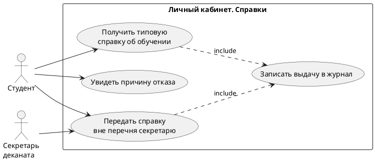
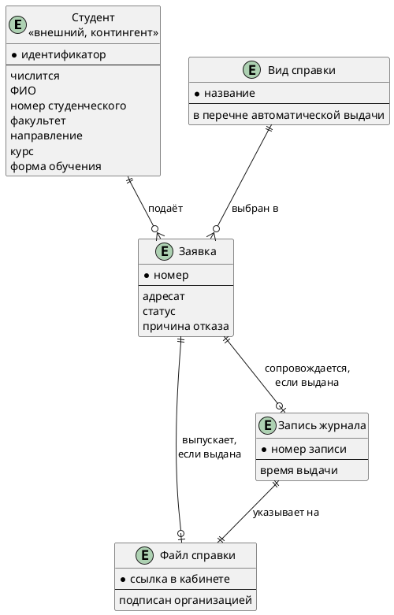

# Документ пользовательских требований. Заказ справки об обучении

Учебный пример. Продолжает [`../../lab1/example/case_concept.md`](../../lab1/example/case_concept.md). В свой вариант этот текст не копируют.

Диаграмма прецедентов: [`diagrams/usecase.puml`](diagrams/usecase.puml).



Исходник тот же, что файл `.puml`. Так и сдают: код в репозитории, не только картинка.

## 1. Реинжиниринг дерева функций

Исходное дерево из концепции:

```text
Выдать справку об обучении
├── Принять заявку на вид и адресата
├── Проверить, что студент числится
├── Выдать типовую справку автоматически
│   ├── Собрать PDF по шаблону
│   ├── Подписать электронной подписью организации
│   ├── Положить файл в личный кабинет
│   └── Записать выдачу в журнал
├── Передать заявку вне перечня секретарю
│   ├── Подтвердить и выдать файл
│   └── Отклонить с причиной
└── Показать отказ, если студент не числится
```

| ID | Пользовательское требование | Узел дерева | Есть в дереве | Что сделано |
|----|-----------------------------|-------------|---------------|-------------|
| EP-1 | Студент получает типовую справку об обучении файлом в кабинете | Выдать типовую справку автоматически | да | оставлен |
| EP-2 | Студент видит причину, если не числится, и не получает файл | Показать отказ, если студент не числится | да | оставлен |
| EP-3 | Секретарь рассматривает справку вне перечня | Передать заявку вне перечня секретарю | да | оставлен |
| EP-4 | Выдача оставляет запись в журнале | Записать выдачу в журнал | да | вынесен отдельным эпиком: журнал нужен секретарю, а не только как шаг файла |

Печать бумаги в дереве концепта нет, в эпик её не добавляли: в границах она вне выпуска.

Скорректированное дерево совпадает с исходным. Отдельный эпик EP-4 не добавил узел, он назвал уже существующий лист интересом секретаря.

## 2. Диаграмма и соответствие

| Узел дерева | Вариант использования | Актор |
|-------------|----------------------|-------|
| Выдать типовую справку автоматически | UC-1 Получить типовую справку об обучении | Студент |
| Показать отказ, если студент не числится | UC-2 Увидеть причину отказа | Студент |
| Передать заявку вне перечня секретарю | UC-3 Передать справку вне перечня секретарю | Студент, секретарь |
| Записать выдачу в журнал | UC-4 Записать выдачу в журнал | include из UC-1 и UC-3 |

UC-4 не запускают сам по себе: запись журнала включается в успешную выдачу.

## 3. Эпики

### EP-1. Получить типовую справку об обучении

- Уровень: эпик
- Узел дерева: выдать типовую справку автоматически
- Бизнес-цель: BG-1
- Источник: студент
- Приоритет: Must

**Пользовательская история.** Как студент, который числится в вузе, я хочу получить типовую справку об обучении файлом в личном кабинете, чтобы подтвердить обучение адресату без визита в деканат.

**Сценарий UC-1.**

| Поле | Содержание |
|------|------------|
| Акторы | Студент. Личный кабинет. Учёт контингента. Сервис подписи |
| Предусловия | Студент вошёл в кабинет. Вид «справка об обучении» в перечне автоматической выдачи |
| Триггер | Студент отправил вид и адресата |
| Постусловие успеха | В кабинете лежит подписанный PDF, в журнале есть запись |
| Постусловие отказа | Файла нет. Если студент не числится, это уже UC-2 |

Основной поток:

1. Студент указывает вид «справка об обучении» и адресата.
2. Кабинет запрашивает статус в учёте.
3. Учёт отвечает, что студент числится.
4. Кабинет убеждается, что вид входит в перечень автоматической выдачи.
5. Кабинет собирает PDF по действующему шаблону.
6. Сервис подписи организации подписывает PDF.
7. Кабинет показывает файл студенту.
8. Кабинет пишет запись в журнал выдачи.

Альтернативы:

1. Вид не входит в перечень. Поток переходит в UC-3, файл на этом шаге не создаётся.
2. Студент не числится. Поток переходит в UC-2.

Исключения:

1. Сервис подписи не принял документ. Заявка не помечается выданной, студент видит, что справка не готова.

### EP-2. Увидеть причину, если справка не выдана из-за статуса

- Уровень: эпик
- Узел дерева: показать отказ, если студент не числится
- Бизнес-цель: BG-2
- Источник: студент
- Приоритет: Must

**Пользовательская история.** Как человек, который открыл личный кабинет, я хочу увидеть причину, если меня нет в контингенте, чтобы не ждать справку, которой не будет.

**Сценарий UC-2.**

| Поле | Содержание |
|------|------------|
| Акторы | Студент. Личный кабинет. Учёт контингента |
| Предусловия | Заявка отправлена |
| Триггер | Учёт ответил, что студент не числится |
| Постусловие успеха | В кабинете виден текст причины, PDF не создан |
| Постусловие отказа | Нет отдельного «плохого» конца: молчаливый отказ здесь и есть дефект |

Основной поток:

1. Кабинет получил ответ учёта «не числится».
2. Кабинет не собирает PDF и не вызывает подпись.
3. Кабинет показывает причину: студент не числится в контингенте.

Альтернативы:

1. Нет. Ветка «числится» в этот сценарий не входит.

Исключения:

1. Учёт недоступен. Причину «не числится» не показывают. Студент видит, что проверку выполнить не удалось, файл не создаётся.

### EP-3. Передать справку вне перечня секретарю

- Уровень: эпик
- Узел дерева: передать заявку вне перечня секретарю
- Бизнес-цель: BG-1 не распространяется на эту ветвь; цель границы — не выдавать военкомат автоматически
- Источник: секретарь деканата и студент
- Приоритет: Must

**Пользовательская история.** Как секретарь деканата, я хочу получить заявку на справку для военкомата или с нестандартной формулировкой и закрыть её подтверждением либо отказом с причиной, чтобы такой вид не уходил студенту без проверки.

**Сценарий UC-3.**

| Поле | Содержание |
|------|------------|
| Акторы | Студент. Личный кабинет. Секретарь |
| Предусловия | Студент числится. Вид не входит в перечень автоматической выдачи |
| Триггер | Кабинет определил, что вид вне перечня |
| Постусловие успеха | Либо подписанный файл и запись журнала, либо причина отказа в кабинете |
| Постусловие отказа | Заявка остаётся «на рассмотрении», если решения ещё нет |

Основной поток:

1. Кабинет создаёт заявку со статусом «на рассмотрении».
2. Студент видит этот статус.
3. Секретарь открывает заявку.
4. Секретарь подтверждает выдачу.
5. Кабинет собирает PDF, подписывает его и кладёт файл студенту.
6. Кабинет пишет журнал. Это включение UC-4.

Альтернативы:

1. Секретарь отклоняет заявку и вписывает причину.
2. Кабинет показывает эту причину студенту. Файла нет, журнал выдачи не пишется.

Исключения:

1. Подпись после подтверждения не прошла. Статус не меняют на «выдана».

### EP-4. Оставить следы выдачи в журнале

- Уровень: эпик
- Узел дерева: записать выдачу в журнал
- Бизнес-цель: BG-1, критерий «у файла есть запись»
- Источник: секретарь деканата
- Приоритет: Must

**Пользовательская история.** Как секретарь деканата, я хочу, чтобы каждый выданный файл сопровождался записью журнала, чтобы учёт выдачи не расходился с тем, что студент скачал.

**Сценарий UC-4.**

| Поле | Содержание |
|------|------------|
| Акторы | Личный кабинет |
| Предусловия | PDF подписан и размещён студенту |
| Триггер | Успешное размещение файла на ветви UC-1 или после подтверждения UC-3 |
| Постусловие успеха | В журнале есть запись об этой выдаче |
| Постусловие отказа | Файла нет, значит и записи о выдаче нет |

Основной поток:

1. Кабинет фиксирует вид, студента, время и признак, что файл размещён.
2. Запись доступна для сверки с выданным файлом.

Альтернативы:

1. Нет отдельной альтернативы «выдать без журнала».

Исключения:

1. Запись журнала не сохранилась. Выдачу не считают завершённой, даже если файл уже показан: это разрыв, его видно в критерии приёмки EP-1.

## 4. Анализ сущностей

Сущности собраны из сценариев EP-1…EP-4, а не из будущих таблиц. На схеме только то, что пользователь различает: что подаёт, что выбирает, что получает и что секретарь сверяет. Исходник: [`diagrams/logical-data.puml`](diagrams/logical-data.puml).



| Сущность | Откуда в сценарии | Что хранит кабинет | Ключ, как его понимает пользователь |
|----------|-------------------|--------------------|-------------------------------------|
| Студент | EP-1, EP-2: числится или нет; поля попадают в файл | ничего, только чтение контингента | идентификатор учётной записи |
| Вид справки | EP-1 и EP-3 расходятся по признаку перечня | название и признак «в перечне» | название вида |
| Заявка | EP-1, EP-2, EP-3 | адресат, статус, причину отказа | номер заявки в кабинете |
| Файл справки | EP-1 и подтверждённый EP-3 | ссылку на подписанный PDF | ссылка, по которой студент забирает файл |
| Запись журнала | EP-4, include из успешной выдачи | время выдачи и ссылку на файл | номер записи |

Связи, которые следуют из постусловий, а не из «так удобнее хранить»:

- Один студент подаёт много заявок. Заявка без студента не создаётся. Студент при этом остаётся во внешнем контингенте: второй список людей кабинет не заводит.
- У заявки ровно один вид. Вид «справка об обучении» ведёт на автоматический файл. Вид вне перечня, в том числе для военкомата, оставляет заявку «на рассмотрении».
- Файл есть не у каждой заявки, а только у выданной: ноль или один. Отказ «не числится» и отказ секретаря файл не создают.
- Запись журнала есть ровно тогда, когда есть файл: ноль или одна на заявку. Записи без файла нет, файл без записи не считается выданным.
- Статус заявки принимает одно из значений: принята, на рассмотрении, выдана, отказано. Причина отказа — атрибут заявки, отдельной сущностью она не стала: без заявки причина не существует.

Не попали на схему и почему:

| Слово из сценария | Почему не сущность |
|-------------------|--------------------|
| Секретарь, студент как роль | это акторы диаграммы прецедентов |
| Электронная подпись | признак файла «подписан организацией», сервис подписи системой не является данными |
| Бумажная печать | вне рамок выпуска |
| Шаблон справки | правило сборки файла, своих экземпляров у студента нет |
| Декан | на пути TO-BE не участвует |

Схема логическая. В лабораторной работе 3 группами для функциональных точек останутся заявка, журнал и внешний контингент. Вид справки здесь выделен, потому что от него зависит ветвь сценария; отдельной картотекой с собственными операциями он не становится. Файл для студента — отдельная сущность, в точках он входит в сборку PDF, а не в ещё один внутренний файл.

## 5. Проверка

### 5.1. Подготовка

| Роль | Кто в примере |
|------|----------------|
| Аналитик | автор примера |
| Заказчик | представитель деканата, в учебной сдаче это преподаватель |
| Разработчик | участник команды |
| Тестировщик | участник команды |

Чек-лист — в разделе 6.

### 5.2. Полнота

| ID | Роль | Действие | Ценность | Контекст | Полнота | Что дополнить |
|----|------|----------|----------|----------|---------|---------------|
| EP-1 | студент, который числится | получить файл типовой справки | подтвердить обучение без визита | вид в перечне, вход в кабинет | полное | |
| EP-2 | человек в кабинете | увидеть причину | не ждать справку | учёта ответил «не числится» | полное | |
| EP-3 | секретарь | закрыть заявку вне перечня | военкомат не уходит без проверки | студент числится, вид вне перечня | полное | |
| EP-4 | секретарь | получить запись журнала на каждый файл | учёт не расходится со скачанным | файл уже размещён | полное | |

### 5.3. Однозначность и проверяемость

| Исходное требование | Проблема | Исправленное требование |
|---------------------|----------|-------------------------|
| «Быстро выдать справку» в черновике цели | Нет меры | В концепции оставлена доля 90 % файлом без визита. В эпике EP-1 меры времени нет: скорость вынесена в нефункциональные требования лабораторной 4 |
| Не выявлено размытых «удобно» и «надёжно» в EP-1…EP-4 | Просмотрены четыре эпика | Формулировки историй оставлены |

### 5.4. Непротиворечивость

| Требование A | Требование B | Конфликт | Решение |
|--------------|--------------|----------|---------|
| EP-1: типовая справка без секретаря | EP-3: секретарь обязателен вне перечня | Кажется, что секретарь и есть, и нет | Разведены виды. Типовая справка об обучении в EP-3 не входит |
| EP-2: файла нет | EP-4: у каждого файла есть журнал | Журнал на отказ | EP-4 включается только после размещения файла. На отказ UC-2 журнал выдачи не пишется |

### 5.5. Атомарность

| Исходное требование | Проблема | Как разделено или почему оставлено одним эпиком |
|---------------------|----------|--------------------------------------------------|
| «Получить справку или отказ, а секретарь ещё и печатает» | Три цели | Разделены на EP-1, EP-2 и EP-3. Печать оставлена вне рамок |
| EP-1 включает PDF, подпись, файл и журнал в одном сценарии | Много шагов | Это одна цель студента. Журнал дополнительно назван EP-4, потому что ценность у секретаря другая. Шаги PDF и подписи остаются потоком EP-1, а не отдельными эпиками |

### 5.6. Трассируемость

| ID | Требование | Источник | Бизнес-цель | Узел дерева | Вариант использования | Статус |
|----|------------|----------|-------------|-------------|----------------------|--------|
| EP-1 | Типовая справка файлом | Студент | BG-1 | Выдать типовую справку автоматически | UC-1 | проверено |
| EP-2 | Причина, если не числится | Студент | BG-2 | Показать отказ | UC-2 | проверено |
| EP-3 | Заявка вне перечня | Секретарь | граница выпуска, не молчаливый военкомат | Передать заявку секретарю | UC-3 | проверено |
| EP-4 | Журнал на каждый файл | Секретарь | критерий BG-1 про запись | Записать выдачу в журнал | UC-4 | проверено |

### 5.7. Приоритет

| ID | Требование | Приоритет | Обоснование |
|----|------------|-----------|-------------|
| EP-1 | Типовая справка файлом | Must | Без этого BG-1 не выполняется |
| EP-2 | Причина, если не числится | Must | Иначе возвращается устный отказ AS-IS |
| EP-3 | Заявка вне перечня | Must | Иначе военкомат либо блокирует типовой путь, либо уходит без секретаря |
| EP-4 | Журнал | Must | Файл без учёта выдачи деканат не принимает |

### 5.8. Ревью

| Замечание | Кто | Решение | Что изменено |
|-----------|-----|---------|--------------|
| Типовую справку всё ещё можно принести секретарю | заказчик | принято | В EP-1 постусловие не содержит визита. В концепции это уже было вне основного хода |
| Журнал сделать необязательным | разработчик | отклонено | EP-4 Must: иначе нельзя сверить выдачу. Замечание остаётся здесь, формулировку не ослабляли |

### 5.9. Разбор с помощью ИИ

Инструмент: учебная пометка. В сдаче студента здесь живой ответ модели. Ниже показано, как выглядит разбор, а не протокол настоящего прогона.

Промпт: «Проанализируй эпики EP-1…EP-4 заказа справки об обучении на неполноту, противоречия и неоднозначность».

| Замечание | Тип | Принято | Куда внесено |
|-----------|-----|---------|--------------|
| Не сказано, что делать, если подпись недоступна | пробел | да | Исключение EP-1 и EP-3 |
| EP-1 и EP-3 оба создают файл, это дубль | дубль | нет | Общий шаг подписи есть, цели разные: автоматический перечень и решение секретаря |

### 5.10. Протокол

| ID | Дефект | Тип | Рекомендация | Статус |
|----|--------|-----|--------------|--------|
| черновик «быстро выдать» | нет меры в истории | неоднозначность | меру держать в BG-1 и в нефункциональных требованиях | исправлено |
| EP-1+EP-3+печать одним абзацем | три цели | атомарность | эпики разделены, печать вне рамок | исправлено |

## 6. Чек-лист

| № | Критерий | EP-1 | EP-2 | EP-3 | EP-4 |
|---|----------|------|------|------|------|
| 1 | Роль | да | да | да | да |
| 2 | Действие | да | да | да | да |
| 3 | Ценность | да | да | да | да |
| 4 | Однозначно | да | да | да | да |
| 5 | Проверяемо | да | да | да | да |
| 6 | Атомарно | да | да | да | да |
| 7 | Не противоречит другим | да | да | да | да |
| 8 | Уникальный ID | да | да | да | да |
| 9 | Источник | да | да | да | да |
| 10 | Приоритет | да | да | да | да |
| 11 | Реализуемо | да | да | да | да |
| 12 | Актуально | да | да | да | да |

## 7. Перечень после проверки

Актуальны EP-1, EP-2, EP-3, EP-4 в формулировках раздела 3. Черновик «быстро выдать» и составная фраза про печать в перечень не входят.
