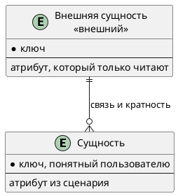

# Документ пользовательских требований

Вариант: 02-Запись к врачу
Команда: Лухава Диана, Разумовская Мария
Связанный документ концепции: `case_concept.md` (лабораторная работа 1)
Дата: 7.11.2026

Пользовательское требование фиксируется на уровне эпика. Каждый эпик оформлен и пользовательской историей, и сценарием использования.

## 1. Реинжиниринг дерева функций

Исходное дерево функций взято из документа концепции без переписывания «как хотелось бы».

```plantuml

@startuml
top to bottom direction

rectangle "Чат-бот записи к врачу\nчерез мессенджер МАХ" as SYS

rectangle "Авторизация" as Auth
rectangle "FE-1. Авторизация по СНИЛС и телефону" as FE1
rectangle "FE-2. Управление профилями родственников" as FE2

rectangle "Запись на очный прием" as Booking
rectangle "FE-12. Предварительное анкетирование перед диспансеризацией" as FE12
rectangle "FE-3. Выбор МО" as FE3
rectangle "FE-15. Выбор специальности врача" as FE15
rectangle "FE-16. Выбор конкретного врача данной специальности" as FE16
rectangle "FE-4. Выбор слота и запись на очный прием" as FE4
rectangle "FE-11. Получение напоминаний о предстоящих приемах" as FE11
rectangle "FE-6. Отмена записи на очный прием" as FE6

rectangle "Профиль пользователя" as Profile
rectangle "FE-5. Просмотр активных записей" as FE5
rectangle "FE-13. Просмотр направлений на анализы" as FE13
rectangle "FE-14. Отображение утерянных записей" as FE14
rectangle "FE-9. Скачивание медицинских документов" as FE9

rectangle "Запись на ТМК" as TMK
rectangle "FE-7. Выбор слота и запись на ТМК" as FE7
rectangle "FE-10. Переход к ТМК: создание чата,\nдобавление врача, ссылка" as FE10
rectangle "FE-8. Отмена записи на ТМК" as FE8

SYS --> Auth
Auth --> FE1
Auth --> FE2

SYS --> Booking
Booking --> FE12
Booking --> FE3
Booking --> FE15
Booking --> FE16
Booking --> FE4
Booking --> FE11
Booking --> FE6

SYS --> Profile
Profile --> FE5
Profile --> FE13
Profile --> FE14
Profile --> FE9

SYS --> TMK
TMK --> FE3
TMK --> FE15
TMK --> FE16
TMK --> FE7
TMK --> FE11
TMK --> FE10
TMK --> FE8

@enduml
```

| ID эпика | Пользовательское требование                                                                                                                                                                      | Узел дерева функций    | Есть в дереве | Что сделано                                                         |
| ------------- | -------------------------------------------------------------------------------------------------------------------------------------------------------------------------------------------------------------------------- | --------------------------------------- | ------------------------ | ----------------------------------------------------------------------------- |
| EP-1          | Пользователь должен иметь возможность записаться к врачу на очный прием                                                                                      | FE-4                                    | да                     | оставлен / добавлен узел / вынесен за рамки |
| EP-3          | Пользователь должен иметь возможность отменить запись на прием                                                                                                     | FE-6, FE-8                              | да                     | оставлен                                                              |
| EP-4          | Пользователь должен иметь возможность просмотреть текущие записи                                                                                                | FE-5                                    | да                     | оставлен                                                              |
| EP-5          | Получение напоминаний пользователем за 24 часа и 15 минут до времени записи                                                                                   | FE-11                                   | да                     | оставлен                                                              |
| EP-6          | Пользователь должен иметь возможность записаться на ТМК                                                                                                                   | FE-7                                    | да                     | оставлен                                                              |
| EP-7          | Пользователь должен иметь возможность инициировать закрытие ЛН врачом                                                                                       | FE-20        | да                   | оставлен                                                     |
| EP-10         | Пользователь должен иметь возможность записать родственника на прием к врачу                                                                           | FE-2, добавлен узел: FE-19  | частично         | добавлен узел                                                     |
| EP-11         | Пользователь должен иметь возможность авторизироваться по СНИЛС и телефону                                                                              | FE-1                                    | да                     | оставлен                                                              |

Скорректированное дерево:

```plantuml

@startuml
top to bottom direction

rectangle "Чат-бот записи к врачу\nчерез мессенджер МАХ" as SYS

rectangle "Авторизация" as Auth
rectangle "FE-1. Авторизация по СНИЛС и телефону" as FE1
rectangle "FE-2. Управление профилями родственников" as FE2

rectangle "Запись на очный прием" as Booking
rectangle "FE-12. Предварительное анкетирование перед диспансеризацией" as FE12
rectangle "FE-3. Выбор МО" as FE3
rectangle "FE-17. Выбор структурного подразделения МО" as FE17
rectangle "FE-15. Выбор специальности врача" as FE15
rectangle "FE-16. Выбор конкретного врача данной специальности" as FE16
rectangle "FE-4. Выбор слота и запись на очный прием" as FE4
rectangle "FE-11. Получение напоминаний о предстоящих приемах" as FE11
rectangle "FE-6. Отмена записи на очный прием" as FE6
rectangle "FE-19. Запись родственника на прием через выбранный профиль" as FE19

rectangle "Профиль пользователя" as Profile
rectangle "FE-5. Просмотр активных записей" as FE5
rectangle "FE-13. Просмотр направлений на анализы" as FE13
rectangle "FE-14. Отображение утерянных записей" as FE14
rectangle "FE-18. Повторная запись при утерянной записи" as FE18
rectangle "FE-9. Скачивание медицинских документов" as FE9
rectangle "FE-20. Инициирование закрытия листка нетрудоспособности" as FE20

rectangle "Запись на ТМК" as TMK
rectangle "FE-7. Выбор слота и запись на ТМК" as FE7
rectangle "FE-10. Переход к ТМК: создание чата,\nдобавление врача, ссылка" as FE10
rectangle "FE-8. Отмена записи на ТМК" as FE8

SYS --> Auth
Auth --> FE1
Auth --> FE2

SYS --> Booking
Booking --> FE12
Booking --> FE3
Booking --> FE17
Booking --> FE15
Booking --> FE16
Booking --> FE4
Booking --> FE11
Booking --> FE6
Booking --> FE19

SYS --> Profile
Profile --> FE5
Profile --> FE13
Profile --> FE14
Profile --> FE18
Profile --> FE9
Profile --> FE20

SYS --> TMK
TMK --> FE3
TMK --> FE15
TMK --> FE16
TMK --> FE7
TMK --> FE11
TMK --> FE10
TMK --> FE8

@enduml

```

## 2. Диаграмма вариантов использования

Исходник: `diagrams/usecase.puml`. Картинка без этого файла не принимается.

Граница системы:

| Узел дерева | Вариант использования | Актор |
| :--- | :--- | :--- |
| **FE-1** | UC-1. Авторизация по СНИЛС и телефону | Пациент |
| **FE-2** | UC-2. Переключение на профиль ребенка или родственника | Пациент |
| **FE-19** | UC-2. Переключение на профиль ребенка или родственника | Пациент |
| **FE-3** | UC-3. Запись на очный прием | Пациент |
| **FE-15** | UC-3. Запись на очный прием | Пациент |
| **FE-16** | UC-3. Запись на очный прием | Пациент |
| **FE-4** | UC-3. Запись на очный прием | Пациент |
| **FE-3** | UC-4. Запись на онлайн-консультацию (ТМК) | Пациент |
| **FE-15** | UC-4. Запись на онлайн-консультацию (ТМК) | Пациент |
| **FE-16** | UC-4. Запись на онлайн-консультацию (ТМК) | Пациент |
| **FE-7** | UC-4. Запись на онлайн-консультацию (ТМК) | Пациент |
| **FE-5** | UC-5. Просмотр записей | Пациент |
| **FE-13** | UC-5. Просмотр записей | Пациент |
| **FE-14** | UC-5. Просмотр записей | Пациент |
| **FE-6** | UC-6. Отмена очного приема или ТМК | Пациент |
| **FE-8** | UC-6. Отмена очного приема или ТМК | Пациент |
| **FE-9** | UC-7. Скачивание медицинских документов (ЛН) | Пациент |
| **FE-11** | UC-8. Получение напоминаний о приеме | Пациент |
| **FE-10** | UC-9. Получение ТМК | Пациент |
| **FE-20** | UC-10. Закрытие ЛН | Врач |
| **FE-10** | UC-11. Проведение ТМК | Врач |

## 3. Эпики

### EP-1. Запись на очный прием к врачу

- Уровень: эпик
- Узел дерева: FE-4
- Бизнес-цель из документа концепции: БЦ-01 Обеспечение записи к врачу через MAX
- Источник (стейкхолдер): пациент
- Приоритет MoSCoW: must

Как пациент, я хочу записаться на очный приём к врачу через чат-бот в MAX, чтобы получить возможность записаться на приём без обращения в регистратуру.

**Сценарий использования UC-3.**
| Поле | Содержание |
| :--- | :--- |
| **Акторы** | Пациент |
| **Предусловия** | PRE-1. Пациент успешно прошел авторизацию (выполнен UC-1). |
| **Триггер** | Пациент выбирает команду "Записаться к врачу" в главном меню бота. |
| **Постусловия успеха** | POST-1. Выбранный слот успешно занят и сохранен в МИС. POST-2. Отправлено S2S-событие `appointment_open_znp`. |
| **Постусловия отказа** | Запись блокируется, слот в МИС остается свободным, бот сообщает об ошибке. |

**Основной поток:**
1. Пациент запрашивает создание новой записи к врачу.
2. Пациент выбирает МО.
3. Пациент выбирает специальность.
4. Пациент выбирает конкретного врача.
5. Пациент выбирает слот.
6. Пациент выбирает формат визита: "Очный визит".
7. МИС фиксирует запись в БД.
8. Бот отображает запись с указанием даты, времени, кабинета и этажа в расписании.

**Альтернативы:**
* **3.1. Запись родственника или подопечного**
    1. На шаге 1 пациент указывает, что хочет оформить запись на другого человека.
    2. Бот запускает процесс переключения на профиль члена семьи (переход к UC-2).

* **3.2. Выбор дистанционного формата приема**
    1. На шаге 6 пациент указывает, что ему необходима ТМК.
    2. Система перенаправляет поток управления на сценарий ТМК (переход к UC-4).

**Исключения:**
* **3.0.E1. Обнаружение дублирующей активной записи**
    1. Срабатывает ограничение на запись к врачам одной специальности.
    2. Бот сообщает: "Запрещена запись к врачу при наличии не оказанного и не отмененного приема к врачу той же специальности. Если требуется произвести запись на другое время, отмените действующую запись: <Наименование услуги> <Дата и время бронирования>". Запись блокируется.

### EP-3. Отмена записи на прием

- Уровень: эпик
- Узел дерева: FE-6, FE-8
- Бизнес-цель из документа концепции: БЦ-03 Снижение нагрузки на регистратуры
- Источник (стейкхолдер): пациент
- Приоритет MoSCoW: must

Как пациент, я хочу отменять свою запись на прием через чат-бот в MAX, чтобы освободить время для других пациентов если я не могу посетить врача.

**Сценарий использования UC-6.**
| Поле | Содержание |
| :--- | :--- |
| **Акторы** | Пациент |
| **Предусловия** | PRE-1. Пациент авторизован в боте. PRE-2. В МИС эта запись активна. |
| **Триггер** | Пациент нажимает кнопку "Отменить запись" у active приема в боте. |
| **Постусловия успеха** | POST-1. Запись отменена. POST-2. Через 30 минут освободился слот. |
| **Постусловия отказа** | Запись не отменяется, статус визита в МИС остается прежним, бот блокирует операцию. |

**Основной поток:**

1. Пациент открывает перечень своих текущих приемов (выполняется UC-5).
2. Пациент нажимает кнопку "Отменить запись" на приеме.
3. Бот запрашивает подтверждение операции.
4. Пациент соглашается (см. 7.1).
5. МИС аннулирует запись.
6. Через 30 минут слот возвращается в расписание как свободный.

**Альтернативы:**
* **7.1. Отказ от проведения операции отмены**
    1. На шаге 4 пациент отказывается.
    2. Бот прерывает процесс удаления записи и возвращает пользователя к расписанию.

**Исключения:**
* **6.0.E1. Прием уже оказан или в процессе**
    1. МИС определяет, что прием уже оказан или в процессе.
    2. Бот блокирует выполнение удаления и выводит сообщение: "Запись на услугу обработана, отмена невозможна". Запись не отменяется.

### EP-4. Просмотр текущих записей

- Уровень: эпик
- Узел дерева: FE-5
- Бизнес-цель из документа концепции: БЦ-03 Снижение нагрузки на регистратуры
- Источник (стейкхолдер): пациент
- Приоритет MoSCoW: must

Как пациент, я хочу просматривать свои текущие записи на прием, чтобы знать дату, время и место нужного мне врача.

**Сценарий использования UC-5.**
| Поле | Содержание |
| :--- | :--- |
| **Акторы** | Пациент |
| **Предусловия** | Пациент успешно прошел авторизацию в боте. |
| **Триггер** | Пациент нажимает кнопку "Мои записи" в главном меню бота. |
| **Постусловия успеха** | Бот отображает структурированный список всех активных приемов и направлений на анализы. |
| **Постусловия отказа** | Бот сообщает, что активные записи отсутствуют. |

**Основной поток:**
1. Пациент запрашивает просмотр своих текущих записей.
2. Бот выводит на экран все активные и утерянные записи и при включенном флаге направления на анализы тоже.

**Исключения:**
* **5.0.E1. Обнаружен сбой синхронизации слота**
    1. Система определяет, что запись в базе данных получила статус утерянной.
    2. Бот блокирует стандартный вывод и отображает под записью пометку: "Запись была утеряна. Необходимо перезаписаться на прием".

### EP-5. Получение напоминаний о приеме

- Уровень: эпик
- Узел дерева: FE-11
- Бизнес-цель из документа концепции: БЦ-03 Снижение нагрузки на регистратуры
- Источник (стейкхолдер): пациент
- Приоритет MoSCoW: should

Как пациент, я хочу получать напоминания о предстоящем приеме, чтобы не забыть о запланированном посещении врача.

**Сценарий использования UC-8.**

| Поле | Содержание |
| :--- | :--- |
| **Акторы** | Пациент |
| **Предусловия** | В МИС существует активная запись. |
| **Триггер** | Наступление планового времени запуска крон-процесса на сервере МИС за 24 часа и за 15 минут до приема. |
| **Постусловия успеха** | Текстовое сервисное напоминание о скором очном визите или ТМК успешно доставлено в диалоговое окно чата мессенджера МАХ. |
| **Постусловия отказа** | Сообщение не доставлено из-за сбоя связи. |

**Основной поток:**
1. На сервере МИС по расписанию запускается автоматическое крон-задание "SendFromQueue".
2. Система извлекает соответствующее значение "MAX_ID" и параметры приема (дата, время, врач).
3. МИС через шлюз формирует и отправляет текстовое напоминание непосредственно в диалог мессенджера МАХ.

### EP-6. Запись на ТМК

- Уровень: эпик
- Узел дерева: FE-7
- Бизнес-цель из документа концепции: БЦ-01 Обеспечение записи к врачу через MAX
- Источник (стейкхолдер): пациент
- Приоритет MoSCoW: must

Как пациент, я хочу записаться на телемедицинскую консультацию через бот в MAX, чтобы получить медицинскую консультацию дистанционно.

**Сценарий использования UC-4.**
| Поле | Содержание |
| :--- | :--- |
| **Акторы** | Пациент |
| **Предусловия** | Пациент успешно прошел авторизацию в боте. |
| **Триггер** | Пациент указывает формат "Онлайн-консультация (ТМК)" на этапе выбора формы приема. |
| **Постусловия успеха** | Слот для ТМК зарезервирован в расписании МИС БАРС. |
| **Постусловия отказа** | Запись не создается, слот свободен, бот перенаправляет пользователя на шаг назад. |

**Основной поток:**
1. Пациент выбирает дистанционный формат ТМК на этапе определения формы визита.
2. Бот проверяет доступность слотов в МИС для ТМК.
3. Пациент выбирает слот.
4. МИС БАРС успешно фиксирует дистанционную запись в расписании врача.

**Исключения:**
* **4.0.E1. У врача в МИС отсутствует привязанная ТМК-услуга**
    1. На шаге 2 МИС определяет, что у врача отсутствуют слоты для ТМК.
    2. Бот возвращает пользователя к выбору расписания.

### EP-7. Инициирование закрытия ЛН

- Уровень: эпик
- Узел дерева: FE-20
- Бизнес-цель из документа концепции: БЦ-01 Обеспечение записи к врачу через MAX
- Источник (стейкхолдер): пациент
- Приоритет MoSCoW: must

Как пациент, я хочу инициировать через бот процесс закрытия листка нетрудоспособности врачом, чтобы завершить период нетрудоспособности без необходимости обращаться в медицинскую организацию лично.

**Сценарий использования UC-7.**
| Поле | Содержание |
| :--- | :--- |
| **Акторы** | Пациент |
| **Предусловия** | Пациент авторизован в боте, в МИС присутствует закрытый ЛН. |
| **Триггер** | Пациент запрашивает выгрузку документа ЛН. |
| **Постусловия успеха** | Готовый для скачивания файл закрытого ЛН отображается в диалоговом окне чата мессенджера. |
| **Постусловия отказа** | Файл не отправлен из-за ошибки в МИС, бот сообщает о временной недоступности документа. |

**Основной поток:**
1. Пациент запрашивает скачивание закрытого ЛН.
2. Бот отправляет запрос в МИС.
3. МИС извлекает файл из базы данных и кодирует его содержимое в текстовую строку.
4. Бот принимает строку, декодирует её обратно в файл и отправляет в чат МАХ в виде скачиваемого вложения.

### EP-10. Запись родственника на прием

- Уровень: эпик
- Узел дерева: FE-2, FE-19
- Бизнес-цель из документа концепции: БЦ-01 Обеспечение записи к врачу через MAX
- Источник (стейкхолдер): пациент
- Приоритет MoSCoW: must

Как пациент, я хочу записывать ребёнка на приём к врачу через свой профиль в чат-боте MAX, чтобы получать медицинские услуги для ребёнка.

**Сценарий использования UC-2.**
| Поле | Содержание |
| :--- | :--- |
| **Акторы** | Пациент |
| **Предусловия** | Пациент успешно прошел авторизацию в боте. |
| **Триггер** | Пациент выбирает опцию "Записать родственника" на этапе выбора формы записи. |
| **Постусловия успеха** | Бот переключен на СНИЛС выбранного члена семьи, бот направляет поток на шаги записи. |
| **Постусловия отказа** | Бот блокирует переключение и возвращает пользователя в главное меню. |

**Основной поток:**

1. Пациент запрашивает список связанных родственников для оформления записи. 
2. МИС извлекает список родственников. 
3. Бот выводит на экран имена родственников в виде интерактивных кнопок.
6. Пациент выбирает конкретного родственника.
7. Бот пеерключаетс на СНИЛС родственника и перенаправляет поток управления на шаги записи.

**Исключения:**
* **2.0.E1. Связи родственников не подтверждены**
    1. На шаге 4 система определяет, что связанных родственников нет.
    2. Бот блокирует переключение профиля, прерывает сценарий и выводит ошибку: "Список родственников пуст или требует подтверждения прав законного представителя в регистратуре".

### EP-11. Авторизация пользователя по СНИЛС или телефону

- Уровень: эпик
- Узел дерева: FE-1
- Бизнес-цель из документа концепции: БЦ-01 Обеспечение записи к врачу через MAX
- Источник (стейкхолдер): пациент
- Приоритет MoSCoW: must

Как пациент, я хочу авторизоваться в чат-боте MAX с использованием СНИЛС и номера телефона, чтобы получить доступ к персональным медицинским услугам.

**Сценарий использования UC-1.**
| Поле | Содержание |
| :--- | :--- |
| **Акторы** | Пациент |
| **Предусловия** | PRE-1. Пациент открыл бот в мессенджере MAX. |
| **Триггер** | Отправка первого сообщения. |
| **Постусловия успеха** | POST-1. В системе создана связь "MAX_ID" и СНИЛС пациента. POST-2. Пациенту открыт доступ к записи на прием. |
| **Постусловия отказа** | Доступ к персональным медицинским сервисам и главному меню бота блокируется. |

**Основной поток:**
1. Пациент активирует бот в мессенджере MAX.
2. Бот считывает "MAX_ID", не находит его у себя и запрашивает ввод СНИЛС.
3. Пациент вводит СНИЛС.
4. Бот просит ввести номер мобильного телефона.
5. Пациент вводит номер телефона.
6. Бот вызывает метод МИС для проверки данных в МИС БАРС.
7. МИС БАРС находит карту пациента, подтверждает прикрепление и возвращает ФИО пациента.
8. Бот сохраняет связку "MAX_ID" со СНИЛС в базу данных и выводит главное меню с приветствием.

**Альтернативы:**
* **1.1. Сессия уже существует в системе**
    1. На шаге 2 система находит "MAX_ID" среди ранее авторизованных пользователей.
    2. Бот пропускает шаги ввода (3-6) и сразу отображает для пациента главное интерактивное меню.

**Исключения:**
* **1.0.E1. Данные не найдены в картотеке**
    1. На шаге 7 система сообщает, что пациент с такими данными не зарегистрирован.
    2. Бот извещает: "Ваши данные не найдены в картотеке. Пожалуйста, проверьте введенные данные, обратитесь в медицинскую организацию, в которую планируете запись". Доступ к меню блокируется.

## 4. Анализ сущностей

Сущности выводятся из сценариев эпиков. Актор, действие и правило сборки сущностью не становятся.

Исходник: `diagrams/logical-data.puml`.

| Сущность | Эпик или сценарий | Что хранит система              | Ключ |
| ---------------- | -------------------------------- | ----------------------------------------------- | -------- |
|                  |                                  | сама / только читает извне |          |

| Связь | Кратность | Откуда это видно в постусловии |
| ---------- | ------------------ | -------------------------------------------------------- |
|            |                    |                                                          |

Что названо в сценарии и на схему не попало:

| Слово | Почему не сущность                               |
| ---------- | ---------------------------------------------------------------- |
|            | актор / атрибут / вне рамок / правило |

## 5. Проверка требований

### 5.1. Подготовка

Участники проверки:

| Роль               | Кто                                                                           |
| ---------------------- | -------------------------------------------------------------------------------- |
| Аналитик       | Студентки, выполняющие лабораторную работу |
| Заказчик       | Преподаватель дисциплины                                  |
| Разработчик | нет                                                                           |
| Тестировщик | нет                                                                           |

### 5.2. Полнота

| ID    | Роль       | Действие                                                                                                   | Ценность                                                                                                                                               | Контекст                                                                                                                 | Полнота | Что дополнить |
| ----- | -------------- | ------------------------------------------------------------------------------------------------------------------ | -------------------------------------------------------------------------------------------------------------------------------------------------------------- | -------------------------------------------------------------------------------------------------------------------------------- | -------------- | ------------------------- |
| EP-1  | Пациент | Записаться на очный прием к врачу                                                      | Запись на прием без обращения в регистратуру                                                                             | Через чат-бот в MAX                                                                                                  | Полная   | -                         |
| EP-3  | Пациент | Отменять свою запись на прием                                                             | Освободить время для других пациентов                                                                                         | Отменить запись, через чат-бота, если пациент не сможет посетить врача | Полная   | -                         |
| EP-4  | Пациент | Просматривать свои текущие записи на прием                                    | Знать дату, время и место для посещения нужного врача                                                              | При использовании чат-бота в MAX                                                                         | Полная   | -                         |
| EP-5  | Пациент | Получить напоминание о предстоящем приеме                                     | Не забыть о запланированном посещении врача                                                                              | За 24 часа и за 15 минут до начала приёма, через MAX                                            | Полная   | -                         |
| EP-6  | Пациент | Записаться на ТМК                                                                                   | Получить медицинскую консультацию дистанционно                                                                      | Через чат-бот в MAX                                                                                                  | Полная   | -                         |
| EP-7  | Пациент | Инициировать закрытие ЛН                                                                     | Завершить период нетрудоспособности без личного обращения в медицинскую организацию | Через чат-бот в MAX                                                                                                  | Полная   | -                         |
| EP-10 | Пациент | Записать родственника на приём к врачу                                                     | Получать медицинские услуги для ребёнка                                                                                     | Через свой профиль в чат-боте MAX                                                                        | Полная   | -                         |
| EP-11 | Пациент | Авторизоваться с использованием СНИЛС и номера телефона           | Получить доступ к персональным медицинским услугам                                                                | При использовании чат-бота в MAX                                                                         | Полная   | -                         |

### 5.3. Однозначность и проверяемость

| Исходное требование                                                                                                     | Проблема                                                                                                                                                                                      | Исправленное требование                                                                                                                                                    |
| ----------------------------------------------------------------------------------------------------------------------------------------- | ----------------------------------------------------------------------------------------------------------------------------------------------------------------------------------------------------- | ------------------------------------------------------------------------------------------------------------------------------------------------------------------------------------------------ |
| EP-7 Пользователь должен иметь возможность инициировать закрытие ЛН врачом | Не совсем понятно, что именно делает пользователь: закрывает ЛН самостоятельно или отправляет запрос врачу | Пользователь должен иметь возможность через чат-бот MAX инициировать процесс закрытия ЛН врачом                  |

### 5.4. Непротиворечивость

| Требование A | Требование B | Конфликт        | Решение |
| ---------------------- | ---------------------- | ----------------------- | -------------- |
|                        |                        | нет / описать |                |

### 5.5. Атомарность

| Исходное требование                                      | Проблема                                                                                                                                                                                                   | Как разделено или почему оставлено одним эпиком                                                                                  |
| -------------------------------------------------------------------------- | ------------------------------------------------------------------------------------------------------------------------------------------------------------------------------------------------------------------ | ------------------------------------------------------------------------------------------------------------------------------------------------------------------------- |
| EP-1. Запись на очный приём к врачу                | Включает несколько действий: выбор медицинской организации, подразделения, специальности, врача и времени приёма. | Оставлено одним эпиком, так как все эти действия нужны для записи на приём.                                  |
| EP-3. Отмена записи на приём                            | Включает отмену очной записи и записи на ТМК.                                                                                                                                 | Оставлено одним эпиком, так как цель обоих действий - отменить запись                                            |
| EP-10. Запись родственника на приём к врачу | Включает выбор профиля родственника и оформление записи.                                                                                                          | Оставлено одним эпиком, так как выбор профиля является частью процесса записи родственника. |

### 5.6. Трассируемость

| ID   | Требование | Источник | Бизнес-цель | Узел дерева | Вариант использования | Статус |
| ---- | -------------------- | ---------------- | --------------------- | --------------------- | ----------------------------------------- | ------------ |
| EP-1 |                      |                  |                       |                       | UC-1                                      |              |

### 5.7. Приоритет

| ID    | Требование                                                                                           | Приоритет | Обоснование                                                                                                                                                                                                                |
| ----- | -------------------------------------------------------------------------------------------------------------- | ------------------ | ------------------------------------------------------------------------------------------------------------------------------------------------------------------------------------------------------------------------------------- |
| EP-1  | Запись на очный приём к врачу                                                          | Must               | Основная функция сервиса                                                                                                                                                                                        |
| EP-3  | Отмена записи на приём                                                                      | Must               | В БЦ-03 в обязательных показателях указано, что должна быть доступна отмена записи через MAX.                                                                |
| EP-4  | Просмотр текущих записей                                                                 | Must               | Отмена идет через Мои записи -> выбор записи -> отмена. Отмена Must (БЦ-03), значит без просмотра она не работает.                                   |
| EP-5  | Получение напоминаний о приёме                                                      | Should             | Повышает удобство использования сервиса, но основной процесс записи может работать без напоминаний                                              |
| EP-6  | Запись на ТМК                                                                                       | Must               | Реализация записи на ТМК входит в основные возможности сервиса                                                                                                                  |
| EP-7  | Инициирование закрытие ЛН                                                               | Must               | Обязательный показатель БЦ-02. 100% типов событий, среди них sick_leave_close. Без этой функции показатель не выполнить.                             |
| EP-10 | Запись родственника на приём                                                          | Must               | Включено в 1 выпуск                                                                                                                                                                                                    |
| EP-11 | Авторизация пользователя по СНИЛС или телефону                        | Must               | Без авторизации невозможно предоставить пользователю доступ к персональным медицинским услугам                                                   |

### 5.8. Ревью со стейкхолдерами

| Замечание | Кто высказал | Решение                      | Что изменено в документе |
| ------------------ | ----------------------- | ----------------------------------- | --------------------------------------------- |
|                    |                         | принято / отклонено |                                               |

### 5.9. Разбор с помощью ИИ

Инструмент: гига чат

Промпт: проверь нука быстра

Ответ модели: привет! проверил, все хорошо!!! только не бей пожалуйста, все очень официачно!

| Замечание модели | Тип (неоднозначность, противоречие, дубль, пробел) | Принято | Куда внесено |
| ------------------------------- | ------------------------------------------------------------------------------------------- | -------------- | ----------------------- |
|                                 |                                                                                             | да / нет  |                         |

### 5.10. Протокол проверки

| ID | Дефект | Тип дефекта | Рекомендация | Статус                        |
| -- | ------------ | --------------------- | ------------------------ | ----------------------------------- |
|    |              |                       |                          | открыт / исправлено |

## 6. Чек-лист по каждому эпику

| № | Критерий                                                | EP-1          | Комментарий |
| -- | --------------------------------------------------------------- | ------------- | ---------------------- |
| 1  | Указана роль пользователя                | да / нет |                        |
| 2  | Указано действие                                 | да / нет |                        |
| 3  | Указана ценность                                 | да / нет |                        |
| 4  | Требование однозначно                       | да / нет |                        |
| 5  | Требование проверяемо                       | да / нет |                        |
| 6  | Требование атомарно                           | да / нет |                        |
| 7  | Требование не противоречит другим | да / нет |                        |
| 8  | Требование имеет уникальный ID         | да / нет |                        |
| 9  | Указан источник требования              | да / нет |                        |
| 10 | Указан приоритет                                 | да / нет |                        |
| 11 | Требование реализуемо                       | да / нет |                        |
| 12 | Требование актуально                         | да / нет |                        |

Колонки эпиков добавляются по числу требований.

## 7. Перечень после проверки

Актуальные формулировки эпиков, историй и сценариев после исправлений. Устаревшие формулировки в этот перечень не копируются: они остаются в протоколе.
