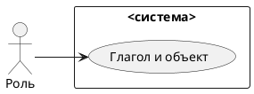
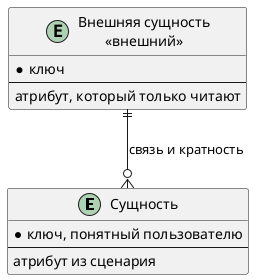

# Документ пользовательских требований

Вариант: 02-Запись к врачу
Команда: Лухава Диана, Разумовская Мария
Связанный документ концепции: `case_concept.md` (лабораторная работа 1)
Дата: 7.11.2026

Пользовательское требование фиксируется на уровне эпика. Каждый эпик оформлен и пользовательской историей, и сценарием использования.

## 1. Реинжиниринг дерева функций

Исходное дерево функций взято из документа концепции без переписывания «как хотелось бы».

```plantuml

@startuml
top to bottom direction

rectangle "Чат-бот записи к врачу\nчерез мессенджер МАХ" as SYS

rectangle "Авторизация" as Auth
rectangle "FE-1. Авторизация по СНИЛС и телефону" as FE1
rectangle "FE-2. Управление профилями родственников" as FE2

rectangle "Запись на очный прием" as Booking
rectangle "FE-12. Предварительное анкетирование перед диспансеризацией" as FE12
rectangle "FE-3. Выбор МО" as FE3
rectangle "FE-15. Выбор специальности врача" as FE15
rectangle "FE-16. Выбор конкретного врача данной специальности" as FE16
rectangle "FE-4. Выбор слота и запись на очный прием" as FE4
rectangle "FE-11. Получение напоминаний о предстоящих приемах" as FE11
rectangle "FE-6. Отмена записи на очный прием" as FE6

rectangle "Профиль пользователя" as Profile
rectangle "FE-5. Просмотр активных записей" as FE5
rectangle "FE-13. Просмотр направлений на анализы" as FE13
rectangle "FE-14. Отображение утерянных записей" as FE14
rectangle "FE-9. Скачивание медицинских документов" as FE9

rectangle "Запись на ТМК" as TMK
rectangle "FE-7. Выбор слота и запись на ТМК" as FE7
rectangle "FE-10. Переход к ТМК: создание чата,\nдобавление врача, ссылка" as FE10
rectangle "FE-8. Отмена записи на ТМК" as FE8

SYS --> Auth
Auth --> FE1
Auth --> FE2

SYS --> Booking
Booking --> FE12
Booking --> FE3
Booking --> FE15
Booking --> FE16
Booking --> FE4
Booking --> FE11
Booking --> FE6

SYS --> Profile
Profile --> FE5
Profile --> FE13
Profile --> FE14
Profile --> FE9

SYS --> TMK
TMK --> FE3
TMK --> FE15
TMK --> FE16
TMK --> FE7
TMK --> FE11
TMK --> FE10
TMK --> FE8

@enduml
```




| ID эпика | Пользовательское требование                                                                                                                                            | Узел дерева функций | Есть в дереве | Что сделано                                                         |
| ------------- | ------------------------------------------------------------------------------------------------------------------------------------------------------------------------------------------------ | ------------------------------------ | ------------------------ | ----------------------------------------------------------------------------- |
| EP-1          | Пользователь должен иметь возможность записаться к врачу на очный прием                                                            | FE-4                                 | да                     | оставлен / добавлен узел / вынесен за рамки |
| EP-2          | Пользователь должен иметь возможность выбрать конкретного специалиста для записи на прием                      | FE-16,FE-15                          | да                     | оставлен                                                              |
| EP-3          | Пользователь должен иметь возможность отменить запись на прием                                                                           | FE-6, FE-8                           | да                     | оставлен                                                              |
| EP-4          | Пользователь должен иметь возможность просмотреть текущие записи                                                                      | FE-5                                 | да                     | оставлен                                                              |
| EP-5          | Получение напоминаний пользователем за 24 часа и 15 минут до времени записи                                                         | FE-11                                | да                     | оставлен                                                              |
| EP-6          | Пользователь должен иметь возможность записаться на ТМК                                                                                         | FE-7                                 | да                     | оставлен                                                              |
| EP-7          | Пользователь должен иметь возможность закрыть ЛН врачом                                                                                        | добавлен узел:           | нет                   | добавлен узел                                                     |
| EP-8          | Пользователь должен иметь возможность повторно записаться в случае потерянной записи                                  | добавлен узел:           | частично         | добавлен узел                                                     |
| EP-9          | Пользователь должен иметь возможность выбора МО для записи                                                                                   | FE-3                                 | да                     | оставлен                                                              |
| EP-10         | Пользователь должен иметь возможность записать родственника на прием к врачу                                                 | FE-2                                 | да                     | оставлен                                                              |
| EP-11         | Пользователь должен иметь возможность авторизироваться по СНИЛС и телефону                                                    | FE-1                                 | да                     | оставлен                                                              |
| EP-12         | Пользователь должен иметь возможность просматривать направления на анализы                                                    | FE-13                                | да                     | оставлен                                                              |
| EP-13         | Пользователь должен иметь возможность скачивать медицинские документы                                                           | FE-9                                 | да                     | оставлен                                                              |
| EP-14         | Пользователь должен иметь возможность проходить предварительное анкетирование перед диспансеризацией | FE-12                                | да                     | оставлен                                                              |
| EP-15         | Пользователь должен иметь возможность просматривать утерянные записи                                                               | FE-14                                | да                     | оставлен                                                              |
| EP-16         | Пользователь должен иметь возможность переключаться между профилями родственников                                      | FE-2                                 |                          |                                                                               |

Скорректированное дерево:

```text
вставить дерево после реинжиниринга
```

## 2. Диаграмма вариантов использования

Исходник: `diagrams/usecase.puml`. Картинка без этого файла не принимается.



Граница системы:


| Узел дерева | Вариант использования | Актор |
| --------------------- | ----------------------------------------- | ---------- |
|                       | UC-1                                      |            |

## 3. Эпики

### EP-1. Название эпика

- Уровень: эпик
- Узел дерева:
- Бизнес-цель из документа концепции:
- Источник (стейкхолдер):
- Приоритет MoSCoW:

**Пользовательская история.** Как <роль>, я хочу <действие>, чтобы <ценность>.

**Сценарий использования UC-1.**


| Поле                            | Содержание |
| ----------------------------------- | -------------------- |
| Акторы                        |                      |
| Предусловия              |                      |
| Триггер                      |                      |
| Постусловия успеха |                      |
| Постусловия отказа |                      |

Основной поток:

Альтернативы:

Исключения:

## 4. Анализ сущностей

Сущности выводятся из сценариев эпиков. Актор, действие и правило сборки сущностью не становятся.

Исходник: `diagrams/logical-data.puml`.




| Сущность | Эпик или сценарий | Что хранит система              | Ключ |
| ---------------- | -------------------------------- | ----------------------------------------------- | -------- |
|                  |                                  | сама / только читает извне |          |


| Связь | Кратность | Откуда это видно в постусловии |
| ---------- | ------------------ | -------------------------------------------------------- |
|            |                    |                                                          |

Что названо в сценарии и на схему не попало:


| Слово | Почему не сущность                               |
| ---------- | ---------------------------------------------------------------- |
|            | актор / атрибут / вне рамок / правило |

## 5. Проверка требований

### 5.1. Подготовка

Участники проверки:


| Роль               | Кто |
| ---------------------- | ------ |
| Аналитик       |        |
| Заказчик       |        |
| Разработчик |        |
| Тестировщик |        |

### 5.2. Полнота


| ID   | Роль | Действие | Ценность | Контекст | Полнота | Что дополнить |
| ---- | -------- | ---------------- | ---------------- | ---------------- | -------------- | ------------------------- |
| EP-1 |          |                  |                  |                  |                |                           |

### 5.3. Однозначность и проверяемость


| Исходное требование | Проблема | Исправленное требование |
| ------------------------------------- | ---------------- | --------------------------------------------- |
|                                       |                  |                                               |

### 5.4. Непротиворечивость


| Требование A | Требование B | Конфликт        | Решение |
| ---------------------- | ---------------------- | ----------------------- | -------------- |
|                        |                        | нет / описать |                |

### 5.5. Атомарность


| Исходное требование | Проблема | Как разделено или почему оставлено одним эпиком |
| ------------------------------------- | ---------------- | ---------------------------------------------------------------------------------------- |
|                                       |                  |                                                                                          |

### 5.6. Трассируемость


| ID   | Требование | Источник | Бизнес-цель | Узел дерева | Вариант использования | Статус |
| ---- | -------------------- | ---------------- | --------------------- | --------------------- | ----------------------------------------- | ------------ |
| EP-1 |                      |                  |                       |                       | UC-1                                      |              |

### 5.7. Приоритет


| ID   | Требование | Приоритет            | Обоснование |
| ---- | -------------------- | ----------------------------- | ---------------------- |
| EP-1 |                      | Must / Should / Could / Won't |                        |

### 5.8. Ревью со стейкхолдерами


| Замечание | Кто высказал | Решение                      | Что изменено в документе |
| ------------------ | ----------------------- | ----------------------------------- | --------------------------------------------- |
|                    |                         | принято / отклонено |                                               |

### 5.9. Разбор с помощью ИИ

Инструмент: гига чат

Промпт: проверь нука быстра

Ответ модели: привет! проверил, все хорошо!!! только не бей пожалуйста, все очень официачно!


| Замечание модели | Тип (неоднозначность, противоречие, дубль, пробел) | Принято | Куда внесено |
| ------------------------------- | ------------------------------------------------------------------------------------------- | -------------- | ----------------------- |
|                                 |                                                                                             | да / нет  |                         |

### 5.10. Протокол проверки


| ID | Дефект | Тип дефекта | Рекомендация | Статус                        |
| -- | ------------ | --------------------- | ------------------------ | ----------------------------------- |
|    |              |                       |                          | открыт / исправлено |

## 6. Чек-лист по каждому эпику


| № | Критерий                                                | EP-1          | Комментарий |
| -- | --------------------------------------------------------------- | ------------- | ---------------------- |
| 1  | Указана роль пользователя                | да / нет |                        |
| 2  | Указано действие                                 | да / нет |                        |
| 3  | Указана ценность                                 | да / нет |                        |
| 4  | Требование однозначно                       | да / нет |                        |
| 5  | Требование проверяемо                       | да / нет |                        |
| 6  | Требование атомарно                           | да / нет |                        |
| 7  | Требование не противоречит другим | да / нет |                        |
| 8  | Требование имеет уникальный ID         | да / нет |                        |
| 9  | Указан источник требования              | да / нет |                        |
| 10 | Указан приоритет                                 | да / нет |                        |
| 11 | Требование реализуемо                       | да / нет |                        |
| 12 | Требование актуально                         | да / нет |                        |

Колонки эпиков добавляются по числу требований.

## 7. Перечень после проверки

Актуальные формулировки эпиков, историй и сценариев после исправлений. Устаревшие формулировки в этот перечень не копируются: они остаются в протоколе.
