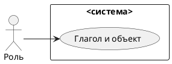
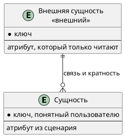

# Документ пользовательских требований

Вариант: 02-Запись к врачу
Команда: Лухава Диана, Разумовская Мария
Связанный документ концепции: `case_concept.md` (лабораторная работа 1)
Дата: 7.11.2026

Пользовательское требование фиксируется на уровне эпика. Каждый эпик оформлен и пользовательской историей, и сценарием использования.

## 1. Реинжиниринг дерева функций

Исходное дерево функций взято из документа концепции без переписывания «как хотелось бы».

```plantuml

@startuml
top to bottom direction

rectangle "Чат-бот записи к врачу\nчерез мессенджер МАХ" as SYS

rectangle "Авторизация" as Auth
rectangle "FE-1. Авторизация по СНИЛС и телефону" as FE1
rectangle "FE-2. Управление профилями родственников" as FE2

rectangle "Запись на очный прием" as Booking
rectangle "FE-12. Предварительное анкетирование перед диспансеризацией" as FE12
rectangle "FE-3. Выбор МО" as FE3
rectangle "FE-15. Выбор специальности врача" as FE15
rectangle "FE-16. Выбор конкретного врача данной специальности" as FE16
rectangle "FE-4. Выбор слота и запись на очный прием" as FE4
rectangle "FE-11. Получение напоминаний о предстоящих приемах" as FE11
rectangle "FE-6. Отмена записи на очный прием" as FE6

rectangle "Профиль пользователя" as Profile
rectangle "FE-5. Просмотр активных записей" as FE5
rectangle "FE-13. Просмотр направлений на анализы" as FE13
rectangle "FE-14. Отображение утерянных записей" as FE14
rectangle "FE-9. Скачивание медицинских документов" as FE9

rectangle "Запись на ТМК" as TMK
rectangle "FE-7. Выбор слота и запись на ТМК" as FE7
rectangle "FE-10. Переход к ТМК: создание чата,\nдобавление врача, ссылка" as FE10
rectangle "FE-8. Отмена записи на ТМК" as FE8

SYS --> Auth
Auth --> FE1
Auth --> FE2

SYS --> Booking
Booking --> FE12
Booking --> FE3
Booking --> FE15
Booking --> FE16
Booking --> FE4
Booking --> FE11
Booking --> FE6

SYS --> Profile
Profile --> FE5
Profile --> FE13
Profile --> FE14
Profile --> FE9

SYS --> TMK
TMK --> FE3
TMK --> FE15
TMK --> FE16
TMK --> FE7
TMK --> FE11
TMK --> FE10
TMK --> FE8

@enduml
```

| ID эпика | Пользовательское требование                                                                                                                                                                      | Узел дерева функций    | Есть в дереве | Что сделано                                                         |
| ------------- | -------------------------------------------------------------------------------------------------------------------------------------------------------------------------------------------------------------------------- | --------------------------------------- | ------------------------ | ----------------------------------------------------------------------------- |
| EP-1          | Пользователь должен иметь возможность записаться к врачу на очный прием                                                                                      | FE-4                                    | да                     | оставлен / добавлен узел / вынесен за рамки |
| EP-2          | Пользователь должен иметь возможность выбирать специальность врача для записи на прием                                                         | FE-15                                   | да                     | оставлен                                                              |
| EP-3          | Пользователь должен иметь возможность отменить запись на прием                                                                                                     | FE-6, FE-8                              | да                     | оставлен                                                              |
| EP-4          | Пользователь должен иметь возможность просмотреть текущие записи                                                                                                | FE-5                                    | да                     | оставлен                                                              |
| EP-5          | Получение напоминаний пользователем за 24 часа и 15 минут до времени записи                                                                                   | FE-11                                   | да                     | оставлен                                                              |
| EP-6          | Пользователь должен иметь возможность записаться на ТМК                                                                                                                   | FE-7                                    | да                     | оставлен                                                              |
| EP-7          | Пользователь должен иметь возможность инициировать закрытие ЛН врачом                                                                                       | добавлен узел: FE-20        | нет                   | добавлен узел                                                     |
| EP-8          | Пользователь должен иметь возможность повторно записаться в случае потерянной записи                                                            | FE-14, добавлен узел: FE-18 | частично         | добавлен узел                                                     |
| EP-9          | Пользователь должен иметь возможность выбора МО для записи                                                                                                             | FE-3                                    | да                     | оставлен                                                              |
| EP-10         | Пользователь должен иметь возможность записать родственника на прием к врачу                                                                           | FE-2, добавлен узел: FE-19  | частично         | добавлен узел                                                     |
| EP-11         | Пользователь должен иметь возможность авторизироваться по СНИЛС и телефону                                                                              | FE-1                                    | да                     | оставлен                                                              |
| EP-12         | Пользователь должен иметь возможность просматривать направления на анализы                                                                              | FE-13                                   | да                     | оставлен                                                              |
| EP-13         | Пользователь должен иметь возможность скачивать медицинские документы                                                                                     | FE-9                                    | да                     | оставлен                                                              |
| EP-14         | Пользователь должен иметь возможность проходить предварительное анкетирование перед диспансеризацией                           | FE-12                                   | да                     | оставлен                                                              |
| EP-15         | Пользователь должен иметь возможность просматривать утерянные записи                                                                                         | FE-14                                   | да                     | оставлен                                                              |
| EP-16         | Пользователь должен иметь возможность переключаться между профилями родственников                                                                | FE-2                                    | да                     | оставлен                                                              |
| EP-17         | Пользователь должен иметь возможность выбрать структурное подразделение медицинской организации для записи на прием | добавлен узел: FE-17        | нет                   | добавлен узел                                                     |
| EP-18         | Пользователь должен иметь возможность выбрать конретного врача выбранной специальности для записи на прием                   | FE-16                                   | да                     | оставлен                                                              |

Скорректированное дерево:

```plantuml

@startuml
top to bottom direction

rectangle "Чат-бот записи к врачу\nчерез мессенджер МАХ" as SYS

rectangle "Авторизация" as Auth
rectangle "FE-1. Авторизация по СНИЛС и телефону" as FE1
rectangle "FE-2. Управление профилями родственников" as FE2

rectangle "Запись на очный прием" as Booking
rectangle "FE-12. Предварительное анкетирование перед диспансеризацией" as FE12
rectangle "FE-3. Выбор МО" as FE3
rectangle "FE-17. Выбор структурного подразделения МО" as FE17
rectangle "FE-15. Выбор специальности врача" as FE15
rectangle "FE-16. Выбор конкретного врача данной специальности" as FE16
rectangle "FE-4. Выбор слота и запись на очный прием" as FE4
rectangle "FE-11. Получение напоминаний о предстоящих приемах" as FE11
rectangle "FE-6. Отмена записи на очный прием" as FE6
rectangle "FE-19. Запись родственника на прием через выбранный профиль" as FE19

rectangle "Профиль пользователя" as Profile
rectangle "FE-5. Просмотр активных записей" as FE5
rectangle "FE-13. Просмотр направлений на анализы" as FE13
rectangle "FE-14. Отображение утерянных записей" as FE14
rectangle "FE-18. Повторная запись при утерянной записи" as FE18
rectangle "FE-9. Скачивание медицинских документов" as FE9
rectangle "FE-20. Инициирование закрытия листка нетрудоспособности" as FE20

rectangle "Запись на ТМК" as TMK
rectangle "FE-7. Выбор слота и запись на ТМК" as FE7
rectangle "FE-10. Переход к ТМК: создание чата,\nдобавление врача, ссылка" as FE10
rectangle "FE-8. Отмена записи на ТМК" as FE8

SYS --> Auth
Auth --> FE1
Auth --> FE2

SYS --> Booking
Booking --> FE12
Booking --> FE3
Booking --> FE17
Booking --> FE15
Booking --> FE16
Booking --> FE4
Booking --> FE11
Booking --> FE6
Booking --> FE19

SYS --> Profile
Profile --> FE5
Profile --> FE13
Profile --> FE14
Profile --> FE18
Profile --> FE9
Profile --> FE20

SYS --> TMK
TMK --> FE3
TMK --> FE15
TMK --> FE16
TMK --> FE7
TMK --> FE11
TMK --> FE10
TMK --> FE8

@enduml

```

## 2. Диаграмма вариантов использования

Исходник: `diagrams/usecase.puml`. Картинка без этого файла не принимается.

Граница системы:

| Узел дерева | Вариант использования | Актор |
| --------------------- | ----------------------------------------- | ---------- |
|                       | UC-1                                      |            |

## 3. Эпики

### EP-1. Запись на очный прием к врачу

- Уровень: эпик
- Узел дерева: FE-4
- Бизнес-цель из документа концепции: БЦ-01 Обеспечение записи к врачу через MAX
- Источник (стейкхолдер): пациент
- Приоритет MoSCoW: must

Как пациент, я хочу записаться на очный приём к врачу через чат-бот в MAX, чтобы получить возможность записаться на приём без обращения в регистратуру.

**Сценарий использования UC-1.**

| Поле                            | Содержание |
| ----------------------------------- | -------------------- |
| Акторы                        |                      |
| Предусловия              |                      |
| Триггер                      |                      |
| Постусловия успеха |                      |
| Постусловия отказа |                      |

Основной поток:

Альтернативы:

Исключения:

### EP-2. Выбор специальности врача

- Уровень: эпик
- Узел дерева: FE-15
- Бизнес-цель из документа концепции: БЦ-01 Обеспечение записи к врачу через MAX
- Источник (стейкхолдер): пациент
- Приоритет MoSCoW: must

Как пациент, я хочу выбирать специальность врача при записи на прием, чтобы найти подходящего специалиста для получения медицинской помощи.

**Сценарий использования UC-1.**

| Поле                            | Содержание |
| ----------------------------------- | -------------------- |
| Акторы                        |                      |
| Предусловия              |                      |
| Триггер                      |                      |
| Постусловия успеха |                      |
| Постусловия отказа |                      |

Основной поток:

Альтернативы:

Исключения:

### EP-3. Отмена записи на прием

- Уровень: эпик
- Узел дерева: FE-6, FE-8
- Бизнес-цель из документа концепции: БЦ-03 Снижение нагрузки на регистратуры
- Источник (стейкхолдер): пациент
- Приоритет MoSCoW: must

Как пациент, я хочу отменять свою запись на прием через чат-бот в MAX, чтобы освободить время для других пациентов если я не могу посетить врача.

**Сценарий использования UC-1.**

| Поле                            | Содержание |
| ----------------------------------- | -------------------- |
| Акторы                        |                      |
| Предусловия              |                      |
| Триггер                      |                      |
| Постусловия успеха |                      |
| Постусловия отказа |                      |

Основной поток:

Альтернативы:

Исключения:

### EP-4. Просмотр текущих записей

- Уровень: эпик
- Узел дерева: FE-5
- Бизнес-цель из документа концепции: БЦ-03 Снижение нагрузки на регистратуры
- Источник (стейкхолдер): пациент
- Приоритет MoSCoW: must

Как пациент, я хочу просматривать свои текущие записи на прием, чтобы знать дату, время и место нужного мне врача.

**Сценарий использования UC-1.**

| Поле                            | Содержание |
| ----------------------------------- | -------------------- |
| Акторы                        |                      |
| Предусловия              |                      |
| Триггер                      |                      |
| Постусловия успеха |                      |
| Постусловия отказа |                      |

Основной поток:

Альтернативы:

Исключения:

### EP-5. Получение напоминаний о приеме

- Уровень: эпик
- Узел дерева: FE-11
- Бизнес-цель из документа концепции: БЦ-03 Снижение нагрузки на регистратуры
- Источник (стейкхолдер): пациент
- Приоритет MoSCoW: should

Как пациент, я хочу получать напоминания о предстоящем приеме, чтобы не забыть о запланированном посещении врача.

**Сценарий использования UC-1.**

| Поле                            | Содержание |
| ----------------------------------- | -------------------- |
| Акторы                        |                      |
| Предусловия              |                      |
| Триггер                      |                      |
| Постусловия успеха |                      |
| Постусловия отказа |                      |

Основной поток:

Альтернативы:

Исключения:

### EP-6. Запись на ТМК

- Уровень: эпик
- Узел дерева: FE-7
- Бизнес-цель из документа концепции: БЦ-01 Обеспечение записи к врачу через MAX
- Источник (стейкхолдер): пациент
- Приоритет MoSCoW: must

Как пациент, я хочу записаться на телемедицинскую консультацию через чат-бот в MAX, чтобы получить медицинскую консультацию дистанционно.

**Сценарий использования UC-1.**

| Поле                            | Содержание |
| ----------------------------------- | -------------------- |
| Акторы                        |                      |
| Предусловия              |                      |
| Триггер                      |                      |
| Постусловия успеха |                      |
| Постусловия отказа |                      |

Основной поток:

Альтернативы:

Исключения:

### EP-7. Инициирование закрытия ЛН

- Уровень: эпик
- Узел дерева: FE-20
- Бизнес-цель из документа концепции: БЦ-01 Обеспечение записи к врачу через MAX
- Источник (стейкхолдер): пациент
- Приоритет MoSCoW: must

Как пациент, я хочу инициировать через чат-бот процесс закрытия листка нетрудоспособности врачом, чтобы завершить период нетрудоспособности без необходимости обращаться в медицинскую организацию лично.

**Сценарий использования UC-1.**

| Поле                            | Содержание |
| ----------------------------------- | -------------------- |
| Акторы                        |                      |
| Предусловия              |                      |
| Триггер                      |                      |
| Постусловия успеха |                      |
| Постусловия отказа |                      |

Основной поток:

Альтернативы:

Исключения:

### EP-8. Повторная запись в случае потерянной записи

- Уровень: эпик
- Узел дерева: FE-14, FE-18
- Бизнес-цель из документа концепции: БЦ-04 минимизация технических сбоев при бронирвоании слотов
- Источник (стейкхолдер): пациент
- Приоритет MoSCoW: should

Как пациент, я хочу получить возможность повторно записаться на приём после потери предыдущей записи, чтобы не остаться без запланированной медицинской помощи.

**Сценарий использования UC-1.**

| Поле                            | Содержание |
| ----------------------------------- | -------------------- |
| Акторы                        |                      |
| Предусловия              |                      |
| Триггер                      |                      |
| Постусловия успеха |                      |
| Постусловия отказа |                      |

Основной поток:

Альтернативы:

Исключения:

### EP-9. Выбор МО для записи

- Уровень: эпик
- Узел дерева: FE-3
- Бизнес-цель из документа концепции: БЦ-01 Обеспечение записи к врачу через MAX
- Источник (стейкхолдер): пациент
- Приоритет MoSCoW: must

Как пациент, я хочу выбирать МО при записи на прием, чтобы записаться на прием в подходящее мне учреждение.

**Сценарий использования UC-1.**

| Поле                            | Содержание |
| ----------------------------------- | -------------------- |
| Акторы                        |                      |
| Предусловия              |                      |
| Триггер                      |                      |
| Постусловия успеха |                      |
| Постусловия отказа |                      |

Основной поток:

Альтернативы:

Исключения:

### EP-10. Запись родственника на прием

- Уровень: эпик
- Узел дерева: FE-2, FE-19
- Бизнес-цель из документа концепции: БЦ-01 Обеспечение записи к врачу через MAX
- Источник (стейкхолдер): пациент
- Приоритет MoSCoW: must

Как пациент, я хочу записывать ребёнка на приём к врачу через свой профиль в чат-боте MAX, чтобы получать медицинские услуги для ребёнка.

**Сценарий использования UC-1.**

| Поле                            | Содержание |
| ----------------------------------- | -------------------- |
| Акторы                        |                      |
| Предусловия              |                      |
| Триггер                      |                      |
| Постусловия успеха |                      |
| Постусловия отказа |                      |

Основной поток:

Альтернативы:

Исключения:

### EP-11. Авторизация пользователя по СНИЛС или телефону

- Уровень: эпик
- Узел дерева: FE-1
- Бизнес-цель из документа концепции: БЦ-01 Обеспечение записи к врачу через MAX
- Источник (стейкхолдер): пациент
- Приоритет MoSCoW: must

Как пациент, я хочу авторизоваться в чат-боте MAX с использованием СНИЛС и номера телефона, чтобы получить доступ к персональным медицинским услугам.

**Сценарий использования UC-1.**

| Поле                            | Содержание |
| ----------------------------------- | -------------------- |
| Акторы                        |                      |
| Предусловия              |                      |
| Триггер                      |                      |
| Постусловия успеха |                      |
| Постусловия отказа |                      |

Основной поток:

Альтернативы:

Исключения:

### EP-12. Просмотр направлений на анализы

- Уровень: эпик
- Узел дерева: FE-13
- Бизнес-цель из документа концепции: нет привязки
- Источник (стейкхолдер): пациент
- Приоритет MoSCoW: could

Как пациент, я хочу просматривать направления на анализы в чат-боте MAX, чтобы знать, какие лабораторные исследования мне назначены.

**Сценарий использования UC-1.**

| Поле                            | Содержание |
| ----------------------------------- | -------------------- |
| Акторы                        |                      |
| Предусловия              |                      |
| Триггер                      |                      |
| Постусловия успеха |                      |
| Постусловия отказа |                      |

Основной поток:

Альтернативы:

Исключения:

### EP-13. Скачивание медицинских документов

- Уровень: эпик
- Узел дерева: FE-9
- Бизнес-цель из документа концепции: нет привязки
- Источник (стейкхолдер): пациент
- Приоритет MoSCoW: should

Как пациент, я хочу скачивать медицинские документы через чат-бот в MAX, чтобы иметь возможность сохранить и использовать их при необходимости.

**Сценарий использования UC-1.**

| Поле                            | Содержание |
| ----------------------------------- | -------------------- |
| Акторы                        |                      |
| Предусловия              |                      |
| Триггер                      |                      |
| Постусловия успеха |                      |
| Постусловия отказа |                      |

Основной поток:

Альтернативы:

Исключения:

### EP-14. Заполнение предварительной анкеты перед диспансеризацией

- Уровень: эпик
- Узел дерева: FE-12
- Бизнес-цель из документа концепции: нет привязки
- Источник (стейкхолдер): пациент
- Приоритет MoSCoW: сould

Как пациент, я хочу заполнять предварительную анкету перед диспансеризацией через чат-бот в MAX, чтобы заранее предоставить информацию о состоянии своего здоровья.

**Сценарий использования UC-1.**

| Поле                            | Содержание |
| ----------------------------------- | -------------------- |
| Акторы                        |                      |
| Предусловия              |                      |
| Триггер                      |                      |
| Постусловия успеха |                      |
| Постусловия отказа |                      |

Основной поток:

Альтернативы:

Исключения:

### EP-15. Просмотр утерянных записей

- Уровень: эпик
- Узел дерева: FE-14
- Бизнес-цель из документа концепции: БЦ-04 минимизация технических сбоев при бронирвоании слотов
- Источник (стейкхолдер): пациент
- Приоритет MoSCoW: must

Как пациент, я хочу видеть информацию об утерянной записи в чат-боте MAX, чтобы своевременно узнать о проблеме и получить возможность записаться повторно.

**Сценарий использования UC-1.**

| Поле                            | Содержание |
| ----------------------------------- | -------------------- |
| Акторы                        |                      |
| Предусловия              |                      |
| Триггер                      |                      |
| Постусловия успеха |                      |
| Постусловия отказа |                      |

Основной поток:

Альтернативы:

Исключения:

### EP-16. Переключение профилей родственников

- Уровень: эпик
- Узел дерева: FE-2
- Бизнес-цель из документа концепции: БЦ-01 Обеспечение записи к врачу через MAX
- Источник (стейкхолдер): пациент
- Приоритет MoSCoW: should

Как пациент, я хочу переключаться между своим профилем и профилями родственников в чат-боте MAX, чтобы получать доступ к медицинским услугам от имени нужного человека.

**Сценарий использования UC-1.**

| Поле                            | Содержание |
| ----------------------------------- | -------------------- |
| Акторы                        |                      |
| Предусловия              |                      |
| Триггер                      |                      |
| Постусловия успеха |                      |
| Постусловия отказа |                      |

Основной поток:

Альтернативы:

Исключения:

### EP-17. Выбор структурного подразделения медицинской организации

- Уровень: эпик
- Узел дерева: FE-17
- Бизнес-цель из документа концепции: БЦ-01 Обеспечение записи к врачу через MAX
- Источник (стейкхолдер): пациент
- Приоритет MoSCoW: must

Как пациент, я хочу выбирать структурное подразделение медицинской организации при записи на приём, чтобы записаться к врачу в подходящем подразделении.

**Сценарий использования UC-1.**

| Поле                            | Содержание |
| ----------------------------------- | -------------------- |
| Акторы                        |                      |
| Предусловия              |                      |
| Триггер                      |                      |
| Постусловия успеха |                      |
| Постусловия отказа |                      |

Основной поток:

Альтернативы:

Исключения:

### EP-18. Выбор конкретного врача по специальности

- Уровень: эпик
- Узел дерева: FE-16
- Бизнес-цель из документа концепции: БЦ-01 Обеспечение записи к врачу через MAX
- Источник (стейкхолдер): пациент
- Приоритет MoSCoW: should

Как пациент, я хочу выбирать конкретного врача из списка специалистов, чтобы записаться на приём к предпочтительному специалисту.

**Сценарий использования UC-1.**

| Поле                            | Содержание |
| ----------------------------------- | -------------------- |
| Акторы                        |                      |
| Предусловия              |                      |
| Триггер                      |                      |
| Постусловия успеха |                      |
| Постусловия отказа |                      |

Основной поток:

Альтернативы:

Исключения:

## 4. Анализ сущностей

Сущности выводятся из сценариев эпиков. Актор, действие и правило сборки сущностью не становятся.

Исходник: `diagrams/logical-data.puml`.

| Сущность | Эпик или сценарий | Что хранит система              | Ключ |
| ---------------- | -------------------------------- | ----------------------------------------------- | -------- |
|                  |                                  | сама / только читает извне |          |

| Связь | Кратность | Откуда это видно в постусловии |
| ---------- | ------------------ | -------------------------------------------------------- |
|            |                    |                                                          |

Что названо в сценарии и на схему не попало:

| Слово | Почему не сущность                               |
| ---------- | ---------------------------------------------------------------- |
|            | актор / атрибут / вне рамок / правило |

## 5. Проверка требований

### 5.1. Подготовка

Участники проверки:

| Роль               | Кто                                                                           |
| ---------------------- | -------------------------------------------------------------------------------- |
| Аналитик       | Студентки, выполняющие лабораторную работу |
| Заказчик       | Преподаватель дисциплины                                  |
| Разработчик | нет                                                                           |
| Тестировщик | нет                                                                           |

### 5.2. Полнота

| ID    | Роль       | Действие                                                                                                   | Ценность                                                                                                                                               | Контекст                                                                                                                 | Полнота | Что дополнить |
| ----- | -------------- | ------------------------------------------------------------------------------------------------------------------ | -------------------------------------------------------------------------------------------------------------------------------------------------------------- | -------------------------------------------------------------------------------------------------------------------------------- | -------------- | ------------------------- |
| EP-1  | Пациент | Записаться на очный прием к врачу                                                      | Запись на прием без обращения в регистратуру                                                                             | Через чат-бот в MAX                                                                                                  | Полная   | -                         |
| EP-2  | Пациент | Выбрать специальность врача                                                              | Найти подходящего специалиста для получения медицинской помощи                                         | При записи на прием через чат-бот в MAX                                                              | Полная   | -                         |
| EP-3  | Пациент | Отменять свою запись на прием                                                             | Освободить время для других пациентов                                                                                         | Отменить запись, через чат-бота, если пациент не сможет посетить врача | Полная   | -                         |
| EP-4  | Пациент | Просматривать свои текущие записи на прием                                    | Знать дату, время и место для посещения нужного врача                                                              | При использовании чат-бота в MAX                                                                         | Полная   | -                         |
| EP-5  | Пациент | Получить напоминание о предстоящем приеме                                     | Не забыть о запланированном посещении врача                                                                              | За 24 часа и за 15 минут до начала приёма, через MAX                                            | Полная   | -                         |
| EP-6  | Пациент | Записаться на ТМК                                                                                   | Получить медицинскую консультацию дистанционно                                                                      | Через чат-бот в MAX                                                                                                  | Полная   | -                         |
| EP-7  | Пациент | Инициировать закрытие ЛН                                                                     | Завершить период нетрудоспособности без личного обращения в медицинскую организацию | Через чат-бот в MAX                                                                                                  | Полная   | -                         |
| EP-8  | Пациент | Повторно записаться на приём                                                              | Не остаться без запланированной медицинской помощи                                                                | После потери предыдущей записи через чат-бот в MAX                                        | Полная   | -                         |
| EP-9  | Пациент | Выбирать МО при записи на прием                                                          | Записаться на приём в подходящее медицинское учреждение                                                       | При записи на приём через чат-бот в MAX                                                              | Полная   | -                         |
| EP-10 | Пациент | Записать ребёнка на приём к врачу                                                     | Получать медицинские услуги для ребёнка                                                                                     | Через свой профиль в чат-боте MAX                                                                        | Полная   | -                         |
| EP-11 | Пациент | Авторизоваться с использованием СНИЛС и номера телефона           | Получить доступ к персональным медицинским услугам                                                                | При использовании чат-бота в MAX                                                                         | Полная   | -                         |
| EP-12 | Пациент | Просматривать направления на анализы                                              | Знать, какие лабораторные исследования назначены                                                                    | Через чат-бот в MAX                                                                                                  | Полная   | -                         |
| EP-13 | Пациент | Скачивать медицинские документы                                                       | Сохранить и использовать документы при необходимости                                                            | Через чат-бот в MAX                                                                                                  | Полная   | -                         |
| EP-14 | Пациент | Заполнять предварительную анкету                                                     | Заранее предоставить информацию о состоянии своего здоровья                                               | Перед диспансеризацией через чат-бот в MAX                                                      | Полная   | -                         |
| EP-15 | Пациент | Видеть информацию об утерянной записи                                             | Своевременно узнать о проблеме и получить возможность записаться повторно                     | При потере записи через чат-бот в MAX                                                                 | Полная   | -                         |
| EP-16 | Пациент | Переключаться между своим профилем и профилями родственников | Получать доступ к медицинским услугам от имени нужного человека                                         | При использовании чат-бота в MAX                                                                         | Полная   | -                         |
| EP-17 | Пациент | Выбирать структурное подразделение медицинской организации   | Записаться к врачу в подходящем подразделении                                                                          | При записи на приём через чат-бот в MAX                                                              | Полная   | -                         |
| EP-18 | Пациент | Выбирать конкретного врача из списка специалистов                      | Записаться на приём к предпочтительному специалисту                                                              | При записи на приём через чат-бот в MAX                                                              | Полная   | -                         |

### 5.3. Однозначность и проверяемость

| Исходное требование                                                                                                     | Проблема                                                                                                                                                                                      | Исправленное требование                                                                                                                                                    |
| ----------------------------------------------------------------------------------------------------------------------------------------- | ----------------------------------------------------------------------------------------------------------------------------------------------------------------------------------------------------- | ------------------------------------------------------------------------------------------------------------------------------------------------------------------------------------------------ |
| EP-7 Пользователь должен иметь возможность инициировать закрытие ЛН врачом | Не совсем понятно, что именно делает пользователь: закрывает ЛН самостоятельно или отправляет запрос врачу | Пользователь должен иметь возможность через чат-бот MAX инициировать процесс закрытия ЛН врачом                  |
| EP-15. Пользователь должен иметь возможность просматривать утерянные записи | Не указано условие, при котором запись считается утерянной                                                                                          | При обнаружении записи со статусом IS_LOST = 1 система должна вывести пользователю сообщение об утере записи |

### 5.4. Непротиворечивость

| Требование A | Требование B | Конфликт        | Решение |
| ---------------------- | ---------------------- | ----------------------- | -------------- |
|                        |                        | нет / описать |                |

### 5.5. Атомарность

| Исходное требование                                      | Проблема                                                                                                                                                                                                   | Как разделено или почему оставлено одним эпиком                                                                                  |
| -------------------------------------------------------------------------- | ------------------------------------------------------------------------------------------------------------------------------------------------------------------------------------------------------------------ | ------------------------------------------------------------------------------------------------------------------------------------------------------------------------- |
| EP-1. Запись на очный приём к врачу                | Включает несколько действий: выбор медицинской организации, подразделения, специальности, врача и времени приёма. | Оставлено одним эпиком, так как все эти действия нужны для записи на приём.                                  |
| EP-3. Отмена записи на приём                            | Включает отмену очной записи и записи на ТМК.                                                                                                                                 | Оставлено одним эпиком, так как цель обоих действий - отменить запись                                            |
| EP-10. Запись родственника на приём к врачу | Включает выбор профиля родственника и оформление записи.                                                                                                          | Оставлено одним эпиком, так как выбор профиля является частью процесса записи родственника. |

### 5.6. Трассируемость

| ID   | Требование | Источник | Бизнес-цель | Узел дерева | Вариант использования | Статус |
| ---- | -------------------- | ---------------- | --------------------- | --------------------- | ----------------------------------------- | ------------ |
| EP-1 |                      |                  |                       |                       | UC-1                                      |              |

### 5.7. Приоритет

| ID    | Требование                                                                                           | Приоритет | Обоснование                                                                                                                                                                                                                |
| ----- | -------------------------------------------------------------------------------------------------------------- | ------------------ | ------------------------------------------------------------------------------------------------------------------------------------------------------------------------------------------------------------------------------------- |
| EP-1  | Запись на очный приём к врачу                                                          | Must               | Основная функция сервиса                                                                                                                                                                                        |
| EP-2  | Выбор специальности врача                                                               | Must               | Необходим для поиска подходящего врача и записи на приём                                                                                                                              |
| EP-3  | Отмена записи на приём                                                                      | Must               | В БЦ-03 в обязательных показателях указано, что должна быть доступна отмена записи через MAX.                                                                |
| EP-4  | Просмотр текущих записей                                                                 | Must               | Отмена идет через Мои записи -> выбор записи -> отмена. Отмена Must (БЦ-03), значит без просмотра она не работает.                                   |
| EP-5  | Получение напоминаний о приёме                                                      | Should             | Повышает удобство использования сервиса, но основной процесс записи может работать без напоминаний                                              |
| EP-6  | Запись на ТМК                                                                                       | Must               | Реализация записи на ТМК входит в основные возможности сервиса                                                                                                                  |
| EP-7  | Инициирование закрытие ЛН                                                               | Must               | Обязательный показатель БЦ-02. 100% типов событий, среди них sick_leave_close. Без этой функции показатель не выполнить.                             |
| EP-8  | Повторная запись в случае потерянной записи                              | Should             | БЦ-04 требует только уведомлять пациента об утере записи. Повторная запись доступна и по стандартному сценарию                            |
| EP-9  | Выбор МО для записи                                                                            | Must               | Без выбора медицинской организации невозможно корректно выполнить процесс записи                                                                              |
| EP-10 | Запись родственника на приём                                                          | Must               | Включено в 1 выпуск                                                                                                                                                                                                    |
| EP-11 | Авторизация пользователя по СНИЛС или телефону                        | Must               | Без авторизации невозможно предоставить пользователю доступ к персональным медицинским услугам                                                   |
| EP-12 | Просмотр направлений на анализы                                                    | Could              | Нет привязки к БЦ                                                                                                                                                                                                       |
| EP-13 | Скачивание медицинских документов                                               | Should             | Предусмотрен во введении концепции, функция не включена в обязательный состав первого выпуска                                                       |
| EP-14 | Заполнение предварительной анкеты перед диспансеризацией | Could              | Нет привязки к БЦ                                                                                                                                                                                                       |
| EP-15 | Просмотр утерянных записей                                                             | Must               | Обязательный показатель БЦ-04. В 100% случаев обнаружения утерянной записи (IS_LOST = 1), мгновенно выводится пользователю сообщение |
| EP-16 | Переключение между профилями родственников                              | Should             | Относится ко второму выпуску                                                                                                                                                                                 |
| EP-17 | Выбор структурного подразделения медицинской организации   | Must               | Необходим для выбора места приёма в рамках предусмотренного процесса записи                                                                                         |
| EP-18 | Выбор конкретного врача по специальности                                   | Should             | Не является обязательной для 1 выпуска, т.к запись доступна без выбора конкретного врача                                                                   |

### 5.8. Ревью со стейкхолдерами

| Замечание | Кто высказал | Решение                      | Что изменено в документе |
| ------------------ | ----------------------- | ----------------------------------- | --------------------------------------------- |
|                    |                         | принято / отклонено |                                               |

### 5.9. Разбор с помощью ИИ

Инструмент: гига чат

Промпт: проверь нука быстра

Ответ модели: привет! проверил, все хорошо!!! только не бей пожалуйста, все очень официачно!

| Замечание модели | Тип (неоднозначность, противоречие, дубль, пробел) | Принято | Куда внесено |
| ------------------------------- | ------------------------------------------------------------------------------------------- | -------------- | ----------------------- |
|                                 |                                                                                             | да / нет  |                         |

### 5.10. Протокол проверки

| ID | Дефект | Тип дефекта | Рекомендация | Статус                        |
| -- | ------------ | --------------------- | ------------------------ | ----------------------------------- |
|    |              |                       |                          | открыт / исправлено |

## 6. Чек-лист по каждому эпику

| № | Критерий                                                | EP-1          | Комментарий |
| -- | --------------------------------------------------------------- | ------------- | ---------------------- |
| 1  | Указана роль пользователя                | да / нет |                        |
| 2  | Указано действие                                 | да / нет |                        |
| 3  | Указана ценность                                 | да / нет |                        |
| 4  | Требование однозначно                       | да / нет |                        |
| 5  | Требование проверяемо                       | да / нет |                        |
| 6  | Требование атомарно                           | да / нет |                        |
| 7  | Требование не противоречит другим | да / нет |                        |
| 8  | Требование имеет уникальный ID         | да / нет |                        |
| 9  | Указан источник требования              | да / нет |                        |
| 10 | Указан приоритет                                 | да / нет |                        |
| 11 | Требование реализуемо                       | да / нет |                        |
| 12 | Требование актуально                         | да / нет |                        |

Колонки эпиков добавляются по числу требований.

## 7. Перечень после проверки

Актуальные формулировки эпиков, историй и сценариев после исправлений. Устаревшие формулировки в этот перечень не копируются: они остаются в протоколе.
