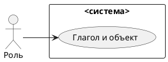
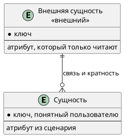

# Документ пользовательских требований

Вариант:  
Команда:  
Связанный документ концепции: `case_concept.md` (лабораторная работа 1)  
Дата:

Пользовательское требование фиксируется на уровне эпика. Каждый эпик оформлен и пользовательской историей, и сценарием использования.

## 1. Реинжиниринг дерева функций

Исходное дерево функций взято из документа концепции без переписывания «как хотелось бы».

```text
вставить дерево из case_concept.md
```

| ID эпика | Пользовательское требование | Узел дерева функций | Есть в дереве | Что сделано |
|----------|-----------------------------|---------------------|---------------|-------------|
| EP-1 | | | да / пробел | оставлен / добавлен узел / вынесен за рамки |

Скорректированное дерево:

```text
вставить дерево после реинжиниринга
```

## 2. Диаграмма вариантов использования

Исходник: `diagrams/usecase.puml`. Картинка без этого файла не принимается.



Граница системы:

| Узел дерева | Вариант использования | Актор |
|-------------|----------------------|-------|
| | UC-1 | |

## 3. Эпики

### EP-1. Название эпика

- Уровень: эпик
- Узел дерева:
- Бизнес-цель из документа концепции:
- Источник (стейкхолдер):
- Приоритет MoSCoW:

**Пользовательская история.** Как <роль>, я хочу <действие>, чтобы <ценность>.

**Сценарий использования UC-1.**

| Поле | Содержание |
|------|------------|
| Акторы | |
| Предусловия | |
| Триггер | |
| Постусловия успеха | |
| Постусловия отказа | |

Основной поток:

1.

Альтернативы:

1.

Исключения:

1.

## 4. Анализ сущностей

Сущности выводятся из сценариев эпиков. Актор, действие и правило сборки сущностью не становятся.

Исходник: `diagrams/logical-data.puml`.



| Сущность | Эпик или сценарий | Что хранит система | Ключ |
|----------|-------------------|--------------------|------|
| | | сама / только читает извне | |

| Связь | Кратность | Откуда это видно в постусловии |
|-------|-----------|--------------------------------|
| | | |

Что названо в сценарии и на схему не попало:

| Слово | Почему не сущность |
|-------|--------------------|
| | актор / атрибут / вне рамок / правило |

## 5. Проверка требований

### 5.1. Подготовка

Участники проверки:

| Роль | Кто |
|------|-----|
| Аналитик | |
| Заказчик | |
| Разработчик | |
| Тестировщик | |

### 5.2. Полнота

| ID | Роль | Действие | Ценность | Контекст | Полнота | Что дополнить |
|----|------|----------|----------|----------|---------|---------------|
| EP-1 | | | | | | |

### 5.3. Однозначность и проверяемость

| Исходное требование | Проблема | Исправленное требование |
|---------------------|----------|-------------------------|
| | | |

### 5.4. Непротиворечивость

| Требование A | Требование B | Конфликт | Решение |
|--------------|--------------|----------|---------|
| | | нет / описать | |

### 5.5. Атомарность

| Исходное требование | Проблема | Как разделено или почему оставлено одним эпиком |
|---------------------|----------|--------------------------------------------------|
| | | |

### 5.6. Трассируемость

| ID | Требование | Источник | Бизнес-цель | Узел дерева | Вариант использования | Статус |
|----|------------|----------|-------------|-------------|----------------------|--------|
| EP-1 | | | | | UC-1 | |

### 5.7. Приоритет

| ID | Требование | Приоритет | Обоснование |
|----|------------|-----------|-------------|
| EP-1 | | Must / Should / Could / Won't | |

### 5.8. Ревью со стейкхолдерами

| Замечание | Кто высказал | Решение | Что изменено в документе |
|-----------|--------------|---------|--------------------------|
| | | принято / отклонено | |

### 5.9. Разбор с помощью ИИ

Инструмент:

Промпт:

Ответ модели:

| Замечание модели | Тип (неоднозначность, противоречие, дубль, пробел) | Принято | Куда внесено |
|------------------|----------------------------------------------------|---------|--------------|
| | | да / нет | |

### 5.10. Протокол проверки

| ID | Дефект | Тип дефекта | Рекомендация | Статус |
|----|--------|-------------|--------------|--------|
| | | | | открыт / исправлено |

## 6. Чек-лист по каждому эпику

| № | Критерий | EP-1 | Комментарий |
|---|----------|------|-------------|
| 1 | Указана роль пользователя | да / нет | |
| 2 | Указано действие | да / нет | |
| 3 | Указана ценность | да / нет | |
| 4 | Требование однозначно | да / нет | |
| 5 | Требование проверяемо | да / нет | |
| 6 | Требование атомарно | да / нет | |
| 7 | Требование не противоречит другим | да / нет | |
| 8 | Требование имеет уникальный ID | да / нет | |
| 9 | Указан источник требования | да / нет | |
| 10 | Указан приоритет | да / нет | |
| 11 | Требование реализуемо | да / нет | |
| 12 | Требование актуально | да / нет | |

Колонки эпиков добавляются по числу требований.

## 7. Перечень после проверки

Актуальные формулировки эпиков, историй и сценариев после исправлений. Устаревшие формулировки в этот перечень не копируются: они остаются в протоколе.
