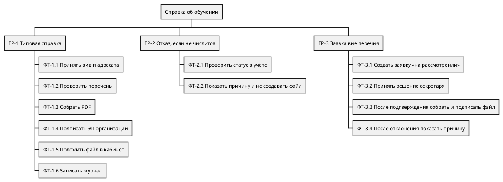

# Документ функциональных требований. Заказ справки об обучении

Учебный пример. Источник — эпики EP-1…EP-4 из лабораторной 2. Схема декомпозиции: [`diagrams/decomposition.puml`](diagrams/decomposition.puml).



Функциональные точки — нескорректированные, учебный подсчёт. Группы данных посчитаны один раз.

| Группа | Тип | Почему низкая сложность | Точки | Кто использует |
|--------|-----|-------------------------|-------|----------------|
| Заявка | ILF | одна группа, поля: студент, вид, адресат, статус, причина | 7 | ФТ-1.1, ФТ-3.1, ФТ-3.2 |
| Журнал выдачи | ILF | одна группа: студент, вид, время, ссылка на файл | 7 | ФТ-1.6 |
| Контингент | EIF | читается из учёта, кабинет его не хранит | 5 | ФТ-2.1 |

Сумма по данным: 19.

## 1. Декомпозиция

| История | Функциональные требования |
|---------|---------------------------|
| EP-1 Типовая справка файлом | ФТ-1.1…ФТ-1.6 |
| EP-2 Причина, если не числится | ФТ-2.1, ФТ-2.2 |
| EP-3 Заявка вне перечня | ФТ-3.1…ФТ-3.4 |
| EP-4 Журнал | ФТ-1.6, та же функция, отдельной второй записи журнала нет |

## 2. Спецификация

### ФТ-1.1

- Формулировка: система должна принимать от студента вид справки и адресата и сохранять заявку.
- История: EP-1. Актор: студент. Вход: вид и адресат. Результат: заявка создана.
- Ошибочный вход: вид не выбран. Заявка не создаётся.
- Приоритет: Must. Без заявки нечего выдавать.

```text
Given: студент вошёл в личный кабинет
When: он отправляет вид и адресата
Then: заявка сохранена, файл ещё не обещан
```

Тип: EI, низкая сложность, мало полей, одна группа «заявка». 3 точки. Покер: 3, 3, 5, итог 3. Раздувает оценку только проверка обязательности адресата.

### ФТ-1.2

- Формулировка: система должна проверять, входит ли вид в перечень автоматической выдачи.
- История: EP-1, развилка с EP-3. Вход: вид заявки. Результат: «в перечне» или «вне перечня».
- Ошибочный вход: перечень пуст. Типовую справку не выпускают молча.
- Приоритет: Must. Иначе военкомат сольётся с типовой справкой.

```text
Given: заявка сохранена и студент числится
When: кабинет читает перечень
Then: для справки об обучении выбран автоматический путь
```

Тип: EQ, низкая, 3 точки. Покер: 2, 2, 3, итог 2.

### ФТ-1.3

- Формулировка: система должна собирать PDF справки об обучении по действующему шаблону и данным контингента.
- История: EP-1. Вход: шаблон и данные студента. Результат: PDF без лишних полей.
- Ошибочный вход: в контингенте нет поля, которое шаблон требует. PDF не собирается.
- Приоритет: Must.

```text
Given: вид в перечне и студент числится
When: кабинет собирает документ
Then: получен PDF по шаблону справки об обучении
```

Покер: 5, 8, 8, итог 8. Раздувает сборка шаблона, не число полей само по себе.

<a id="ft-1-3-fp"></a>

#### Референс метода на ФТ-1.3

Ниже на сборке PDF показан весь незакрытый подсчёт одной функции. Остальные функции этого примера записаны коротко: тип, сложность и вес. Считаются они теми же шагами. Это нескорректированные точки по упрощённой схеме IFPUG. Коэффициент поправки сюда не входит.

**Шаг 1. Элементарный процесс.** Считается законченное действие, которое пользователь отличает от соседних и после которого данные в согласованном состоянии. Дробление одного действия на «выбрать поля» и «нажать сформировать» две точки не даёт.

Для ФТ-1.3 процесс один: из заявки, уже прошедшей перечень, кабинет выпускает один PDF либо отказывает. Отдельной операции «выбрать поля» у студента нет.

**Шаг 2. Тип транзакции.** Основное намерение выбирает одну клетку:

| Намерение | Тип |
|-----------|-----|
| Принять данные и изменить хранимую группу | EI, внешний вход |
| Отдать данные наружу, и при этом вычислить поле, сформировать документ или сопроводить выход изменением данных | EO, внешний выход |
| Отдать данные наружу без вычисления и без изменения хранимых групп | EQ, внешний запрос |

ФТ-1.3 отдаёт документ наружу, и документ не копия одной записи: поля контингента собираются в справку, дата выдачи вычисляется. Это EO. EQ не подходит, потому что есть вычисление. EI не подходит, потому что этот шаг хранилище не меняет.

**Шаг 3. Число групп данных.** Для транзакции это FTR, file types referenced: сколько разных ILF и EIF процесс читает или меняет. Одну группу дважды не считают. Правило сборки, константа и подпись к полю группой не являются.

FTR = |{уникальные ILF и EIF, которые процесс читает или меняет}|

| Группа | Тип группы | Зачем процессу | Берём в FTR |
|--------|------------|----------------|-------------|
| Заявка | ILF | вид справки и адресат | да |
| Контингент | EIF | сведения студента | да |
| Шаблон | не группа данных | правило, как разложить поля | нет |
| Журнал | ILF | этот шаг его не читает и не пишет | нет |

FTR = 2.

**Шаг 4. Число полей.** Для транзакции это DET, data element types: поля, которые различает пользователь, плюс одно поле на всю способность процесса вернуть сообщение.

DET = N_полей + N_сообщение

N_полей — число разных пользовательских полей на входе и на выходе процесса. Одно и то же поле, пришедшее из двух групп, считается один раз. Служебный ключ, который пользователь не видит, колонтитул и разметка файла в N_полей не входят.

N_сообщение равно 1, если процесс умеет сообщить об ошибке или подтверждении, и 0, если такого сообщения нет. Несколько текстов ошибок остаются одним полем.

| № | Поле | Откуда | В DET |
|---|------|--------|-------|
| 1 | ФИО | контингент | да |
| 2 | номер студенческого | контингент | да |
| 3 | факультет | контингент | да |
| 4 | направление | контингент | да |
| 5 | курс | контингент | да |
| 6 | форма обучения | контингент | да |
| 7 | вид справки | заявка | да |
| 8 | адресат | заявка | да |
| 9 | дата выдачи | вычисляется при сборке | да |
| 10 | сообщение «PDF не собран» | одно сообщение на процесс | да, это N_сообщение |
| — | внутренний ключ заявки | пользователь его не называет | нет |
| — | разметка PDF | не поле предметной области | нет |

N_полей = 9, N_сообщение = 1.

DET = 9 + 1 = 10.

**Шаг 5. Сложность по матрице.** Для EI строки матрицы другие, чем для EO и EQ. Берётся матрица своего типа.

Внешний вход, EI:

| FTR | DET 1–4 | DET 5–15 | DET 16 и больше |
|-----|---------|----------|-----------------|
| 0–1 | низкая | низкая | средняя |
| 2 | низкая | средняя | высокая |
| 3 и больше | средняя | высокая | высокая |

Внешний выход и внешний запрос, EO и EQ:

| FTR | DET 1–5 | DET 6–19 | DET 20 и больше |
|-----|---------|----------|-----------------|
| 0–1 | низкая | низкая | средняя |
| 2–3 | низкая | средняя | высокая |
| 4 и больше | средняя | высокая | высокая |

ФТ-1.3 — это EO, поэтому вторая матрица. FTR = 2 попадает в строку «2–3», DET = 10 попадает в столбец «6–19». Клетка — средняя сложность.

Группа данных, когда её оценивают отдельно, считается не через FTR, а через RET, record element types: сколько логических подгрупп пользователь видит внутри файла. Одна карточка без подгрупп даёт RET = 1. Матрица ILF и EIF:

| RET | DET 1–19 | DET 20–50 | DET 51 и больше |
|-----|----------|-----------|-----------------|
| 1 | низкая | низкая | средняя |
| 2–5 | низкая | средняя | высокая |
| 6 и больше | средняя | высокая | высокая |

К ФТ-1.3 эта матрица не применяется: заявка и контингент уже оценены в таблице данных в начале документа. Здесь они только ссылки процесса.

**Шаг 6. Вес.** Вес W зависит от типа и сложности:

| Тип | Низкая | Средняя | Высокая |
|-----|--------|---------|---------|
| EI | 3 | 4 | 6 |
| EO | 4 | 5 | 7 |
| EQ | 3 | 4 | 6 |
| ILF | 7 | 10 | 15 |
| EIF | 5 | 7 | 10 |

FP_i = W(тип_i, сложность_i)

FP(ФТ-1.3) = W(EO, средняя) = 5.

**Шаг 7. Что в эти 5 точек не входит.** Нескорректированный объём системы — сумма весов всех транзакций и всех групп данных, каждая группа один раз:

UFP = Σ FP_транзакций + Σ FP_групп

Вклад ФТ-1.3 в эту сумму равен 5, а не сумме с файлами, которые он читает:

FP(ФТ-1.3) ≠ W(EO, средняя) + W(ILF «заявка») + W(EIF «контингент»)

5 ≠ 5 + 7 + 5.

Семь точек заявки и пять точек контингента стоят в таблице данных и второй раз к функции не прибавляются.

Скорректированный объём в этой лабораторной не считается. Его формула, чтобы было видно, что именно отброшено:

AFP = UFP × VAF, VAF = 0,65 + 0,01 × Σ характеристик системы

Характеристики системы и VAF относятся к ограничениям качества. Их место в лабораторной работе 4, в точки функций они не подставляются. Для ФТ-1.3 итогом метода остаются 5 нескорректированных функциональных точек.

### ФТ-1.4

- Формулировка: система должна передавать PDF в сервис электронной подписи организации и принимать подписанный файл.
- История: EP-1. Вход: PDF. Результат: подписанный PDF. Ошибка: сервис не принял документ, заявка не становится «выдана».
- Приоритет: Must. Без подписи организации файл не справка этого выпуска.

```text
Given: PDF собран
When: кабинет отправляет его в сервис подписи
Then: назад приходит подписанный PDF либо явный отказ сервиса
```

Тип: EI, низкая, 3 точки. Покер: 5, 8, 8, итог 8. Раздувает внешний сервис, не размер файла.

### ФТ-1.5

- Формулировка: система должна показывать студенту подписанный файл в личном кабинете.
- История: EP-1. Результат: файл доступен студенту, которому принадлежит заявка.
- Ошибочный вход: файла ещё нет. Кабинет не показывает пустую «готовую» справку.
- Приоритет: Must.

```text
Given: PDF подписан
When: студент открывает заявку
Then: он может забрать файл
```

Тип: EQ, низкая, 3 точки. Покер: 3, 3, 3, итог 3.

### ФТ-1.6

- Формулировка: система должна записывать выдачу в журнал, когда файл размещён.
- История: EP-1 и EP-4. Результат: запись со студентом, видом, временем и ссылкой на файл.
- Ошибка: запись не сохранилась. Выдача не считается завершённой.
- Приоритет: Must.

```text
Given: файл размещён студенту
When: кабинет закрывает выдачу
Then: в журнале есть одна запись об этом файле
```

Тип: EI, низкая, 3 точки. Покер: 3, 3, 5, итог 3.

### ФТ-2.1

- Формулировка: система должна запрашивать в учёте контингента, числится ли студент, и не изменять учёт.
- История: EP-2, также шаг перед EP-1. Вход: идентификатор студента из кабинета. Результат: «числится» или «не числится».
- Ошибка: учёт недоступен. Ответ «не числится» не подставляется.
- Приоритет: Must.

```text
Given: заявка отправлена
When: кабинет запрашивает статус
Then: получен один из двух ответов учёта либо сообщение, что учёт недоступен
```

Тип: EQ к внешнему файлу, низкая, 3 точки. Покер: 5, 5, 5, итог 5. Раздувает зависимость от учёта.

### ФТ-2.2

- Формулировка: система должна показать причину «студент не числится» и не создавать PDF.
- История: EP-2. Приоритет: Must.

```text
Given: учёт ответил «не числится»
When: кабинет завершает заявку
Then: студент видит эту причину, файла нет
```

Тип: EQ, низкая, 3 точки. Покер: 2, 3, 3, итог 3.

### ФТ-3.1

- Формулировка: система должна создать заявку со статусом «на рассмотрении», если студент числится, а вид вне перечня.
- История: EP-3. Приоритет: Must.

```text
Given: студент числится и вид не в перечне
When: кабинет классифицирует заявку
Then: статус «на рассмотрении», PDF не собран
```

Тип: EI, низкая, 3 точки. Покер: 3, 3, 3, итог 3.

### ФТ-3.2

- Формулировка: система должна принять от секретаря одно решение: подтвердить выдачу или отклонить её с непустой причиной.
- История: EP-3. Ошибка: отклонение без текста не сохраняется.
- Приоритет: Must.

```text
Given: заявка «на рассмотрении»
When: секретарь подтверждает или отклоняет
Then: сохранено ровно одно из двух решений, у отклонения есть причина
```

Тип: EI, средняя: два исхода и обязательная причина. 4 точки. Покер: 5, 5, 5, итог 5.

### ФТ-3.3

- Формулировка: после подтверждения секретаря система должна собрать и подписать PDF тем же способом, что ФТ-1.3 и ФТ-1.4, и разместить файл, как ФТ-1.5.
- История: EP-3. Отдельный внешний выход не вводится: это те же 5 точек EO, уже учтённые в ФТ-1.3.
- Приоритет: Must.

```text
Given: секретарь подтвердил заявку вне перечня
When: кабинет выпускает файл
Then: студент видит подписанный PDF, как на типовой ветви
```

Дополнительных функциональных точек нет. Покер на повторное включение пути: 3, 5, 5, итог 5. Раздувает не новый документ, а развилка «только после подтверждения».

### ФТ-3.4

- Формулировка: система должна показать студенту причину отклонения секретаря и не создавать файл.
- История: EP-3. Приоритет: Must.

```text
Given: секретарь отклонил заявку с причиной
When: студент открывает заявку
Then: виден текст причины, файла нет
```

Тип: EQ, низкая, 3 точки. Покер: 2, 2, 2, итог 2.

## 3. Схема

Файл [`diagrams/decomposition.puml`](diagrams/decomposition.puml) перечисляет те же ФТ, что раздел 2. Расхождений нет.

## 4. Сводка оценок

| ID | Тип | Точки | Поинты |
|----|-----|-------|--------|
| ФТ-1.1 | EI | 3 | 3 |
| ФТ-1.2 | EQ | 3 | 2 |
| ФТ-1.3 | EO | 5 | 8 |
| ФТ-1.4 | EI | 3 | 8 |
| ФТ-1.5 | EQ | 3 | 3 |
| ФТ-1.6 | EI | 3 | 3 |
| ФТ-2.1 | EQ | 3 | 5 |
| ФТ-2.2 | EQ | 3 | 3 |
| ФТ-3.1 | EI | 3 | 3 |
| ФТ-3.2 | EI | 4 | 5 |
| ФТ-3.3 | те же EO и EI, что у ФТ-1.3 и ФТ-1.4 | 0 сверх уже посчитанных | 5 |
| ФТ-3.4 | EQ | 3 | 2 |
| Данные | ILF 7+7, EIF 5 | 19 | не оцениваются покером отдельно |

Сумма точек: 3+3+5+3+3+3+3+3+3+4+3+19 = 55. Сумма поинтов: 3+2+8+8+3+3+5+3+3+5+5+2 = 50.

ФТ-1.3 и ФТ-1.4 дают мало точек и много поинтов: документ и внешняя подпись. ФТ-1.1 почти не «весит» в поинтах, хотя это вход. Поэтому точки и поинты в выпуске не сортируют функции одинаково.

## 5. Матрица

Колонка нефункциональных требований пустая до лабораторной 4.

| ID | Источник | ФТ | Приоритет | Приёмка | Точки функций | Поинты |
|----|----------|----|-----------|---------|---------------|--------|
| EP-1 | студент, BG-1 | 1.1–1.6 | Must | файл в кабинете и запись журнала | 20 | 27 |
| EP-2 | студент, BG-2 | 2.1, 2.2 | Must | причина «не числится», файла нет | 6 | 8 |
| EP-3 | секретарь | 3.1–3.4 | Must | статус «на рассмотрении», затем файл или причина | 10 сверх общих EO | 15 |
| EP-4 | секретарь | 1.6 | Must | запись есть, если файл размещён | 3, уже внутри EP-1 | 3, уже внутри EP-1 |

19 точек данных в строки историй не раскладывались повторно: они общие.

## 6. Выводы

В ближайший выпуск входят все четыре эпика: каждый Must. Самый большой объём данных у заявки и журнала, самая дорогая работа в поинтах — сборка PDF и подпись. Их нельзя отложить, иначе типовая справка не появляется. Повторный путь после секретаря дорог умеренно, потому что документ уже оценён в ФТ-1.3.
