# Документ функциональных требований

Вариант: 02-Запись к врачу
Команда:  Лухава Диана, Разумовская Мария
Источник: `Документ пользовательских требований.md`
Дата: 21.11.2026

## 1. Декомпозиция


| История                                            | Функциональные требования                                                                                                                                                                                                                                                                                                                                                                                                                                                                                                                                                        |
| --------------------------------------------------------- | -------------------------------------------------------------------------------------------------------------------------------------------------------------------------------------------------------------------------------------------------------------------------------------------------------------------------------------------------------------------------------------------------------------------------------------------------------------------------------------------------------------------------------------------------------------------------------------------------------- |
| US-1.<br />З<br />апись на очный приём  | ФТ-1.1: Система должна предлагать пациенту выбрать МО, специальность и врача.<br /><br /><br /><br />ФТ-1.2 Система должна предлагать выбрать формат визита до выбора слота и показывать свободные слоты.<br /><br /><br /><br /> ФТ-1.3: Система должна отказывать в записи при дублирующей активной записи, отсутствии прикрепления или занятом слоте. |
| US-2. Отмена записи                           | ФТ-2.1: Система должна запрашивать у пациента 2 подтверждения отмены. ФТ-2.2: Система должна запрещать отмену, если до начала приема менее 30 минут или прием уже оказан.                                                                                                                                                                                                                                                                                               |
| US-3.<br />Просмотр текущих записей | ФТ-3.1: Система должна показывать список активных и утерянных записей с датой, временем врачом и МО.<br /> ФТ-3.2: Система должна помечать утерянную запись сообщением "Запись была утеряна. Необходимо перезаписаться на прием".                                                                                                                                                                                         |
| US-4.<br />Напоминания о приёме         | ФТ-4.1: Система должна по расписанию отправлять напоминание в MAX за 24 часа и за 15 минут до приема, указывая дату, время и врача                                                                                                                                                                                                                                                                                                                                                                         |
| US-5. Запись на ТМК                            | ФТ-5.1: Система должна проверять доступность слотов ТМК после выбора формата ТМК и возвращать пациента к выбору расписания, если слотов нет. ФТ-5.2: Система должна фиксировать запись на ТМК в МИС БАРС.                                                                                                                                                                                                                                 |
| US-6<br />. Закрытие ЛН                         | ФТ-6.1: Система должна принимать запрос пациента на получение закрытого ЛН и запрашивать документ в МИС. ФТ-6.2: Система должна предоставлять пациенту файл закрытого ЛН в MAX. ФТ-6.3: При ошибке получения документа система должна уведомлять пациента о временной недоступности документа.                                                                    |
| US-7.<br /><br />Запись ребёнка              | ФТ-7.1: Система должна показывать список связанных родственников кнопками и переключать бот на выбранный профиль.                                                                                                                                                                                                                                                                                                                                                                                          |
| US-8.<br />Авторизация                         | ФТ-8.1: Система должна запрашивать СНИЛС и номер телефона и проверять их в МИС БАРС. ФТ-8.2: Система должна показывать номер техподдержки и блокировать меню, если карточка пациента не найдена.                                                                                                                                                                                                                                                 |

## 2. Спецификация функций

### ФТ-1.1

- Формулировка: Система должна предлагать пациенту выбрать МО, специальность и врача
- История-источник: US-1
- Актор: Пациент
- Вход: команда "Записаться к врачу", выбранные МО, специальность и врач
- Результат: бот по очереди показывает списки МО, специальностей и врачей, выбор пациента сохраняется для следующего шага
- Ошибочный вход: пациент не авторизован, бот не начинает запись и предлагает авторизоваться
- Приоритет MoSCoW: Must
- Обоснование приоритета: без выбора МО, специальности и врача запись невозможна

```text
Given: пациент авторизован в чат-боте MAX
When: пациент выбирает "Записаться к врачу", затем МО, специальность и врача
Then: бот сохраняет выбор и переходит к выбору формата визита
```

### ФТ-1.2

- Формулировка: Система должна предлагать выбрать формат визита до выбора слота и показывать свободные слоты.
- История-источник: US-1
- Актор: Пациент
- Вход: выбранный врач, формат визита Очный визит, слот
- Результат: бот показывает свободные слоты выбранного врача (ближайшие первыми), выбранный слот сохраняется
- Ошибочный вход: пациент выбирает формат ТМК, бот передаёт поток в сценарий записи на ТМК
- Приоритет MoSCoW: Must
- Обоснование приоритета: без слота и формата визита запись не оформить

```text
Given: пациент выбрал МО, специальность и врача
When: пациент выбирает формат "Очный визит" и свободный слот
Then: бот сохраняет слот и переходит к оформлению записи
```

### ФТ-1.3

- Формулировка: Система должна отказывать в записи при дублирующей активной записи, отсутствии прикрепления или занятом слоте
- История-источник: US-1
- Актор: Пациент
- Вход: Запрос на запись, выбранные специальность, врач и слот
- Результат: Запись не создаётся, пациент получает сообщение о причине отказа, слот остаётся свободным, если отказ произошёл до его бронирования
- Ошибочный вход: Попытка записаться при наличии дублирующей активной записи, отсутствии необходимого прикрепления или занятом слоте.
- Приоритет MoSCoW: Must
- Обоснование приоритета: Проверки необходимы для соблюдения правил записи и предотвращения некорректного бронирования.

```text
Given: Пациент авторизован и выбрал врача и слот для записи
When: Система проверяет возможность создания записи.
Then:  Если обнаружена дублирующая активная запись, отсутствует необходимое прикрепление или слот занят, система отказывает в записи и сообщает пациенту причину.Новая запись не создаётся.
```

### ФТ-2.1

- Формулировка: Система должна запрашивать у пациента 2 подтверждения отмены.
- История-источник: US-2
- Актор: Пациент
- Вход: Пациент авторизован, имеет активную запись и выбирает её отмену в разделе Мои записи
- Результат: После получения двух подтверждений система передаёт запрос на отмену записи в МИС БАРС
- Ошибочный вход: Пациент не подтверждает отмену либо отказывается от операции. Система прекращает процесс отмены, запись остаётся активной.
- Приоритет MoSCoW: Must.
- Обоснование приоритета: Отмена записи необходима для освобождения времени приёма, если пациент не может посетить врача.

```text
Given: Пациент авторизован и имеет активную запись.
When: Пациент выбирает отмену и дважды подтверждает действие.
Then: Система передаёт запрос на отмену записи в МИС БАРС.
```

### ФТ-2.2

- Формулировка: Система должна запрещать отмену, если до начала приема менее 30 минут или прием уже оказан.
- История-источник: US-2
- Актор: Пациент
- Вход: Пациент инициирует отмену активной записи.
- Результат: Если ограничения не нарушены, система продолжает процесс отмены. Если отмена запрещена, запись сохраняется без изменений, а пациент получает сообщение о невозможности отмены.
- Ошибочный вход: До приёма осталось менее 30 минут либо приём уже оказан или проводится.
- Приоритет MoSCoW: Must
- Обоснование приоритета: Ограничения предотвращают отмену записи в ситуациях, когда операция недоступна по установленным правилам

```text
Given: Пациент имеет активную запись на приём.
When: Пациент пытается отменить запись, когда до начала приёма менее 30 минут или приём уже оказан
Then: Система блокирует отмену, сохраняет текущий статус записи и сообщает пациенту о невозможности операции
```

### ФТ-3.1

- Формулировка: Система должна показывать список активных и утерянных записей с датой, временем врачом и МО
- История-источник: US-3
- Актор: Пациент
- Вход: Пациент авторизован и выбирает раздел Мои записи.
- Результат: Система отображает список активных и утерянных записей пациента
- Ошибочный вход: Активные записи отсутствуют. Система сообщает пациенту об отсутствии активных записей.
- Приоритет MoSCoW: Must
- Обоснование приоритета: Просмотр записей позволяет пациенту получать информацию о запланированных посещениях без обращения в регистратуру.

```text
Given: Пациент авторизован в боте.
When: Пациент открывает раздел Мои записи.
Then: Система отображает его активные и утерянные записи с с датой, временем, врачом и МО.
```

### ФТ-3.2

- Формулировка: Система должна помечать утерянную запись сообщением "Запись была утерена. Необходимо перезаписаться на прием".
- История-источник: US-3
- Актор: Пациент
- Вход: При просмотре записей система получает запись со статусом утерянная.
- Результат: Система отображает запись с соответствующей пометкой и сообщением о необходимости повторной записи.
- Ошибочный вход: Запись не имеет статуса утерянная.
- Приоритет MoSCoW: Must.
- Обоснование приоритета: Пациент должен понимать, что запись больше не гарантирует посещение врача и требуется повторная запись.

```text
Given: В МИС имеется запись со статусом утерянная
When: Пациент открывает раздел Мои записи
Then: Система отображает соответствующую пометку и сообщение о необходимости перезаписаться.
```

### ФТ-4.1

- Формулировка: Система должна по расписанию отправлять напоминание в MAX за 24 часа и за 15 минут до приема, указывая дату, время и врача
- История-источник: US-4
- Актор: Пациент
- Вход: В МИС существует активная запись пациента, а до начала приёма остаётся 24 часа или 15 минут.
- Результат: Пациент получает сообщение в MAX с датой, временем и врачом
- Ошибочный вход: Возникает сбой связи или доставки сообщения. Напоминание может быть не доставлено.
- Приоритет MoSCoW: Should.
- Обоснование приоритета: Напоминания помогают пациенту не забыть о приёме, но не являются непосредственным условием создания записи.

```text
Given: В МИС существует активная запись пациента.
When: Наступает время отправки напоминания
Then: Система отправляет пациенту напоминание в MAX за 24 часа и за 15 минут до приёма
```

### ФТ-5.1

- Формулировка: Система должна проверять доступность слотов ТМК после выбора формата ТМК и возвращать пациента к выбору расписания, если слотов нет
- История-источник: US-5
- Актор: Пациент
- Вход: Пациент авторизован и выбирает ТМК
- Результат: Система отображает доступные слоты для ТМК, если они имеются
- Ошибочный вход: У выбранного врача нет слотов ТМК. Система сообщает об этом и возвращает пациента к выбору расписания
- Приоритет MoSCoW: Must.
- Обоснование приоритета: Проверка доступности необходима для оформления ТМК.

```text
Given: Пациент авторизован и выбирает ТМК
When: Система запрашивает доступные слоты для ТМК в МИС БАРС.
Then: Система отображает доступные слоты либо сообщает об их отсутствии и возвращает пациента к выбору расписания.
```

### ФТ-5.2

- Формулировка: Система должна фиксировать запись на ТМК в МИС БАРС.
- История-источник: US-5
- Актор: Пациент
- Вход: Пациент выбрал доступный слот ТМК.
- Результат: МИС БАРС сохраняет запись на ТМК.
- Ошибочный вход: МИС БАРС не может сохранить запись или слот уже занят. Запись не создаётся, слот не занимается этим пациентом, система предлагает выбрать другой слот
- Приоритет MoSCoW: Must.
- Обоснование приоритета: Создание записи в МИС необходимо для фиксации консультации в расписании врача.

```text
Given: Пациент выбрал доступный слот ТМК.
When: Система передаёт данные выбранного слота в МИС БАРС.
Then: МИС БАРС сохраняет запись, а система подтверждает оформление консультации.
```

### ФТ-6.1

- Формулировка: Система должна принимать запрос пациента на получение закрытого ЛН и запрашивать документ в МИС
- История-источник: US-6
- Актор: Пациент
- Вход: Пациент авторизован в боте, а в МИС имеется закрытый ЛН.
- Результат: Система отправляет запрос в МИС на получение файла закрытого ЛН.
- Ошибочный вход: Пациент не авторизован или закрытый ЛН отсутствует
- Приоритет MoSCoW: Must.
- Обоснование приоритета: Запрос документа является необходимым этапом его получения через MAX.

```text
Given: Пациент авторизован, в МИС имеется закрытый ЛН.
When: Пациент запрашивает получение документа.
Then: Система направляет запрос в МИС для получения файла закрытого ЛН
```

### ФТ-6.2

- Формулировка: Система должна предоставлять пациенту файл закрытого ЛН в MAX.
- История-источник: US-6
- Актор: Пациент
- Вход: МИС успешно предоставила файл закрытого ЛН.
- Результат: Файл отображается в чате MAX и доступен пациенту для скачивания.
- Ошибочный вход: Файл не получен или не может быть отправлен.
- Приоритет MoSCoW: Must.
- Обоснование приоритета: Передача документа пациенту является основной целью данного сценария.

```text
Given: МИС предоставила файл закрытого ЛН.
When: Система получает документ для отправки.
Then: Система отправляет файл в чат MAX
```

### ФТ-6.3

- Формулировка: При ошибке получения документа система должна уведомлять пациента о временной недоступности документа.
- История-источник: US-6
- Актор: Пациент
- Вход: Пациент запросил закрытый ЛН, но при получении документа возникла ошибка МИС.
- Результат: Пациент получает сообщение о временной недоступности документа
- Ошибочный вход: МИС не предоставляет файл из-за технической ошибки или недоступности сервиса.
- Приоритет MoSCoW: Must
- Обоснование приоритета: Пациент должен понимать, почему документ не был получен

```text
Given: Пациент запросил получение закрытого ЛН.
When: Система получает ошибку от МИС при запросе документа.
Then: Система сообщает о временной недоступности документа и не отправляет файл.
```

### ФТ-7.1

- Формулировка: Система должна показывать список связанных родственников кнопками и переключать бот на выбранный профиль.
- История-источник: US-7
- Актор: Пациент
- Вход: Пациент авторизован и запрашивает запись родственника.
- Результат: Система отображает список доступных связанных родственников. После выбора система переключает контекст записи на профиль выбранного человека и направляет пациента к оформлению записи.
- Ошибочный вход: Пациент не выбрал родственника из списка. Переключение профиля не выполняется.
- Приоритет MoSCoW: Must
- Обоснование приоритета: Переключение профиля необходимо для оформления записи ребёнка или другого подопечного через профиль пациента

```text
Given: Пациент авторизован и имеет доступные связанные профили.
When: Пациент выбирает функцию записи родственника и нажимает на имя нужного человека.
Then: Система переключает профиль на выбранного родственника и направляет пациента к оформлению записи.
```

### ФТ-8.1

- Формулировка: Система должна запрашивать СНИЛС и номер телефона и проверять их в МИС БАРС.
- История-источник: US-8
- Актор: Пациент
- Вход: Пациент впервые открывает бота
- Результат: При успешной проверке система сохраняет связь MAX_ID и СНИЛС и открывает пациенту главное меню бота
- Ошибочный вход: СНИЛС или номер телефона некорректны либо данные пациента не найдены в МИС
- Приоритет MoSCoW: Must
- Обоснование приоритета: Авторизация нужна, чтобы определить пациента и предоставить ему доступ к его медицинским данным и услугам.

```text
Given: Пациент впервые открывает бота
When: Пациент вводит СНИЛС и номер телефона, а система проверяет данные через МИС БАРС
Then: При успешной проверке система сохраняет связь MAX_ID и СНИЛС и открывает главное меню.
```

### ФТ-8.2

- Формулировка: Система должна показывать номер техподдержки и блокировать меню, если карточка пациента не найдена.
- История-источник: US-8
- Актор: Пациент
- Вход: Пациент вводит СНИЛС и номер телефона для авторизации.
- Результат: Если проверка не пройдена, система сообщает об ошибке, отображает номер технической поддержки и блокирует меню.
- Ошибочный вход: СНИЛС или номер телефона некорректны либо пациент с указанным СНИЛС отсутствует.
- Приоритет MoSCoW: Must
- Обоснование приоритета: Обработка ошибок нужна, чтобы посторонние не получили доступ к медицинским данным пациента, а сам пациент понимал, что делать, если возникла проблема.

```text
Given: Пациент находится на этапе авторизации
When: Система не может подтвердить данные пациента через МИС БАРС.
Then: Система отклоняет авторизацию, сообщает об ошибке, отображает номер технической поддержки и не открывает главное меню.
```

## 3. Схема декомпозиции

Исходник: `diagrams/decomposition.puml`. Идентификаторы на схеме те же, что в разделе 2.

```plantuml
@startwbs
* Запись к врачу через MAX
** US-1. Запись на очный приём
*** ФТ-1.1. Выбор МО, специальности и врача
*** ФТ-1.2. Выбор формата визита и просмотр свободных слотов
*** ФТ-1.3. Отказ в записи при наличии ограничений
** US-2. Отмена записи
*** ФТ-2.1. Подтверждение отмены записи
*** ФТ-2.2. Проверка возможности отмены
** US-3. Просмотр текущих записей
*** ФТ-3.1. Просмотр активных и утерянных записей
*** ФТ-3.2. Отображение сообщения об утерянной записи
** US-4. Напоминания о приёме
*** ФТ-4.1. Отправка напоминаний за 24 часа и 15 минут
** US-5. Запись на ТМК
*** ФТ-5.1. Проверка доступности слотов ТМК
*** ФТ-5.2. Фиксация записи на ТМК в МИС БАРС
** US-6. Закрытие ЛН
*** ФТ-6.1. Запрос закрытого ЛН в МИС
*** ФТ-6.2. Отправка файла ЛН пациенту в MAX
*** ФТ-6.3. Уведомление о временной недоступности документа
** US-7. Запись ребёнка
*** ФТ-7.1. Выбор связанного родственника и переключение профиля
** US-8. Авторизация
*** ФТ-8.1. Проверка СНИЛС и номера телефона в МИС БАРС
*** ФТ-8.2. Обработка отсутствия карточки пациента
@endwbs

```



## 4. Оценки сложности

| ID | Тип (EI, EO, EQ, ILF, EIF) | Сложность и почему | Функциональные точки | Карты покера | Пользовательские поинты | Что раздувает оценку |
| :--- | :--- | :--- | :--- | :--- | :--- | :--- |
| ФТ-1.1 | EQ | Средняя: требует последовательных запросов к справочникам МО, специальностей и врачей с учетом прав доступа. | 4 | 3 | 3 | Зависимость от ограничений записи. |
| ФТ-1.2 | EQ | Средняя: выполняет запрос и фильтрует занятые слоты. | 3 | 3 | 3 | Формат интерактивных кнопок для мессенджера MAX. |
| ФТ-1.3 | EI | Высокая: множественные проверки перед вызовом `ticket_add`. | 6 | 8 | 8 | Интерпретировать минимум 9 различных типов ошибок от МИС. Проверки на дубли, пересечения, прикрепление. |
| ФТ-2.1 | EI | Низкая: управление состоянием диалога в боте. | 3 | 2 | 2 | Минимальная логика на стороне бота, простая передача в `ticket_del`. |
| ФТ-2.2 | EI | Средняя: проверка временных интервалов и статуса записи перед вызовом `ticket_del`. | 4 | 3 | 3 | Необходимость точного расчета времени до начала приема. |
| ФТ-3.1 | EQ | Средняя: агрегация данных из `ticket_info`. | 4 | 3 | 3 | Обработка массива записей, утерянных, по живой очереди записей и напрвлений на анализы. |
| ФТ-3.2 | EQ | Низкая: проверка флага `IS_LOST` и подстановка текста. | 3 | 2 | 2 | Простое отображение. |
| ФТ-4.1 | EO | Средняя: фоновый процесс, чтение таблицы `INT_MAX_EXP`. | 4 | 5 | 5 | Обработка ошибок отправки и повторные попытки. |
| ФТ-5.1 | EQ | Средняя: фильтрация и проверка доступности. | 4 | 3 | 3 | Специфическая логика отбора ТМК-услуг в методе `resources`. |
| ФТ-5.2 | EI | Средняя: создание записи с кодом услуги ТМК. | 4 | 4 | 4 |  |
| ФТ-6.1 | EQ | Низкая: запрос файла из МИС, ожидание ответа с base64-строкой. | 3 | 2 | 2 |  |
| ФТ-6.2 | EO | Низкая: декодирование и корректная отправка файла в чат MAX. | 3 | 2 | 2 | Ограничения мессенджера на размер передаваемых файлов. |
| ФТ-6.3 | EO | Низкая: перехват ошибки от МИС и отправка статического сообщения. | 3 | 2 | 2 | Простая обработка исключений. |
| ФТ-7.1 | EI | Средняя: запрос массива `relatives` из `patient_info`, отрисовка кнопок, переключение контекста. | 4 | 3 | 3 | Управление состоянием сессии. |
| ФТ-8.1 | EI | Высокая: многовариантный поиск в `patient_info` (СНИЛС + телефон). | 5 | 5 | 5 | Сложный алгоритм поиска контрагента и задержки внешних систем. |
| ФТ-8.2 | EO | Низкая: вывод сообщения об ошибке и блокировка переходов по меню. | 3 | 2 | 2 | Статическая логика обработки. |

Сумма функциональных точек: 60 FP  
Сумма пользовательских поинтов: 52 SP


Внутренние и внешние группы данных, посчитанные один раз:


| Группа данных | ILF или EIF | Сложность | Точки | Какие функции её используют |
| ------------------------- | -------------- | ------------------ | ---------- | --------------------------------------------------- |
|                           |                |                    |            |                                                     |

## 5. Матрица трассировки

Колонка нефункциональных требований заполняется в лабораторной работе 4.

| ID | Тип | Источник | Связанные ФТ | Приоритет | Критерий приёмки | FP | Поинты |
| :--- | :--- | :--- | :--- | :--- | :--- | :---: | :---: |
| US-1 | Пользовательское | EP-1 | ФТ-1.1, ФТ-1.2, ФТ-1.3 | Must | AC-2, AC-7, AC-13, AC-14 | 13 | 14 |
| US-2 | Пользовательское | EP-2 | ФТ-2.1, ФТ-2.2 | Must | AC-3, AC-15 | 7 | 5 |
| US-3 | Пользовательское | EP-3 | ФТ-3.1, ФТ-3.2 | Must | AC-6, AC-11 | 7 | 5 |
| US-4 | Пользовательское | EP-4 | ФТ-4.1 | Should | AC-4 | 4 | 5 |
| US-5 | Пользовательское | EP-5 | ФТ-5.1, ФТ-5.2 | Must | AC-5 | 8 | 7 |
| US-6 | Пользовательское | EP-6 | ФТ-6.1, ФТ-6.2, ФТ-6.3 | Must | AC-18 | 9 | 6 |
| US-7 | Пользовательское | EP-7 | ФТ-7.1 | Must | AC-12 | 4 | 3 |
| US-8 | Пользовательское | EP-8 | ФТ-8.1, ФТ-8.2 | Must | AC-1 | 8 | 7 |

Проверка контрольных сумм: 13+7+7+4+8+9+4+8 = 60 FP | 14+5+5+5+7+6+3+7 = 52 SP

## 6. Выводы

Какие функции дают основной объём в точках. Какие функции дороги в поинтах при небольшом объёме данных. Что из этого команда берёт в ближайший выпуск.
